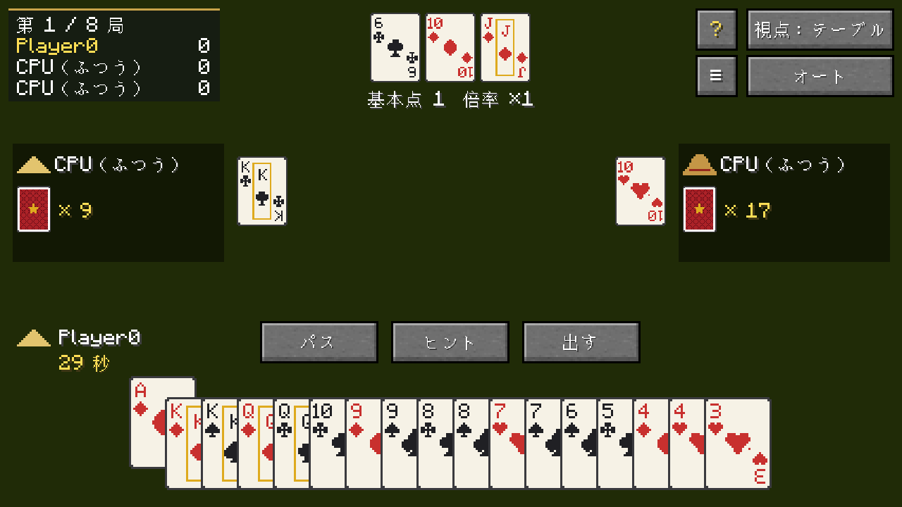
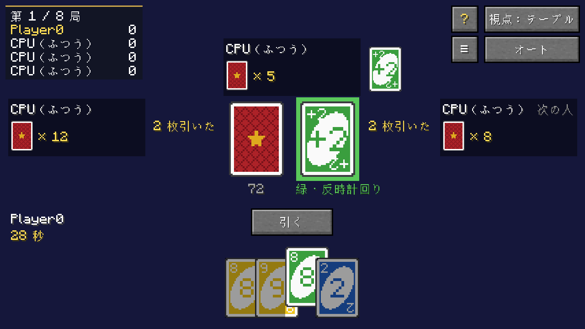
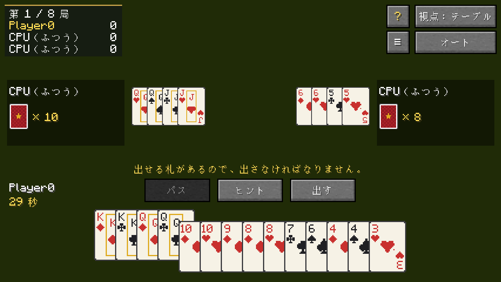
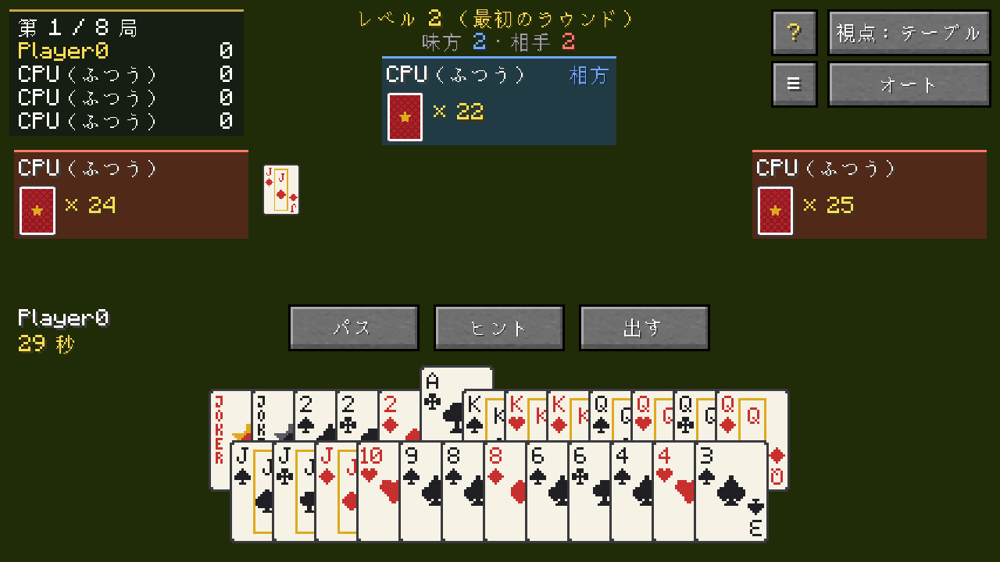
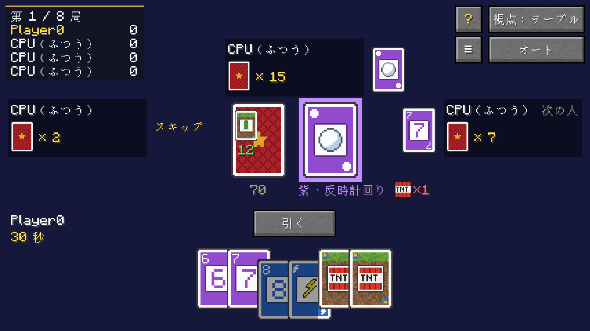

<p align="center"></p>

<p align="center">
  <a href="README.md">English</a> · <a href="README.zh-CN.md">简体中文</a> · <a href="README.zh-TW.md">繁體中文</a> · <b>日本語</b> · <a href="README.ko.md">한국어</a>
</p>

<p align="center">
  <a href="https://github.com/Konyaco/TuKuai/actions/workflows/build.yml"></a>
  <a href="https://github.com/Konyaco/TuKuai/releases/latest"></a>
  
  
  <a href="LICENSE"></a>
</p>

TuKuai（土块棋牌室）は、クラフトして設置できるカードテーブルを Minecraft に追加し、友人や CPU とカードゲームを遊べるようにする Mod です。


## 特長

- **ワールドに置かれた卓**：カードはワールド内のテーブルの上に並びます。手札は持ち主に向けて立てられ、出したカードは中央に置かれ、周りの人からも見えます。
- **マルチプレイと CPU**：空席は CPU で埋められます。強さは「やさしい」「ふつう」「むずかしい」の 3 段階です。席を外したり切断したりしたプレイヤーの番は CPU が代わりに打ちます。打っている人が全員離席すると対局は一時停止し、誰かが席に着いて続けるか終えるのを待ちます。
- **リプレイと戦績**：対局は自動で保存され、どの席の視点からでも見直せます。テーブルはプレイヤーごとの戦績を記録します。
- **見た目のカスタマイズ**：テーブルとスツールはさまざまな木材で作れ、テーブルクロスとクッションは染色できます。カードの裏面と表面にも複数のデザインがあります。
- **没入視点**：画面がワールドを覆わず、テーブル上のカードを直接選んで出せます。

## ゲーム

<table>
  <tr>
    <td width="55%"></td>
    <td><b>闘地主</b><br>3 人で遊ぶゲームで、地主 1 人と農民 2 人が対戦します。ルールは通常の入札、地主の奪い合い、シャッフルなしから選べます。</td>
  </tr>
  <tr>
    <td></td>
    <td><b>UNO</b><br>2〜4 人。通常ルールと、ペナルティカードを重ねられるルールから選べます。</td>
  </tr>
  <tr>
    <td></td>
    <td><b>跑得快（パオダークァイ）</b><br>3 人がそれぞれ個人で戦い、最初に手札を出し切った人が勝ちます。手札は 16 枚または 15 枚で、出せるときは必ず出すルールの有無を選べます。</td>
  </tr>
  <tr>
    <td></td>
    <td><b>掼蛋（グワンダン）</b><br>4 人が 2 チームに分かれ、2 組のトランプで遊びます。1 局だけ遊ぶか、A まで続けて遊ぶかを選べます。</td>
  </tr>
  <tr>
    <td></td>
    <td><b>トゥトゥカード</b><br>この Mod オリジナルのゲームで、遊び方は UNO に近く、特殊カードは Minecraft のものから取っています。たとえば TNT はテーブルの上で煙を上げます。2〜8 人で、6 人と 8 人では大きなカードテーブルを使います。</td>
  </tr>
</table>

各ゲームのルールはゲーム内のルールブックで確認できます。卓の **?** ボタンで開きます。

## はじめかた

### ダウンロード

[Releases](https://github.com/Konyaco/TuKuai/releases/latest) から使っているローダー用の jar をダウンロードしてください。Minecraft 26.1.2 と、次の Mod が必要です。

| ローダー | 前提 Mod |
| --- | --- |
| NeoForge 26.1.2 | [Kotlin for Forge](https://modrinth.com/mod/kotlin-for-forge) 6.4.0 以降 |
| Fabric | [Fabric API](https://modrinth.com/mod/fabric-api)、[Fabric Language Kotlin](https://modrinth.com/mod/fabric-language-kotlin) 1.13.13 以降 |

### レシピ

<table>
  <tr>
    <td width="33%" align="center"><br><b>カードテーブル</b><br>羊毛の色は自由です。板材の種類でテーブルの木材が決まります。</td>
    <td width="33%" align="center"><br><b>大きなカードテーブル</b><br>カードテーブルから作ります。最大 8 人が座れます。</td>
    <td width="33%" align="center"><br><b>スツール</b><br>羊毛でクッションの色が、ハーフブロックで木材が決まります。</td>
  </tr>
</table>

クリエイティブモードでは、3 つとも「機能的ブロック」タブにあります。

### 遊び方

1. **カードテーブルを置く**。3×3 ブロックの大きさで、クリックしたブロックから前方に広がります。前と左右に空きを作っておいてください。
2. **テーブルを右クリック**し、「ここに座る」で着席します。空席は「CPU を入れる」で埋められます。
3. **ゲームとルールを選び**、「開始」を押します。

スツールを席のある辺の外側中央に置くと、右クリックでその席に座れます。大きなカードテーブルは 5×5 ブロックで、各辺に 2 席、最大 8 人が座れます。

表示言語は英語・簡体字中国語・繁体字中国語・日本語・韓国語に対応し、ゲームの言語設定に従います。

<details>
<summary><b>サーバー設定</b></summary>

サーバーを初めて起動したとき（シングルプレイのワールドを開いたときも）、`config/tukuai-server.properties` が作られます。変更後は `/reload` を実行するか、再起動してください。

| 設定 | 初期値 | 内容 |
| --- | --- | --- |
| `allowBots` | `true` | CPU の着席を許可するか |
| `botDelaySeconds` | `1.1` | CPU がカードを出すまでの平均待ち時間（秒） |
| `saveReplays` | `true` | リプレイを保存するか |
| `maxReplays` | `500` | 保存するリプレイの上限。超えると古いものから削除。`0` で無制限 |
| `keepStats` | `true` | 戦績を記録するか |

</details>

<details>
<summary><b>開発</b></summary>

JDK 25 が必要です。

```sh
./gradlew build                 # コンパイル、テスト、両ローダーの jar の作成
./gradlew :fabric:runClient     # Fabric でゲームを起動
./gradlew :neoforge:runClient   # NeoForge でゲームを起動
```

| ディレクトリ | 内容 |
| --- | --- |
| `engine` | ルール、CPU、リプレイ。Minecraft に依存しない Kotlin コード |
| `common` | 両ローダー共通の Minecraft コードとリソース |
| `fabric`、`neoforge` | 各ローダーのエントリポイントと登録処理 |

新しいゲームの追加：

1. `engine` で `GameDefinition` を実装し、`TuKuai.init()` で `GameRegistry` に登録する。
2. `common/.../client` で `GameUi` を実装し、`TuKuaiClient.init()` で `GameUis` に登録する。
3. すべての言語ファイルに `tukuai.game.<id>` と各ルールの名前を追加する。

テスト：

```sh
./gradlew :engine:test                  # ルールと CPU の単体テスト
./gradlew :fabric:runClientGameTest     # ゲームを起動して数局遊び、スクリーンショットを撮る
./gradlew :fabric:runMultiplayerTest    # 専用サーバーと 2 つのクライアントによる対戦テスト
TUKUAI_SHOWCASE=en_us,zh_cn ./gradlew :fabric:runClientGameTest   # この README のスクリーンショットを撮る
```

コミットメッセージは `[type](scope) Title` の形式です。依存関係のバージョンは `gradle.properties` にあります。

</details>

## ライセンス

[MIT](LICENSE)
