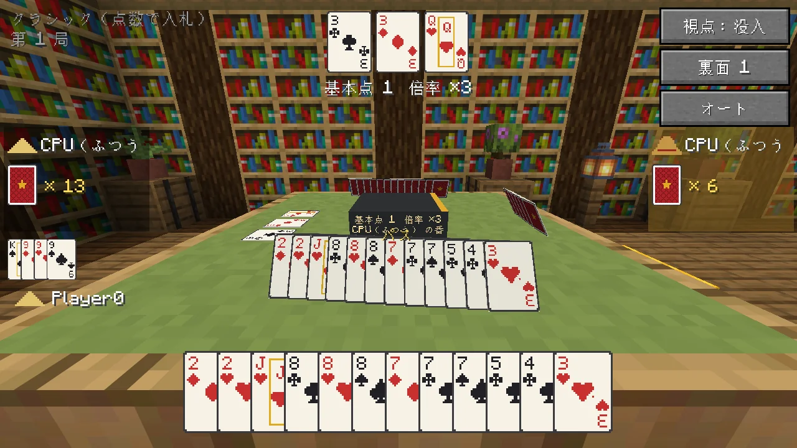
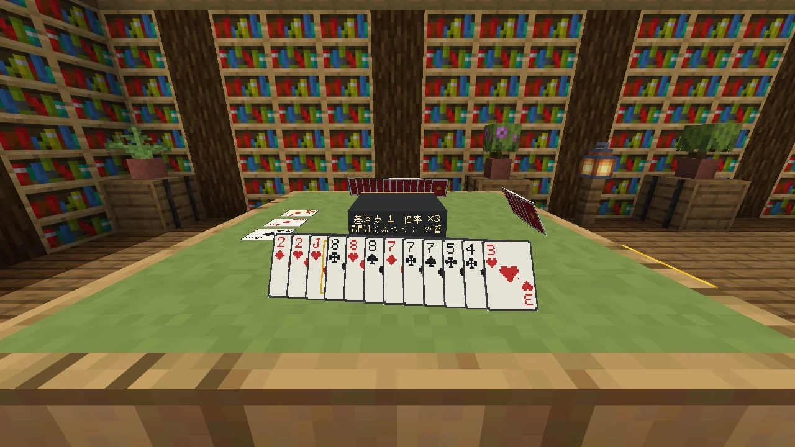
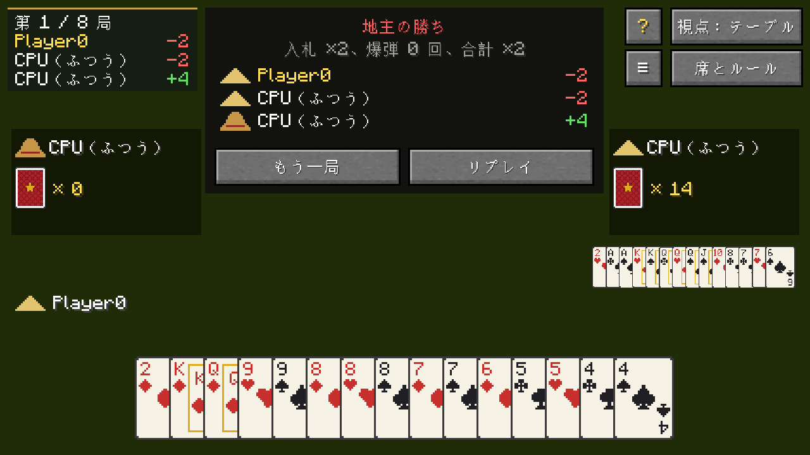
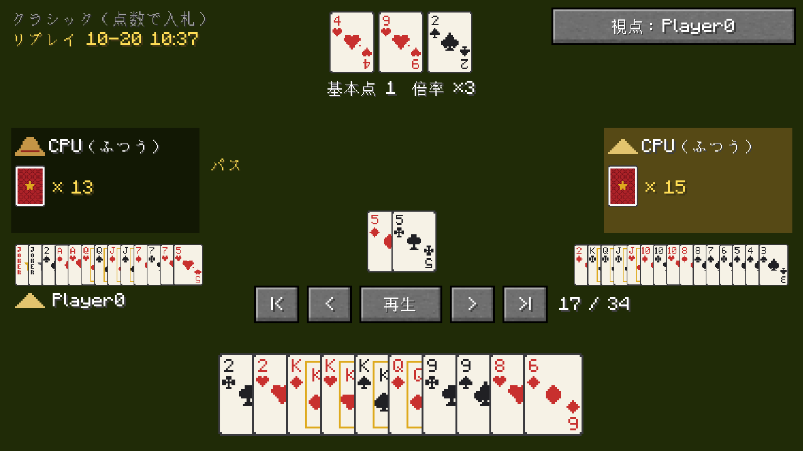
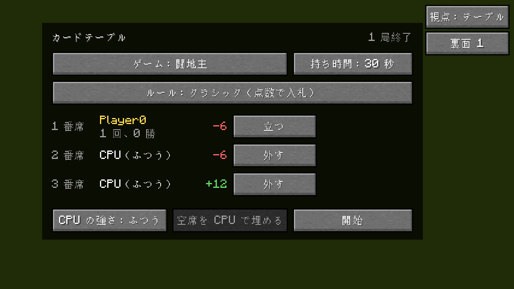

  <a href="README.md">English</a> · <a href="README.zh-CN.md">简体中文</a> · <a href="README.zh-TW.md">繁體中文</a> · <b>日本語</b> · <a href="README.ko.md">한국어</a>

  Minecraft の中にカードテーブルを置いて、友だちや CPU と闘地主、UNO、跑得快、掼蛋を遊ぶ Mod です。

  
  
  
  
  

TuKuai（土块棋牌室、「土ブロック雀荘」くらいの意味）は、作って置けるカードテーブルを追加します。ほかのプレイヤーと同じ卓に座り、空いた席は CPU で埋めれば、すぐに始められます。カードは本当にテーブルの上に並ぶので、通りがかった人も観戦できます。今は闘地主、UNO、跑得快、掼蛋で、ほかのゲームもこれから増える予定です。

使うのはゲーム内のポイントだけで、本物のお金は一切関係ありません。負けて失うのはせいぜいメンツくらいです。

## ダウンロード

[Releases](https://github.com/Konyaco/TuKuai/releases/latest) から、使っているローダー用の jar をダウンロードしてください。Minecraft 26.1.2 と、次の Mod が必要です。

| ローダー | 一緒に入れるもの |
| --- | --- |
| NeoForge 26.1.2 | [Kotlin for Forge](https://modrinth.com/mod/kotlin-for-forge) 6.4.0 以降 |
| Fabric | [Fabric API](https://modrinth.com/mod/fabric-api)、[Fabric Language Kotlin](https://modrinth.com/mod/fabric-language-kotlin) 1.13.13 以降 |

## できること

### 闘地主

中国の 3 人用トランプゲームで、地主 1 人と農民 2 人が戦います。ルールは「クラシック（点数で入札）」「地主の奪い合い」「シャッフルなし」（爆弾が多め）の 3 種類です。

<table>
  <tr>
    <td width="50%"></td>
    <td width="50%"></td>
  </tr>
  <tr>
    <td align="center">テーブル視点：画面いっぱいにテーブル。</td>
    <td align="center">没入視点：世界を隠さず、目の前に本物のテーブル。Tab で切り替え。</td>
  </tr>
</table>

### UNO

2〜4 人。ルールは 4 人・3 人・2 人のクラシックと、ドロー重ねあり（+2 に +2、+4 には +2 か +4 を重ねられる）の 4 人用、の 4 種類です。

<table>
  <tr>
    <td width="50%"></td>
    <td width="50%"></td>
  </tr>
  <tr>
    <td align="center">出せるカードが浮き上がり、クリックで出せます。</td>
    <td align="center">画面を閉じても、ちゃんと席に着いたまま。</td>
  </tr>
</table>

### 跑得快（パオダークァイ）

「早く抜けろ」という名前のとおり、3 人がそれぞれ手札を出し切る速さを競います。スペードの 3 を持つ人が最初に出します。ルールは 1 人 16 枚、1 人 15 枚、それに 16 枚でいつでもパスできるものの 3 種類。ほかの 2 つでは、出せる札があるなら必ず出さなければなりません。

誰かが残り 1 枚になると、その人の枠とテーブルに赤い警告が出ます。その直前の人がシングルを出すなら、手札でいちばん強い札でなければなりません。

### 掼蛋（グワンダン）

4 人が 2 チームに分かれ、向かいの人が相方です。ジョーカー入りのトランプ 2 組を使い、1 人 27 枚。出し方は闘地主と同じで、ストレートはちょうど 5 枚、連続ペアはちょうど 3 組、連続スリーカードはちょうど 2 組。爆弾は同じ数字 4〜10 枚、同花順、ジョーカー 4 枚です。チームの誰かが最初に上がればそのラウンドの勝ちで、相方の順位によって 1〜3 レベル上がります。次のラウンドは勝ったチームのレベルで打ち、そのランクのハート 2 枚が万能札になります。ルールは 2 種類：1 ラウンドだけか、A まで（レベルと貢ぎをラウンドごとに引き継ぎ）。

相方の枠は青、相手チームは赤で、いま打っているレベルは画面の上に出ます。

### ワールドの中で見える

テーブルは 3x3 ブロック。手札はそれぞれ持ち主のほうを向いてテーブルに立っていて、ほかの人からは裏面しか見えません。場に出たカードと地主のカードは真ん中に置かれます。カードには少し厚みがあります。染料でテーブルを右クリックするとクロスの色が変わり、画面右上のボタンでカードの裏面を選べます。その横の小さなボタンでカードの表も変えられます：クラシック、手札が重なっても読みやすい大きな隅の数字、4 色（ダイヤが青、クラブが緑）。テーブルとスツールはオークから歪んだ木まで、どの木材でも作れます。スツールのクッションは 16 色。

<table>
  <tr>
    <td width="50%"></td>
    <td width="50%"></td>
  </tr>
  <tr>
    <td align="center">自分の手札は自分のほうを向いて立っています。</td>
    <td align="center">村人はただの飾りです。実際に打っている CPU は透明で、奥ゆかしいのか不気味なのかは見る人次第。</td>
  </tr>
</table>

### CPU と、席を外した人

空席には CPU を入れられます。強さは「やさしい」「ふつう」「むずかしい」の 3 段階。「むずかしい」は頭の中で何度も勝負を読んでからカードを出します。

誰かが席を外したり接続が切れたりしても、CPU が代わりに打つのでゲームは止まりません。2 回続けて時間切れになるとオートになります。戻ってきたら「オート解除」を押せば続きから遊べます。

### リプレイと戦績

終わったゲームは自動で保存されます。1 手ずつ見返したり、全員の手札を見たり、好きな席からの視点に切り替えたりできます。テーブルはプレイヤーごとの戦績も記録します。

<table>
  <tr>
    <td width="33%"></td>
    <td width="33%"></td>
    <td width="33%"></td>
  </tr>
  <tr>
    <td align="center">結果</td>
    <td align="center">リプレイ。全員の手札が見える</td>
    <td align="center">席とルールの画面に戦績</td>
  </tr>
</table>

遊び方がわからなくても大丈夫。卓の **?** ボタンでルールブックが開きます。闘地主、跑得快、掼蛋の役、UNO の記号カードはすべて図つきで、いま座っている卓のルールをまとめたページもあります。

表示は英語・簡体字中国語・繁体字中国語・日本語・韓国語に対応していて、ゲームの言語設定に従います。

## 遊び方

1. **カードテーブルを作る**：1 段目に好きな色の羊毛を 3 つ、2 段目に同じ種類の木材を 3 つ（テーブルの枠と脚はその木になります）、3 段目の左右の角に好きな原木を 1 つずつ。クリエイティブでは「機能的ブロック」タブにあります。
2. **置いて右クリック**：テーブルはクリックしたブロックから 3x3 に広がるので、前と左右に空きを作っておいてください。「ここに座る」で着席、空席の「CPU を入れる」、まとめて埋めるなら「空席を CPU で埋める」。
3. **ゲームを選ぶ**：「ゲーム」で闘地主・UNO・跑得快・掼蛋を切り替え、ルールと持ち時間を選んで「開始」。

旧バージョンで置いた 1 ブロックのテーブルは自動で 3x3 になります。周りに空きがなければアイテムになって落ちます。

**スツール**：羊毛・木のハーフブロック・棒を上から縦に並べて作ります。羊毛の色がクッションの色になり（あとから染料で右クリックして変えられます）、ハーフブロックの木がスツールの木になります。席のある辺（闘地主と跑得快は 3 辺、4 人の UNO と掼蛋は 4 辺）の外側、真ん中の正面に置いておけば、右クリックでその席に座れます。テーブルの横になくても、スツールはスツールとして普通に座れます。

### 操作

闘地主：

| 操作 | 内容 |
| --- | --- |
| カードを左クリック | 選択 / 選択解除 |
| 右クリック | 選択をすべて解除 |
| Space / Enter | 選んだカードを出す。何も選んでいなければパス |
| H | ヒント。押すたびに別の出し方 |
| Tab | テーブル視点 / 没入視点の切り替え |

UNO：出せるカードは浮き上がっていて、クリックで出せます。ワイルドカードは先に色を選びます。

| 操作 | 内容 |
| --- | --- |
| カードを左クリック | そのカードを出す |
| 右クリック | 色選びをやめる |
| D | 引く（ペナルティはまとめて引く） |
| Space / Enter | 引いたカードが出せるけど手元に残す |
| U | 残り 2 枚で UNO を宣言してから出す。忘れると 2 枚引く |
| Tab | テーブル視点 / 没入視点の切り替え |

UNO の簡略化：最初にめくられるのは必ず数字カードです。+4 は場の色のカードを持っていないときだけ出せます（チャレンジはなし）。UNO は最後から 2 枚目を出すときに一緒に宣言する必要があり、忘れたらその場でペナルティです。最初に手札がなくなった人の勝ちで、ほかの人は残った手札の点数を払います。数字カードは数字どおり、アクションカードは 20 点、ワイルドカードは 50 点です。

跑得快：

| 操作 | 内容 |
| --- | --- |
| カードを左クリック | 選択 / 選択解除 |
| 右クリック | 選択をすべて解除 |
| Space / Enter | 選んだカードを出す。何も選んでいなければパス（パスできるとき） |
| H | ヒント。押すたびに別の出し方 |
| Tab | テーブル視点 / 没入視点の切り替え |

出せる札があって出さなければならないときは、「パス」が押せなくなります。上がった人は、ほかの人の残り札 1 枚につき 1 点をもらいます。残り 1 枚の人は払わず、1 枚も出せなかった人は 2 倍。場を取った爆弾は、ほかの全員から 10 点ずつ集めます。

掼蛋：

| 操作 | 内容 |
| --- | --- |
| カードを左クリック | 選択 / 選択解除 |
| 右クリック | 選択をすべて解除 |
| Space / Enter | 選んだカードを出す。何も選んでいなければパス |
| H | ヒント。押すたびに別の出し方 |
| Tab | テーブル視点 / 没入視点の切り替え |

手札が多いときは 2 段に並び、万能札には金色の枠がつきます。A まで打つときに貢ぎのお返しをする番になったら、10 以下の札を 1 枚選んで「お返し」を押します。各ラウンドの 1 位が「次のラウンド」を押して配ります。

### リプレイ

- 1 局が終わったら、結果の枠にある「リプレイ」をクリック。
- `/tukuai replays` で最近の対局を一覧表示、名前をクリックすると開きます。`/tukuai replay <名前>` で名前を指定して開くこともできます。
- リプレイ中は Space で一時停止 / 再開、左右キーで 1 手戻る / 進む、Home / End で最初 / 最後へ、Tab で視点を切り替え。

リプレイはワールドフォルダの `tukuai/replays` に保存されます。

### 戦績

- `/tukuai stats` で自分の対局数・勝ち数・ポイントを表示。`/tukuai stats <プレイヤー名>` でほかの人のものも見られます。
- `/tukuai top` でポイント上位 10 人を表示。

戦績はワールドフォルダの `tukuai/stats.json` に保存されます。記録されるのは人間だけで、CPU の戦績は残りません。

## サーバー設定

サーバーを初めて起動したとき（シングルプレイのワールドを開いたときも）、`config/tukuai-server.properties` が作られます。書き換えたら `/reload` するか再起動してください。

| 設定 | 初期値 | 内容 |
| --- | --- | --- |
| `allowBots` | `true` | CPU の着席を許可するか |
| `botDelaySeconds` | `1.1` | CPU がカードを出すまでの平均待ち時間（秒） |
| `saveReplays` | `true` | リプレイを保存するか |
| `maxReplays` | `500` | 保存するリプレイの上限。超えたら古いものから消える。`0` で無制限 |
| `keepStats` | `true` | 戦績を記録するか |

## 開発者向け

ビルド方法、コード構成、新しいゲームの追加、テストについては [English README の For developers](README.md#for-developers) を見てください。

## ライセンス

[MIT](LICENSE)
