<p align="center">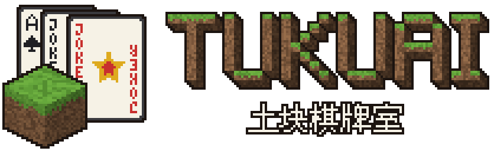</p>

<p align="center">
  <a href="README.md">English</a> · <a href="README.zh-CN.md">简体中文</a> · <a href="README.zh-TW.md">繁體中文</a> · <b>日本語</b> · <a href="README.ko.md">한국어</a>
</p>

<p align="center">
  <a href="https://github.com/Konyaco/TuKuai/actions/workflows/build.yml"></a>
  <a href="https://github.com/Konyaco/TuKuai/releases/latest"></a>
  
  
  <a href="LICENSE"></a>
</p>
<h3 align="center">あなたの Minecraft の世界に、カードテーブルをひとつ。<br>椅子を引いて、友だちと闘地主や麻雀、UNO を。友だちがいなければ CPU が相手をします。</h3>

<p align="center">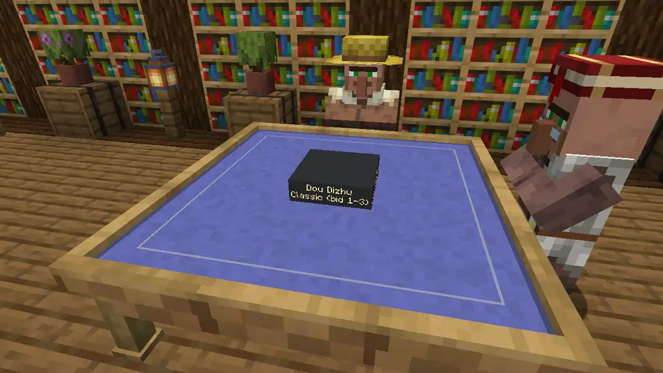</p>

<p align="center"><b>10 つのゲーム</b> · <b>2〜8 人</b> · <b>空席は CPU が埋める</b> · <b>全対局のリプレイ</b> · <b>Fabric と NeoForge</b></p>

## ゲーム

<table>
  <tr>
    <td width="50%">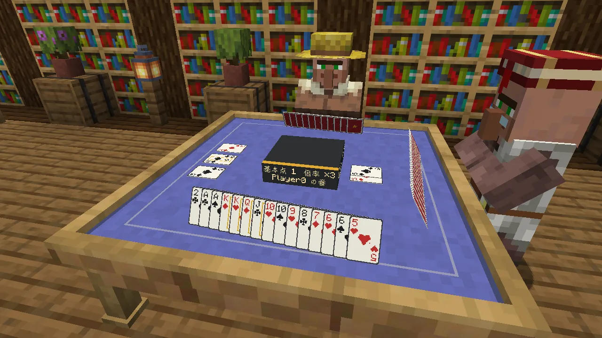</td>
    <td width="50%">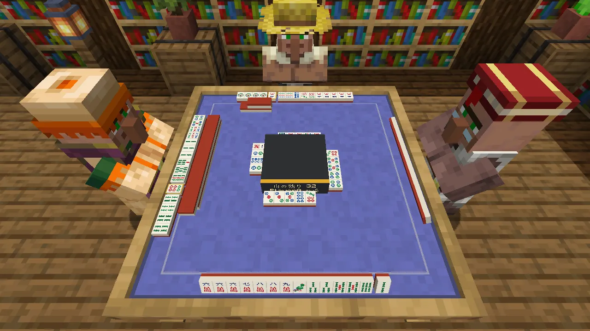</td>
  </tr>
  <tr>
    <td valign="top"><b>闘地主</b> · 3 人または 4 人<br>地主 1 人対農民たち。点数での入札、地主の奪い合い、シャッフルなしのほか、2 組のカードで 4 人で遊び、最大 8 枚の爆弾を出せるルールもあります。</td>
    <td valign="top"><b>麻雀</b> · 4 人<br>3 つのルール。<b>四川麻雀</b>の血戦到底は、3 枚を交換し、捨てる色を決め、誰かが和了っても 3 人が和了るまで続けます。<b>中国公式麻雀</b>は花牌ありで、チー・ポン・カンができ、81 種の番から 8 番以上で和了ります。<b>リーチ麻雀</b>は役と符、リーチ、ドラ、フリテン。牌はテーブルの上に立ち、中央に山が積まれ、待ち牌とその点数も表示されます。</td>
  </tr>
  <tr>
    <td>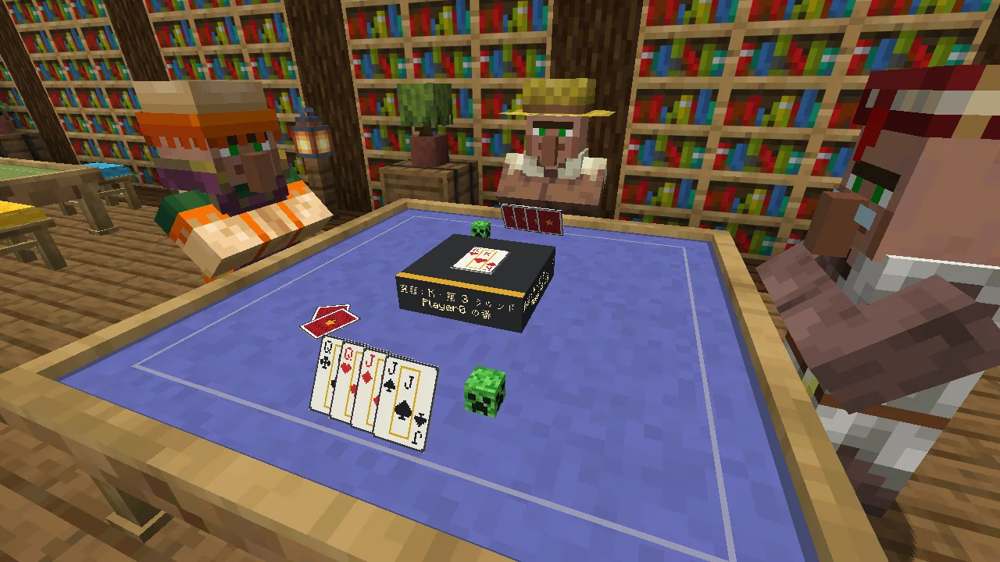</td>
    <td>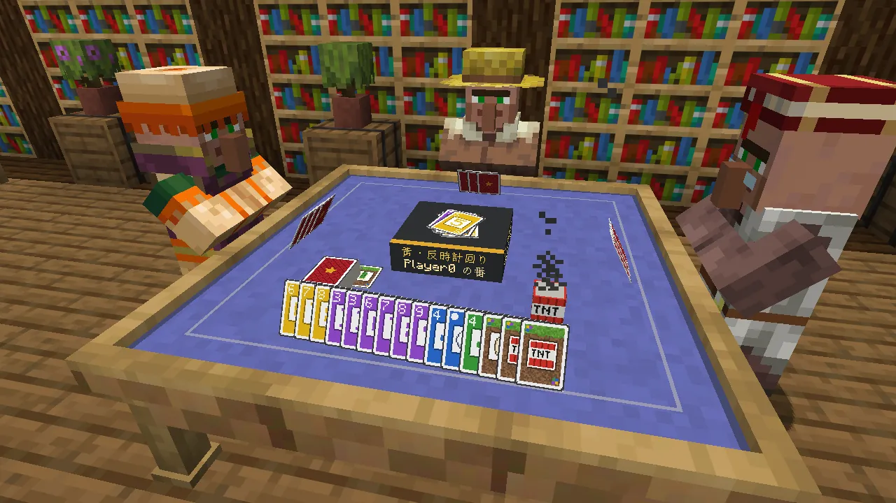</td>
  </tr>
  <tr>
    <td valign="top"><b>クリーパー・ブラフ</b> · 2〜8 人<br>Liar's Bar のリボルバーをクリーパーに替えたようなゲーム。カードを伏せて出し、必要ならうそをつき、あるいは前の人のうそを見破ります。外れた側は自分のクリーパーの導火線に火をつけ、6 回に 1 回は爆発します。ダメージがあるかはホストが決めます。</td>
    <td valign="top"><b>トゥトゥカード</b> · 2〜8 人<br>UNO に近いこの Mod オリジナルのゲームで、特殊カードは Minecraft から。火のついた TNT がテーブルで煙を上げ、誰の番で爆発するかは誰にもわかりません。</td>
  </tr>
  <tr>
    <td>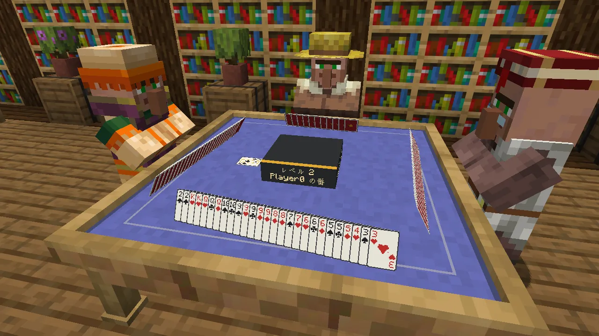</td>
    <td>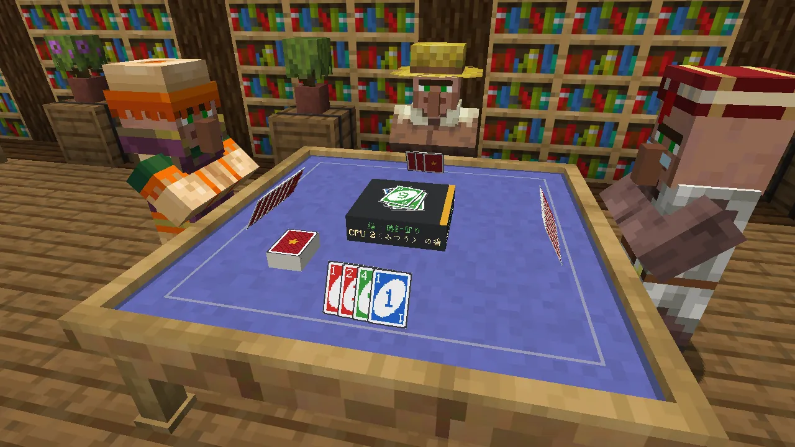</td>
  </tr>
  <tr>
    <td valign="top"><b>掼蛋（グワンダン）</b> · 4 人<br>2 チームに分かれ、2 組のカードで。ワイルドカードも献上もあります。1 局だけでも、A まで上り詰める長期戦でも。</td>
    <td valign="top"><b>UNO</b> · 2〜4 人<br>クラシックルールか、ペナルティカードを次の人に重ねられるルールで。</td>
  </tr>
  <tr>
    <td>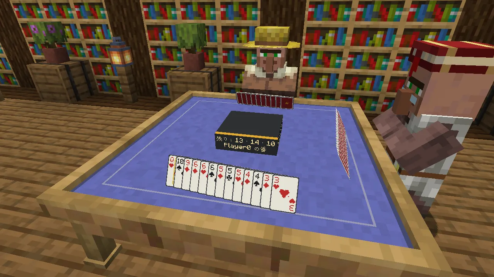</td>
    <td>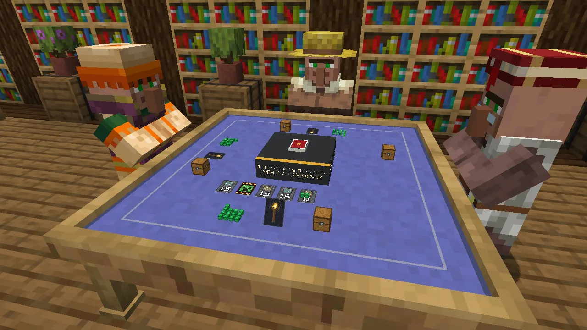</td>
  </tr>
  <tr>
    <td valign="top"><b>跑得快（パオダークァイ）</b> · 3 人<br>全員が敵同士で、最初に手札を出し切った人の勝ち。手札は 16 枚か 15 枚、出せるなら必ず出すルールの有無も選べます。</td>
    <td valign="top"><b>洞窟探検</b> · 2〜8 人<br>全員で洞窟に潜り、カードがめくられるたびに、中にいる人で鉱石のエメラルドを山分けします。1 枚ごとに全員が同時に、互いに見えないまま、さらに奥へ進むかキャンプに戻ってエメラルドをチェストにしまうかを選びます。同じ危険が 2 度目に出ると、洞窟に残っていた人は持ち物をすべて失います。</td>
  </tr>
  <tr>
    <td>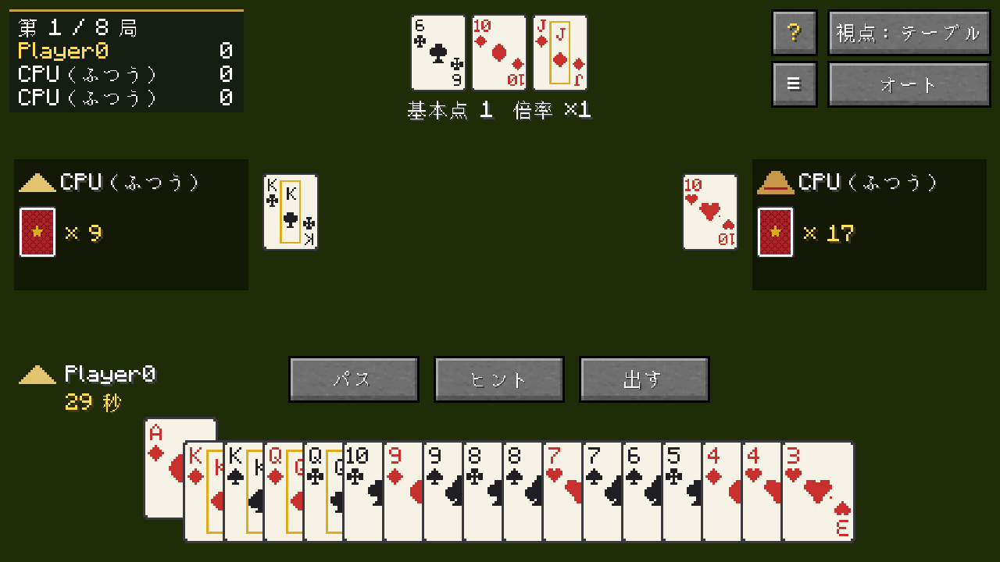</td>
    <td valign="middle"><b>すぐに遊べる</b><br>席に着けば、手札、得点、<b>ヒント</b>ボタンが表示されます。<b>?</b> ボタンのルールブックは、どのゲームも図解付きです。</td>
  </tr>
</table>

## TuKuai で遊ぶ理由

- **カードは本当にテーブルの上に。** 手札は持ち主に向けて立ち、出したカードは中央に並び、通りがかりの人も観戦できます。没入視点にすれば、テーブル上のカードを直接選んで出せます。
- **メンバーに困らない。** 空席には「やさしい」「ふつう」「むずかしい」の CPU がいつでも座り、席を外したり切断したりした人の代わりも打ちます。全員が席を離れると、対局は戻ってくるまで待ちます。
- **一晩じっくり。** 試合は数局分の得点を通算し、全対局はどの席の視点からでも見直せ、テーブルは全員の戦績を記録します。
- **部屋を自分好みに。** テーブルと椅子はあらゆる木材で作れ、テーブルクロスとクッションは好きな色に染められ、カードの裏面と表面も数種類あります。大きなテーブルなら 8 人まで座れます。

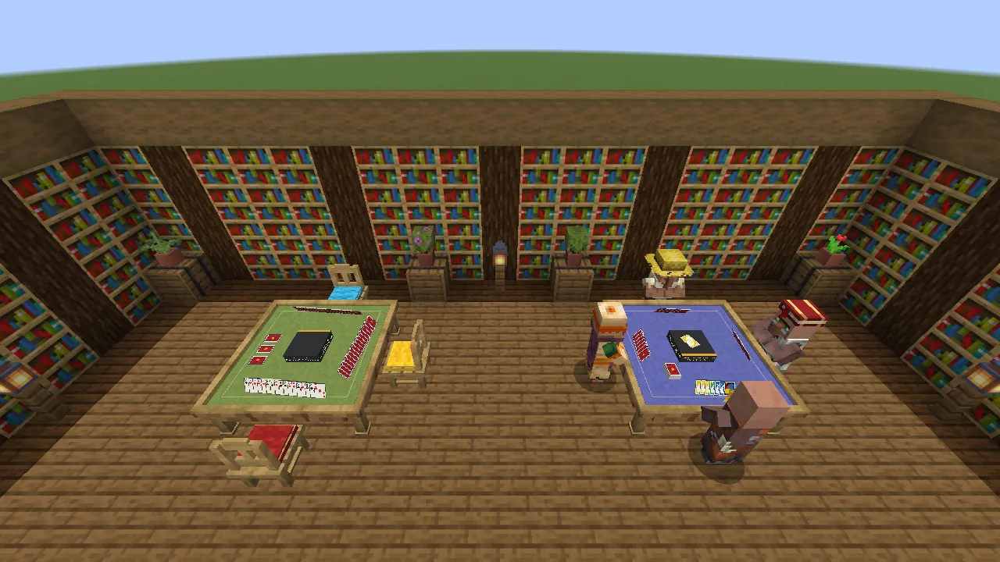

## はじめかた

### ダウンロード

[Releases](https://github.com/Konyaco/TuKuai/releases/latest) から Minecraft のバージョンとローダーに合った jar（例：`tukuai-fabric-1.21.1-<バージョン>.jar`）をダウンロードしてください。サーバーと全プレイヤーのゲームの両方に入れてください。Minecraft 26.3、26.2、26.1.2、1.21.11、1.21.1 に対応しており、次の Mod が必要です。

| ローダー | 前提 Mod |
| --- | --- |
| NeoForge 1.21.11, 26.1.2, 26.2, 26.3 | [Kotlin for Forge](https://modrinth.com/mod/kotlin-for-forge) 6.4.0 以降 |
| NeoForge 1.21.1 | [Kotlin for Forge](https://modrinth.com/mod/kotlin-for-forge) 5.12.0 以降 |
| Fabric | [Fabric API](https://modrinth.com/mod/fabric-api)、[Fabric Language Kotlin](https://modrinth.com/mod/fabric-language-kotlin) 1.13.13 以降 |

1.21.1 にはペールオークがないため、ペールオークのテーブルと椅子はありません。

### レシピ

<table>
  <tr>
    <td width="33%" align="center">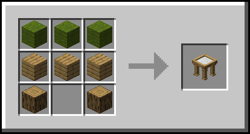<br><b>カードテーブル</b><br>羊毛の色は自由です。板材の種類でテーブルの木材が決まります。</td>
    <td width="33%" align="center">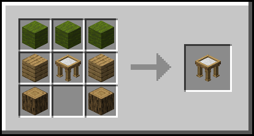<br><b>大きなカードテーブル</b><br>カードテーブルから作ります。最大 8 人が座れます。</td>
    <td width="33%" align="center">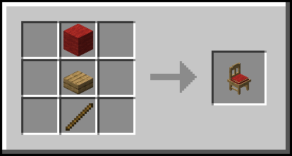<br><b>椅子</b><br>羊毛でクッションの色が、ハーフブロックで木材が決まります。</td>
  </tr>
</table>

クリエイティブモードでは、3 つとも「機能的ブロック」タブにあります。

### 遊び方

1. **カードテーブルを置く**。3×3 ブロックの大きさで、クリックしたブロックから前方に広がります。前と左右に空きを作っておいてください。
2. **テーブルを右クリック**すると、ロビーにテーブルを上から見た図が出ます。空いている場所をクリックするとそこに着き、「CPU を入れる」で CPU を置けます。辺の数より少ない人数のゲームでは、どの辺を空けてもかまいません。手番は反時計回りに進みます。
3. **ゲームとルールを選び**、「開始」を押します。

椅子がなければテーブルのそばに立って遊びます。椅子を辺の外側中央に置くと、右クリックでその席に座れます。大きなカードテーブルは 5×5 ブロックで、各辺に 2 席、最大 8 人が座れます。

表示言語は英語・簡体字中国語・繁体字中国語・日本語・韓国語に対応し、ゲームの言語設定に従います。

<details>
<summary><b>サーバー設定</b></summary>

サーバーを初めて起動したとき（シングルプレイのワールドを開いたときも）、`config/tukuai-server.properties` が作られます。変更後は `/reload` を実行するか、再起動してください。

| 設定 | 初期値 | 内容 |
| --- | --- | --- |
| `allowBots` | `true` | CPU の着席を許可するか |
| `botDelaySeconds` | `1.1` | CPU がカードを出すまでの平均待ち時間（秒） |
| `saveReplays` | `true` | リプレイを保存するか |
| `maxReplays` | `500` | 保存するリプレイの上限。超えると古いものから削除。`0` で無制限 |
| `keepStats` | `true` | 戦績を記録するか |

</details>

<details>
<summary><b>開発</b></summary>

JDK 25 が必要です。Minecraft 1.21.11 と 1.21.1 用の JDK 21 は Gradle が自動で取得します。

```sh
./gradlew build                        # コンパイル、テスト、全ローダー・全 Minecraft バージョンの jar の作成
./gradlew :mc26:fabric-26.3:runClient  # Fabric で Minecraft 26.3 を起動
./gradlew :neoforge-1.21.1:runClient   # NeoForge で Minecraft 1.21.1 を起動
```

| ディレクトリ | 内容 |
| --- | --- |
| `engine` | ルール、CPU、リプレイ。Minecraft に依存しない Kotlin コード |
| `common` | 全ローダー・全 Minecraft バージョン共通の Minecraft コードとリソース。最新の Minecraft に合わせて書かれています |
| `mc26` | Minecraft 26.1.2・26.2・26.3 と 1.21.11（26.1 の一つ前）をまとめた 1 つの [Stonecutter](https://stonecutter.kikugie.dev/) プロジェクト。`src` に `compat` パッケージ、レンダラー、各ローダーのエントリポイント、アイテムモデル、レシピがあり、バージョンごとに違う箇所は `//?` コメントで示します。`versions/<ローダー>-<minecraft>/gradle.properties` にそれぞれのバージョン |
| `versions/1.21.1` | Minecraft 1.21.1：`gradle.properties` の各バージョン、最新の Minecraft の名前を使えるようにする `compat` パッケージ、レンダラー、アイテムモデル、レシピ |
| `versions/1.21.1/fabric`、`versions/1.21.1/neoforge` | 1.21.1 の各ローダーのエントリポイントと登録処理 |

新しいゲームの追加：

1. `engine` で `GameDefinition` を実装し、`TuKuai.init()` で `GameRegistry` に登録する。
2. `common/.../client` で `GameUi` を実装し、`TuKuaiClient.init()` で `GameUis` に登録する。
3. すべての言語ファイルに `tukuai.game.<id>` と各ルールの名前を追加する。

テスト：

```sh
./gradlew :engine:test                           # ルールと CPU の単体テスト
./gradlew :mc26:fabric-26.1.2:runClientGameTest  # ゲームを起動して数局遊び、スクリーンショットを撮る
./gradlew :mc26:fabric-26.1.2:runMultiplayerTest # 専用サーバーと 2 つのクライアントによる対戦テスト
./gradlew :fabric-1.21.1:runSmokeTest            # Minecraft 1.21.1 で各ゲームを 1 局ずつ遊び、スクリーンショットを撮る
./gradlew :mc26:neoforge-26.3:runSmokeTest       # 同じことを 26.x の任意のバージョンとローダーで行う
TUKUAI_SHOWCASE=en_us,zh_cn ./gradlew :mc26:fabric-26.1.2:runClientGameTest   # この README のスクリーンショットを撮る
```

コミットメッセージは `[type](scope) Title` の形式です。依存関係のバージョンは `gradle.properties` と `versions/<minecraft>/gradle.properties` にあります。

</details>

## ライセンス

[MIT](LICENSE)
