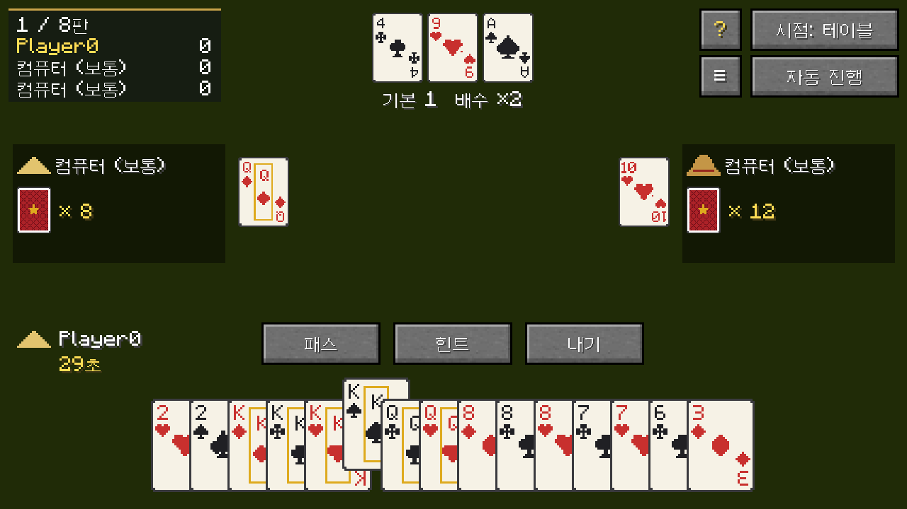
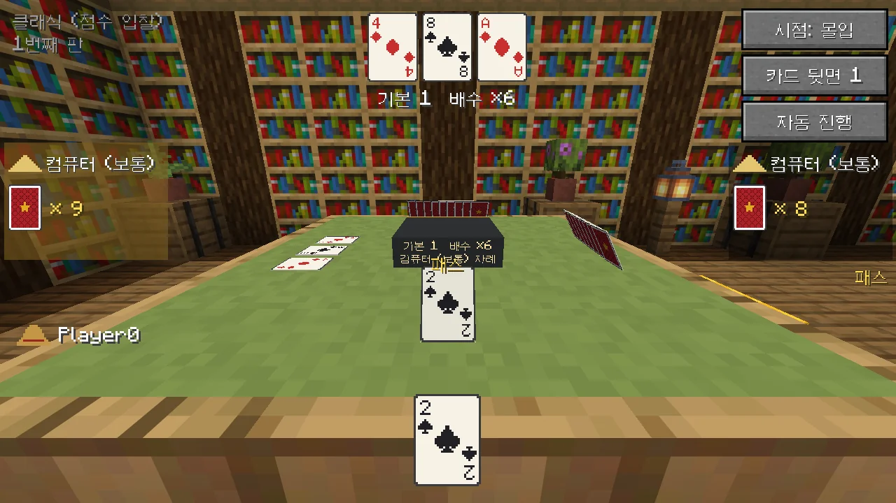
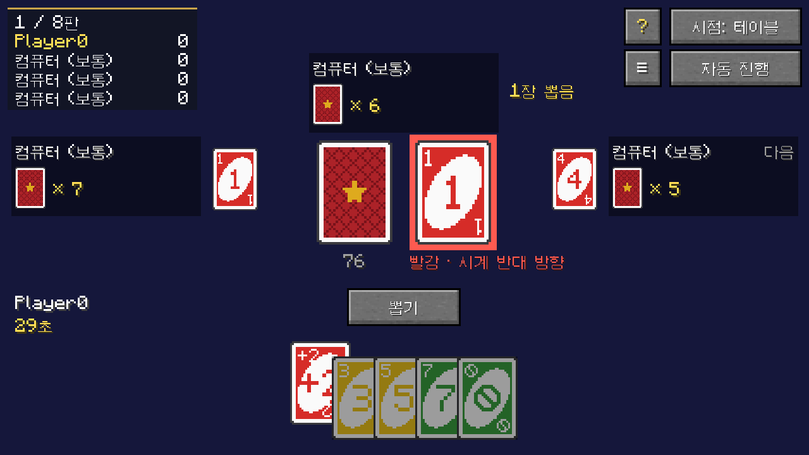
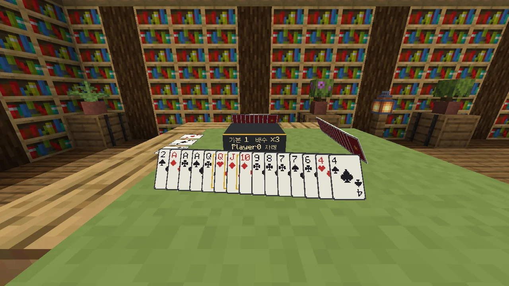
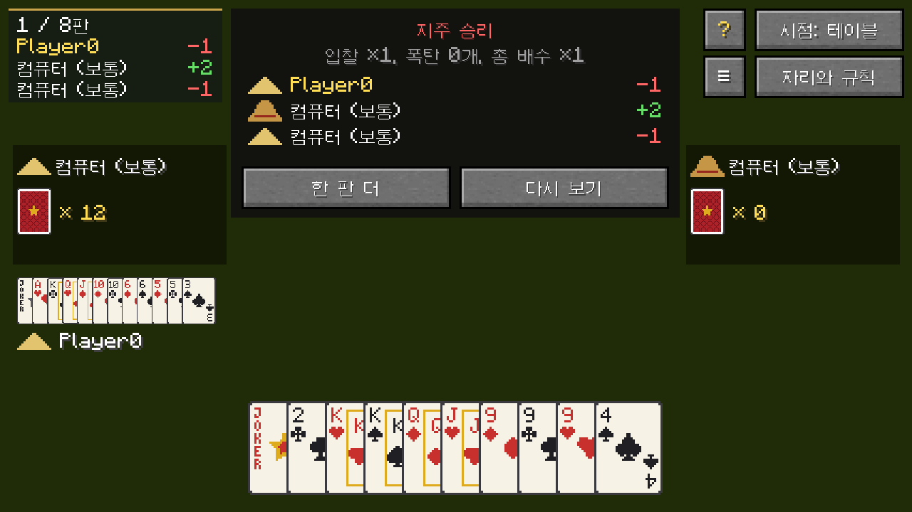
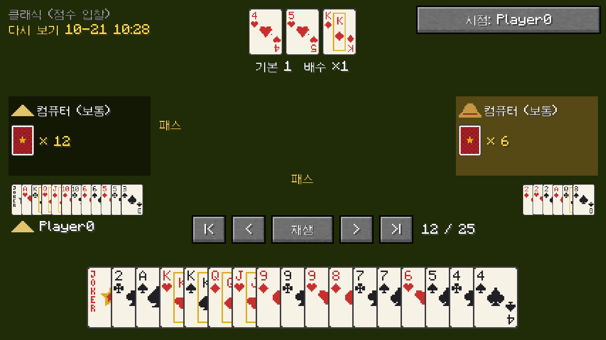
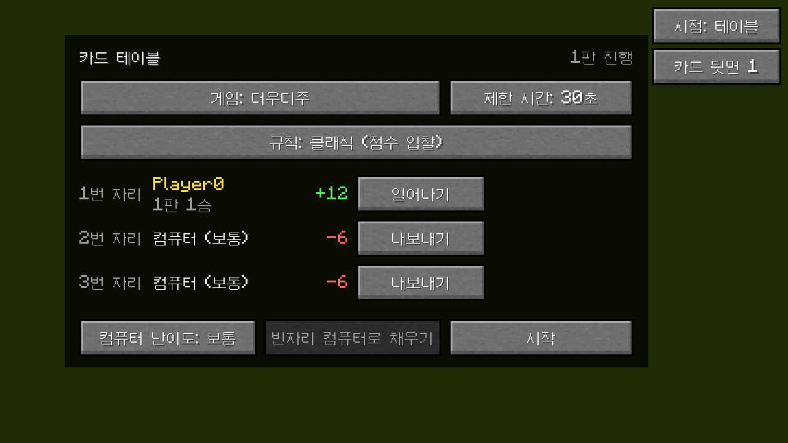

  <a href="README.md">English</a> · <a href="README.zh-CN.md">简体中文</a> · <a href="README.zh-TW.md">繁體中文</a> · <a href="README.ja.md">日本語</a> · <b>한국어</b>

  Minecraft 안에 카드 테이블을 놓고, 친구나 컴퓨터와 함께 더우디주, UNO, 파오더콰이를 즐기는 모드입니다.

  
  
  
  
  

TuKuai(土块棋牌室, 대충 "흙 블록 기원"이라는 뜻)는 만들어서 설치할 수 있는 카드 테이블을 추가합니다. 다른 플레이어와 한 테이블에 앉고, 빈자리는 컴퓨터로 채우면 바로 시작할 수 있습니다. 카드가 실제로 테이블 위에 놓이기 때문에 지나가던 사람도 구경할 수 있습니다. 지금은 더우디주, UNO, 파오더콰이가 있고, 다른 게임도 나중에 추가할 예정입니다.

게임 안의 점수만 쓰고, 실제 돈과는 아무 관계가 없습니다. 져도 잃는 건 체면 정도입니다.

## 다운로드

[Releases](https://github.com/Konyaco/TuKuai/releases/latest)에서 사용하는 로더에 맞는 jar를 받으세요. Minecraft 26.1.2와 아래 모드가 필요합니다.

| 로더 | 함께 설치 |
| --- | --- |
| NeoForge 26.1.2 | [Kotlin for Forge](https://modrinth.com/mod/kotlin-for-forge) 6.4.0 이상 |
| Fabric | [Fabric API](https://modrinth.com/mod/fabric-api), [Fabric Language Kotlin](https://modrinth.com/mod/fabric-language-kotlin) 1.13.13 이상 |

## 할 수 있는 것

### 더우디주

중국의 3인용 카드 게임으로, 지주 한 명과 농민 두 명이 겨룹니다. 규칙은 "클래식 (점수 입찰)", "지주 빼앗기", "섞지 않기"(폭탄이 더 많이 나옴) 세 가지입니다.

<table>
  <tr>
    <td width="50%"></td>
    <td width="50%"></td>
  </tr>
  <tr>
    <td align="center">테이블 시점: 화면 전체가 테이블입니다.</td>
    <td align="center">몰입 시점: 세상을 가리지 않고, 눈앞에 진짜 테이블이 보입니다. Tab으로 전환.</td>
  </tr>
</table>

### UNO

2~4명. 규칙은 4명, 3명, 2명 클래식과, 드로우를 쌓을 수 있는 4명용(+2에 +2, +4에는 +2나 +4) 네 가지입니다.

<table>
  <tr>
    <td width="50%"></td>
    <td width="50%"></td>
  </tr>
  <tr>
    <td align="center">낼 수 있는 카드가 올라오고, 클릭하면 냅니다.</td>
    <td align="center">화면을 닫아도 여전히 테이블에 앉아 있습니다.</td>
  </tr>
</table>

### 파오더콰이

"빨리 달려라"라는 이름처럼, 세 명이 각자 패를 먼저 다 내려고 겨룹니다. 스페이드 3을 가진 사람이 먼저 냅니다. 규칙은 1인 16장, 1인 15장, 그리고 16장에 언제든 패스할 수 있는 것까지 세 가지입니다. 나머지 두 규칙에서는 이길 수 있으면 반드시 내야 합니다.

누군가 한 장만 남으면 그 사람의 칸과 테이블에 빨간 경고가 뜨고, 바로 앞 사람은 싱글을 낼 때 손에서 가장 높은 카드만 낼 수 있습니다.

### 월드 안에서 보이는 테이블

테이블은 3x3 블록입니다. 각자의 패는 주인을 향해 테이블 위에 서 있어서 다른 사람에게는 뒷면만 보이고, 방금 낸 카드와 지주의 카드는 가운데에 놓입니다. 카드에는 약간의 두께가 있습니다. 염료를 들고 테이블을 우클릭하면 테이블보 색이 바뀌고, 화면 오른쪽 위 버튼으로 카드 뒷면을 고를 수 있습니다. 그 옆의 작은 버튼으로 카드 앞면도 바꿀 수 있습니다: 클래식, 패가 겹쳐도 잘 보이는 큰 모서리 숫자, 4색(다이아몬드는 파랑, 클로버는 초록). 테이블과 의자는 참나무부터 뒤틀린 나무까지 어떤 나무로든 만들 수 있고, 의자 방석은 16가지 색입니다.

<table>
  <tr>
    <td width="50%"></td>
    <td width="50%"></td>
  </tr>
  <tr>
    <td align="center">내 패는 나를 향해 서 있습니다.</td>
    <td align="center">주민들은 그냥 장식입니다. 실제로 치는 컴퓨터는 투명한데, 예의 바른 건지 으스스한 건지는 보는 사람 마음입니다.</td>
  </tr>
</table>

### 컴퓨터, 그리고 자리를 비운 사람

빈자리에는 컴퓨터를 앉힐 수 있습니다. 난이도는 쉬움, 보통, 어려움 세 단계이고, 어려움은 머릿속으로 판을 여러 번 굴려 본 다음에 카드를 냅니다.

누군가 자리를 비우거나 접속이 끊겨도 컴퓨터가 대신 치기 때문에 게임이 멈추지 않습니다. 두 번 연속으로 시간을 넘기면 자동 진행으로 바뀌고, 돌아와서 "자동 해제"를 누르면 이어서 할 수 있습니다.

### 다시 보기와 전적

끝난 게임은 자동으로 저장됩니다. 한 수씩 다시 보고, 모두의 패를 보고, 아무 자리의 시점으로나 바꿔 볼 수 있습니다. 테이블은 플레이어마다 전적도 기록합니다.

<table>
  <tr>
    <td width="33%"></td>
    <td width="33%"></td>
    <td width="33%"></td>
  </tr>
  <tr>
    <td align="center">결과</td>
    <td align="center">다시 보기, 모두의 패가 보임</td>
    <td align="center">자리와 규칙 화면의 전적</td>
  </tr>
</table>

처음이라면 테이블의 **?** 버튼으로 규칙서를 열어 보세요. 더우디주와 파오더콰이의 모든 패 조합과 UNO의 모든 기능 카드를 그림으로 보여 주고, 지금 앉은 테이블의 규칙만 정리한 페이지도 있습니다.

영어, 중국어 간체, 중국어 번체, 일본어, 한국어를 지원하며 게임의 언어 설정을 따릅니다.

## 플레이 방법

1. **카드 테이블 만들기**: 첫째 줄에 아무 색 양털 3개, 둘째 줄에 같은 종류의 나무 판자 3개(테이블 틀과 다리가 그 나무로 나옵니다), 셋째 줄 양쪽 끝에 아무 원목 1개씩. 크리에이티브에서는 "기능 블록" 탭에 있습니다.
2. **설치하고 우클릭**: 테이블은 클릭한 블록에서 3x3으로 펼쳐지므로 앞쪽과 양옆에 공간을 비워 두세요. "여기 앉기"로 앉고, 빈자리에서 "컴퓨터 추가", 한 번에 채우려면 "빈자리 컴퓨터로 채우기".
3. **게임 고르기**: "게임"으로 더우디주, UNO, 파오더콰이를 바꾸고, 규칙과 제한 시간을 고른 뒤 "시작".

예전 버전에서 설치한 한 칸짜리 테이블은 저절로 3x3이 됩니다. 주변에 공간이 없으면 아이템으로 떨어집니다.

**의자**: 양털, 나무 반 블록, 막대기를 위에서부터 세로로 놓아 만듭니다. 양털 색이 방석 색이 되고(나중에 염료로 우클릭해서 바꿀 수도 있습니다), 반 블록의 나무가 의자의 나무가 됩니다. 자리가 있는 변(더우디주와 파오더콰이는 세 변, 4인 UNO는 네 변) 바깥쪽 가운데에 놓아 두면, 의자를 우클릭해서 그쪽 자리에 앉을 수 있습니다. 테이블 옆이 아니어도 의자는 의자라서 그냥 앉을 수 있습니다.

### 조작

더우디주:

| 조작 | 동작 |
| --- | --- |
| 카드 좌클릭 | 선택 / 선택 해제 |
| 우클릭 | 선택 모두 해제 |
| Space / Enter | 선택한 카드 내기. 아무것도 고르지 않았으면 패스 |
| H | 힌트. 누를 때마다 다른 조합 |
| Tab | 테이블 / 몰입 시점 전환 |

UNO: 낼 수 있는 카드는 올라와 있고, 클릭하면 냅니다. 와일드 카드는 먼저 색을 고릅니다.

| 조작 | 동작 |
| --- | --- |
| 카드 좌클릭 | 그 카드 내기 |
| 우클릭 | 색 고르기 취소 |
| D | 뽑기 (벌칙은 한 번에 다 뽑음) |
| Space / Enter | 뽑은 카드를 낼 수 있지만 가지고 있기 |
| U | 두 장 남았을 때 UNO를 외치고 내기. 잊으면 2장 뽑음 |
| Tab | 테이블 / 몰입 시점 전환 |

UNO에서 간단하게 바꾼 점: 처음 뒤집는 카드는 항상 숫자 카드입니다. +4는 현재 색 카드가 없을 때만 낼 수 있습니다(이의 제기 없음). UNO는 끝에서 두 번째 카드를 낼 때 함께 외쳐야 하고, 잊으면 바로 벌칙입니다. 패를 먼저 다 낸 사람이 이기고, 나머지는 남은 카드만큼 점수를 냅니다. 숫자 카드는 숫자대로, 기능 카드는 20점, 와일드 카드는 50점입니다.

파오더콰이:

| 조작 | 동작 |
| --- | --- |
| 카드 좌클릭 | 선택 / 선택 해제 |
| 우클릭 | 선택 모두 해제 |
| Space / Enter | 선택한 카드 내기. 아무것도 고르지 않았으면 패스(패스할 수 있을 때) |
| H | 힌트. 누를 때마다 다른 조합 |
| Tab | 테이블 / 몰입 시점 전환 |

이길 수 있어서 반드시 내야 할 때는 "패스" 버튼이 비활성화됩니다. 먼저 다 낸 사람은 다른 사람의 남은 카드 한 장마다 1점을 받습니다. 한 장 남은 사람은 내지 않고, 한 장도 못 낸 사람은 두 배를 냅니다. 판을 가져간 폭탄은 다른 사람마다 10점씩 받습니다.

### 다시 보기

- 한 판이 끝나면 결과 창에서 "다시 보기"를 클릭합니다.
- `/tukuai replays`로 최근 게임 목록을 보고, 이름을 클릭하면 열립니다. `/tukuai replay <이름>`으로 이름을 지정해 열 수도 있습니다.
- 다시 보기 중에는 Space로 일시 정지 / 재생, 좌우 방향키로 한 수 뒤로 / 앞으로, Home / End로 처음 / 끝, Tab으로 시점 전환.

다시 보기 파일은 월드 폴더의 `tukuai/replays`에 저장됩니다.

### 전적

- `/tukuai stats`로 내가 한 게임 수, 이긴 수, 점수를 봅니다. `/tukuai stats <플레이어>`로 다른 사람 것도 볼 수 있습니다.
- `/tukuai top`으로 점수 상위 10명을 봅니다.

전적은 월드 폴더의 `tukuai/stats.json`에 저장됩니다. 사람만 기록되고, 컴퓨터는 기록되지 않습니다.

## 서버 설정

서버를 처음 켤 때(싱글플레이 월드를 열 때도) `config/tukuai-server.properties`가 만들어집니다. 고친 다음 `/reload` 하거나 다시 시작하면 적용됩니다.

| 설정 | 기본값 | 동작 |
| --- | --- | --- |
| `allowBots` | `true` | 컴퓨터가 자리에 앉을 수 있는지 |
| `botDelaySeconds` | `1.1` | 컴퓨터가 카드를 내기 전에 평균 몇 초 기다리는지 |
| `saveReplays` | `true` | 다시 보기를 저장할지 |
| `maxReplays` | `500` | 다시 보기를 몇 개까지 남길지. 넘으면 오래된 것부터 지움. `0`은 제한 없음 |
| `keepStats` | `true` | 전적을 기록할지 |

## 개발자용

빌드 방법, 코드 구조, 새 게임 추가, 테스트는 [English README의 For developers](README.md#for-developers)를 참고하세요.

## 라이선스

[MIT](LICENSE)
