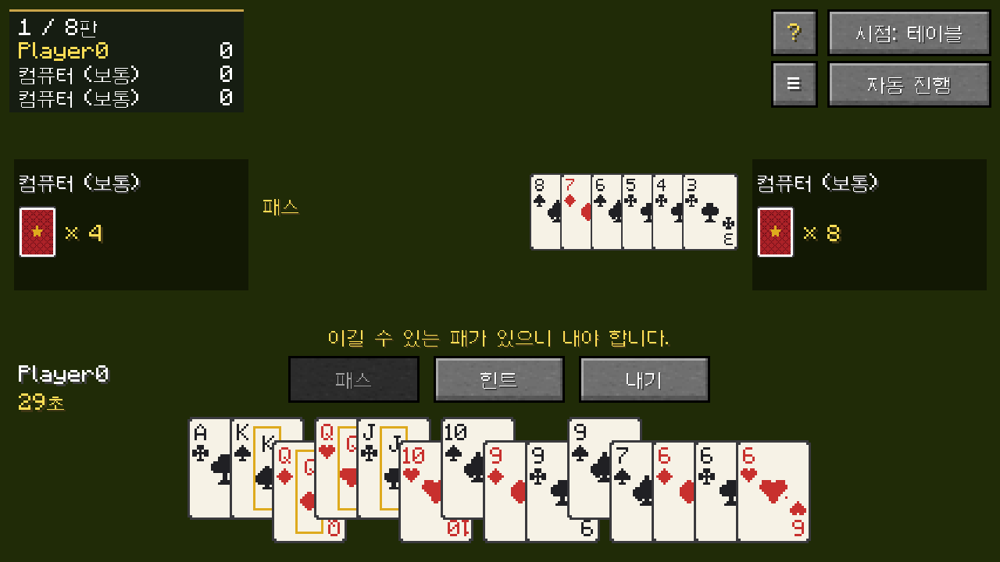
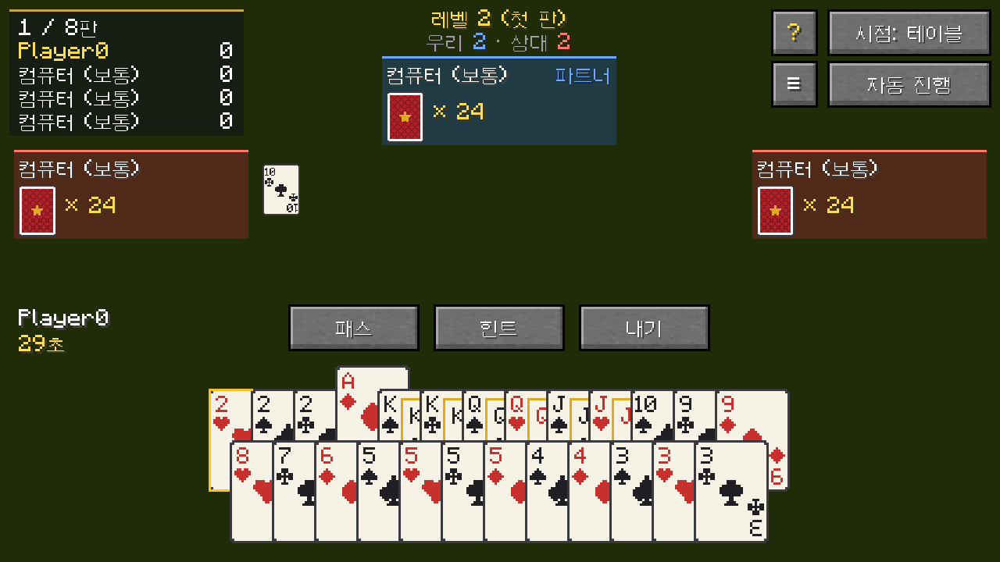
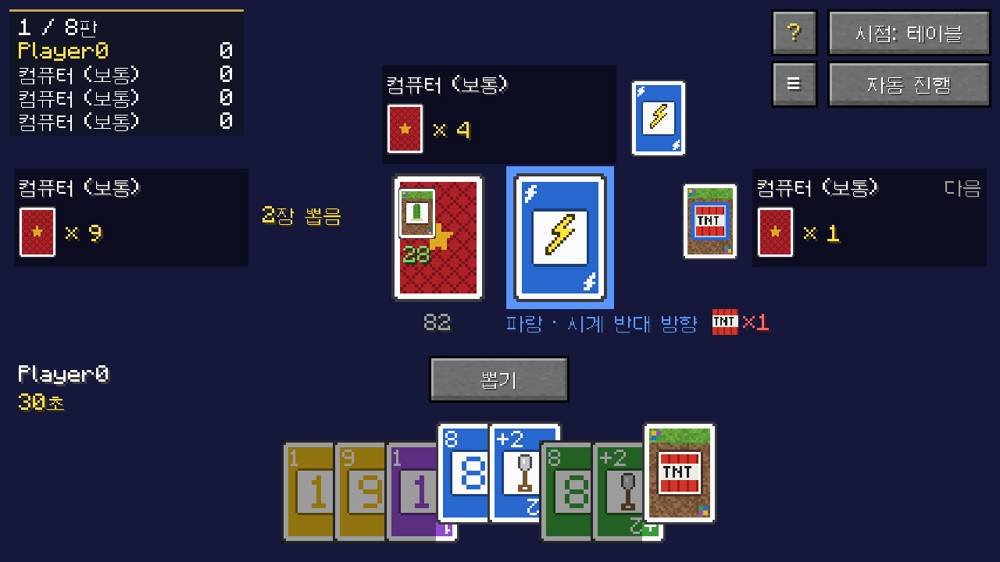

<p align="center"></p>

<p align="center">
  <a href="README.md">English</a> · <a href="README.zh-CN.md">简体中文</a> · <a href="README.zh-TW.md">繁體中文</a> · <a href="README.ja.md">日本語</a> · <b>한국어</b>
</p>

<p align="center">
  <a href="https://github.com/Konyaco/TuKuai/actions/workflows/build.yml"></a>
  <a href="https://github.com/Konyaco/TuKuai/releases/latest"></a>
  
  
  <a href="LICENSE"></a>
</p>

TuKuai(土块棋牌室)는 만들어서 설치할 수 있는 카드 테이블을 Minecraft에 추가하여, 친구나 컴퓨터와 함께 카드 게임을 할 수 있게 하는 모드입니다.


## 특징

- **월드 안의 테이블**: 카드가 월드 속 테이블 위에 놓입니다. 손패는 주인을 향해 세워지고, 낸 카드는 가운데에 놓이며, 주변 사람도 볼 수 있습니다.
- **멀티플레이와 컴퓨터**: 빈자리는 컴퓨터로 채울 수 있으며 난이도는 쉬움, 보통, 어려움 세 단계입니다. 자리를 비우거나 접속이 끊긴 플레이어의 차례는 컴퓨터가 대신 둡니다. 치던 사람이 모두 자리를 떠나면 누군가 앉아서 이어서 치거나 대국을 끝낼 때까지 일시 정지됩니다.
- **다시 보기와 전적**: 모든 판이 자동으로 저장되며, 어느 자리의 시점으로든 다시 볼 수 있습니다. 테이블은 플레이어별 전적을 기록합니다.
- **외형 꾸미기**: 테이블과 의자는 여러 나무로 만들 수 있고, 테이블보와 방석은 염색할 수 있으며, 카드 뒷면과 앞면도 여러 디자인이 있습니다.
- **몰입 시점**: 화면이 월드를 가리지 않으며, 테이블 위의 카드를 바로 골라 낼 수 있습니다.

## 게임

<table>
  <tr>
    <td width="55%"></td>
    <td><b>더우디주</b><br>세 명이 하는 게임으로, 지주 한 명과 농민 두 명이 겨룹니다. 규칙은 기본 입찰, 지주 빼앗기, 섞지 않기 중에서 고를 수 있습니다.</td>
  </tr>
  <tr>
    <td></td>
    <td><b>UNO</b><br>2~4명. 기본 규칙과 벌칙 카드를 겹쳐 낼 수 있는 규칙 중에서 고를 수 있습니다.</td>
  </tr>
  <tr>
    <td></td>
    <td><b>파오더콰이</b><br>세 명이 각자 겨루며, 손패를 먼저 모두 낸 사람이 이깁니다. 손패는 16장 또는 15장이며, 낼 수 있으면 반드시 내야 하는 규칙을 쓸지 고를 수 있습니다.</td>
  </tr>
  <tr>
    <td></td>
    <td><b>관단</b><br>네 명이 두 팀으로 나뉘어 카드 두 벌로 합니다. 한 판만 하거나 A까지 이어서 할 수 있습니다.</td>
  </tr>
  <tr>
    <td></td>
    <td><b>투투 카드</b><br>이 모드의 오리지널 게임으로, 진행 방식은 UNO와 비슷하고 특수 카드는 Minecraft에서 가져왔습니다. 예를 들어 TNT는 테이블 위에서 연기를 냅니다. 2~8명이며, 6명과 8명은 큰 카드 테이블이 필요합니다.</td>
  </tr>
</table>

각 게임의 규칙은 게임 안의 규칙서에서 볼 수 있습니다. 테이블의 **?** 버튼을 누르면 열립니다.

## 시작하기

### 다운로드

[Releases](https://github.com/Konyaco/TuKuai/releases/latest)에서 사용하는 Minecraft 버전과 로더에 맞는 jar(예: `tukuai-fabric-1.21.1-<버전>.jar`)를 받으세요. Minecraft 26.1.2와 1.21.1을 지원하며, 다음 모드가 필요합니다.

| 로더 | 필수 모드 |
| --- | --- |
| NeoForge 26.1.2 | [Kotlin for Forge](https://modrinth.com/mod/kotlin-for-forge) 6.4.0 이상 |
| NeoForge 1.21.1 | [Kotlin for Forge](https://modrinth.com/mod/kotlin-for-forge) 5.12.0 이상 |
| Fabric | [Fabric API](https://modrinth.com/mod/fabric-api), [Fabric Language Kotlin](https://modrinth.com/mod/fabric-language-kotlin) 1.13.13 이상 |

1.21.1에는 창백한 참나무가 없어서, 창백한 참나무 카드 테이블과 의자는 26.1.2에서만 쓸 수 있습니다.

### 조합법

<table>
  <tr>
    <td width="33%" align="center"><br><b>카드 테이블</b><br>양털 색은 자유입니다. 판자의 종류가 테이블의 나무를 정합니다.</td>
    <td width="33%" align="center"><br><b>큰 카드 테이블</b><br>카드 테이블로 만듭니다. 최대 8명이 앉을 수 있습니다.</td>
    <td width="33%" align="center"><br><b>의자</b><br>양털이 방석 색을, 반 블록이 나무를 정합니다.</td>
  </tr>
</table>

크리에이티브 모드에서는 세 가지 모두 "기능 블록" 탭에 있습니다.

### 첫 게임

1. **카드 테이블 설치하기**. 3×3 블록 크기로, 클릭한 블록에서 앞쪽으로 펼쳐지므로 앞과 양옆에 공간을 비워 두세요.
2. **테이블을 우클릭**하고 "여기 앉기"로 앉습니다. 빈자리는 "컴퓨터 추가"로 채울 수 있습니다.
3. **게임과 규칙을 고르고** "시작"을 누릅니다.

의자를 자리가 있는 변의 바깥쪽 가운데에 놓으면, 의자를 우클릭해 그 자리에 앉을 수 있습니다. 큰 카드 테이블은 5×5 블록이며, 한 변에 두 자리씩 최대 8명이 앉습니다.

영어, 중국어 간체, 중국어 번체, 일본어, 한국어를 지원하며 게임의 언어 설정을 따릅니다.

<details>
<summary><b>서버 설정</b></summary>

서버를 처음 켤 때(싱글플레이 월드를 열 때도) `config/tukuai-server.properties`가 만들어집니다. 수정한 뒤 `/reload`를 실행하거나 다시 시작하면 적용됩니다.

| 설정 | 기본값 | 동작 |
| --- | --- | --- |
| `allowBots` | `true` | 컴퓨터가 자리에 앉을 수 있는지 |
| `botDelaySeconds` | `1.1` | 컴퓨터가 카드를 내기 전 평균 대기 시간(초) |
| `saveReplays` | `true` | 다시 보기를 저장할지 |
| `maxReplays` | `500` | 보관할 다시 보기 수. 넘으면 오래된 것부터 삭제. `0`은 제한 없음 |
| `keepStats` | `true` | 전적을 기록할지 |

</details>

<details>
<summary><b>개발</b></summary>

JDK 25가 필요합니다. Minecraft 1.21.1에 쓰는 JDK 21은 Gradle이 알아서 받습니다.

```sh
./gradlew build                        # 컴파일, 테스트, 모든 로더와 Minecraft 버전의 jar 생성
./gradlew :fabric-26.1.2:runClient     # Fabric으로 Minecraft 26.1.2 실행
./gradlew :neoforge-1.21.1:runClient   # NeoForge로 Minecraft 1.21.1 실행
```

| 디렉터리 | 내용 |
| --- | --- |
| `engine` | 규칙, 컴퓨터, 다시 보기. Minecraft에 의존하지 않는 Kotlin 코드 |
| `common` | 모든 로더와 Minecraft 버전이 함께 쓰는 Minecraft 코드와 리소스. 최신 Minecraft에 맞춰 작성 |
| `versions/<minecraft>` | 그 Minecraft 버전에만 있는 부분: `gradle.properties`의 각 버전, 이전 버전에서 최신 Minecraft의 이름을 쓰게 해 주는 `compat` 패키지, 렌더러, 아이템 모델, 조합법 |
| `versions/<minecraft>/fabric`, `versions/<minecraft>/neoforge` | 그 버전의 각 로더 진입점과 등록 |

새 게임 추가:

1. `engine`에서 `GameDefinition`을 구현하고 `TuKuai.init()`에서 `GameRegistry`에 등록합니다.
2. `common/.../client`에서 `GameUi`를 구현하고 `TuKuaiClient.init()`에서 `GameUis`에 등록합니다.
3. 모든 언어 파일에 `tukuai.game.<id>`와 각 규칙의 이름을 추가합니다.

테스트:

```sh
./gradlew :engine:test                         # 규칙과 컴퓨터의 단위 테스트
./gradlew :fabric-26.1.2:runClientGameTest     # 게임을 실행해 몇 판 진행하고 스크린샷을 찍음
./gradlew :fabric-26.1.2:runMultiplayerTest    # 전용 서버와 클라이언트 두 개로 하는 멀티플레이 테스트
./gradlew :fabric-1.21.1:runSmokeTest          # Minecraft 1.21.1에서 게임마다 한 판씩 하고 스크린샷을 찍음
TUKUAI_SHOWCASE=en_us,zh_cn ./gradlew :fabric-26.1.2:runClientGameTest   # 이 README의 스크린샷을 찍음
```

커밋 메시지는 `[type](scope) Title` 형식입니다. 의존성 버전은 `gradle.properties`와 `versions/<minecraft>/gradle.properties`에 있습니다.

</details>

## 라이선스

[MIT](LICENSE)
