<p align="center">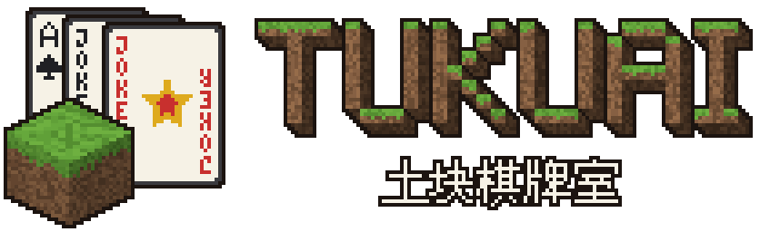</p>

<p align="center">
  <a href="README.md">English</a> · <a href="README.zh-CN.md">简体中文</a> · <a href="README.zh-TW.md">繁體中文</a> · <a href="README.ja.md">日本語</a> · <b>한국어</b>
</p>

<p align="center">
  <a href="https://github.com/Konyaco/TuKuai/actions/workflows/build.yml"></a>
  <a href="https://github.com/Konyaco/TuKuai/releases/latest"></a>
  
  
  <a href="LICENSE"></a>
</p>
<h3 align="center">당신의 Minecraft 월드에 카드 테이블 하나.<br>의자를 당겨 앉아 친구들과 더우디주, 마작, UNO를. 친구가 없으면 컴퓨터가 자리를 채워 줍니다.</h3>

<p align="center">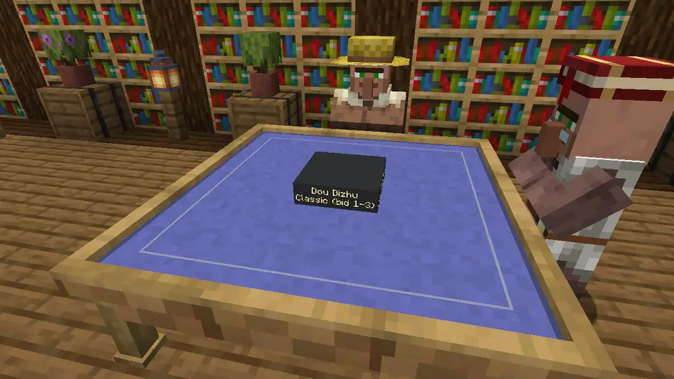</p>

<p align="center"><b>게임 8종</b> · <b>2~8인</b> · <b>빈자리는 컴퓨터가</b> · <b>모든 판 다시 보기</b> · <b>Fabric과 NeoForge</b></p>

## 게임

<table>
  <tr>
    <td width="50%">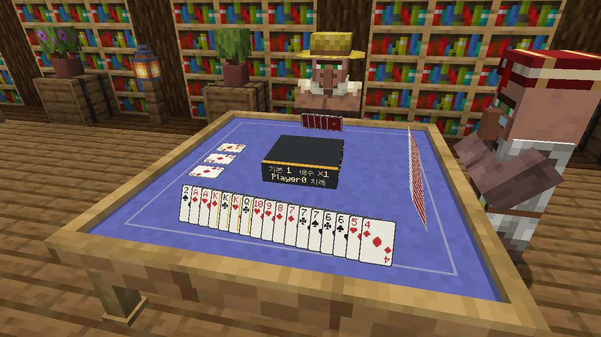</td>
    <td width="50%">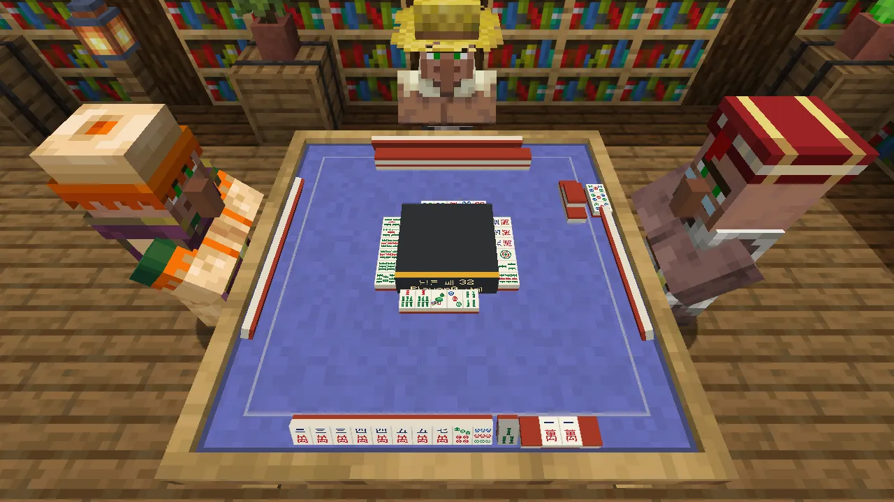</td>
  </tr>
  <tr>
    <td valign="top"><b>더우디주</b> · 3인 또는 4인<br>지주 한 명 대 농민들. 점수 입찰, 지주 빼앗기, 섞지 않은 덱으로 칠 수 있고, 카드 두 벌로 네 명이 치며 최대 여덟 장짜리 폭탄을 내는 규칙도 있습니다.</td>
    <td valign="top"><b>마작</b> · 4인<br>쓰촨 마작 혈전도저. 세 장을 넘기고, 버릴 색을 정하고, 누가 화료해도 세 명이 날 때까지 계속합니다. 패는 테이블 위에 서 있고 가운데에 패산이 쌓입니다.</td>
  </tr>
  <tr>
    <td>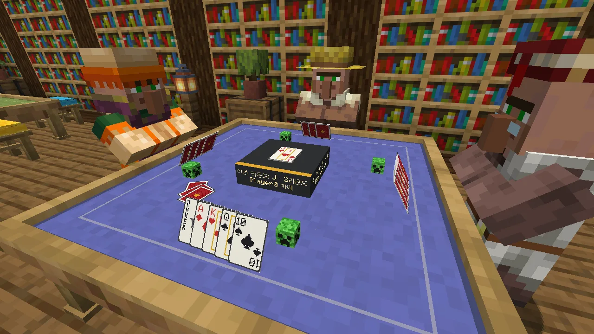</td>
    <td>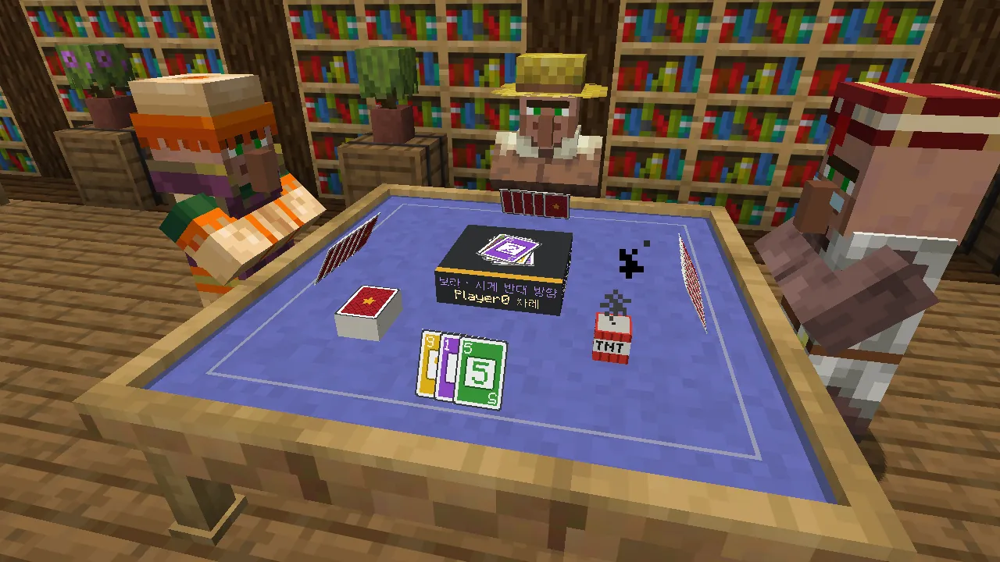</td>
  </tr>
  <tr>
    <td valign="top"><b>크리퍼 블러프</b> · 2~8인<br>Liar's Bar에서 리볼버 대신 크리퍼를 쓰는 게임. 카드를 엎어 내며 필요하면 거짓말을 하고, 아니면 앞사람의 거짓말을 밝혀냅니다. 틀린 쪽은 자기 크리퍼의 도화선에 불을 붙이고, 여섯 번에 한 번은 터집니다. 피해를 입을지는 방장이 정합니다.</td>
    <td valign="top"><b>투투 카드</b> · 2~8인<br>UNO와 비슷한 이 모드만의 게임으로, 특수 카드는 Minecraft에서 따왔습니다. 불붙은 TNT가 테이블에서 연기를 내뿜고, 누구 차례에 터질지는 아무도 모릅니다.</td>
  </tr>
  <tr>
    <td>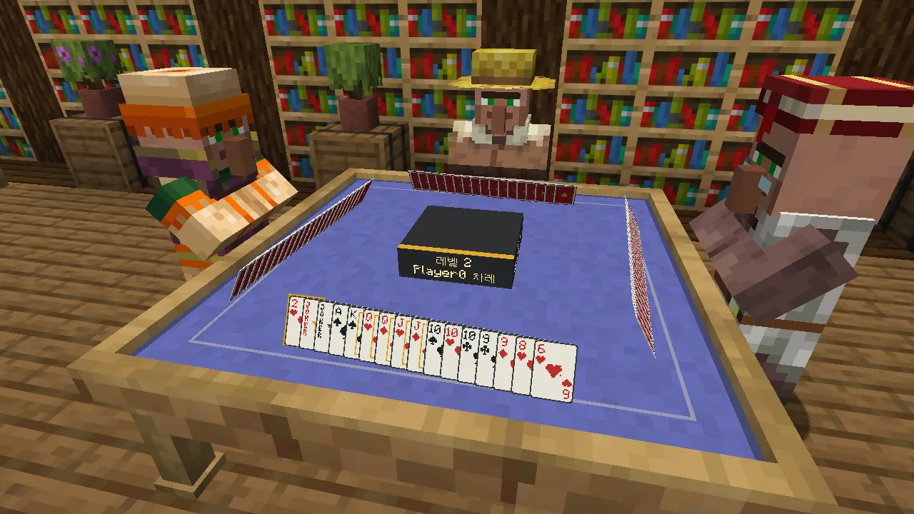</td>
    <td>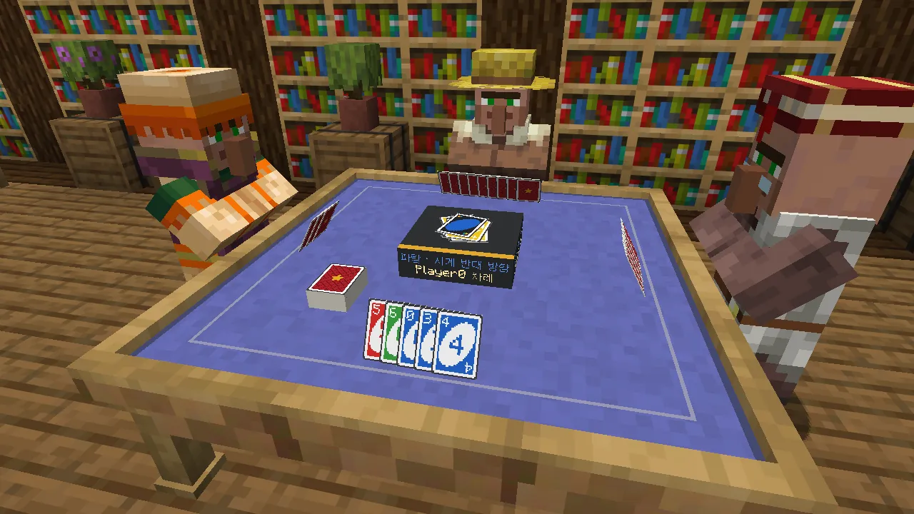</td>
  </tr>
  <tr>
    <td valign="top"><b>관단</b> · 4인<br>두 팀, 카드 두 벌, 와일드카드와 공물. 한 판만 치거나, A까지 올라가는 긴 게임을 칩니다.</td>
    <td valign="top"><b>UNO</b> · 2~4인<br>클래식 규칙, 또는 벌칙 카드를 다음 사람에게 쌓아 넘기는 규칙으로.</td>
  </tr>
  <tr>
    <td>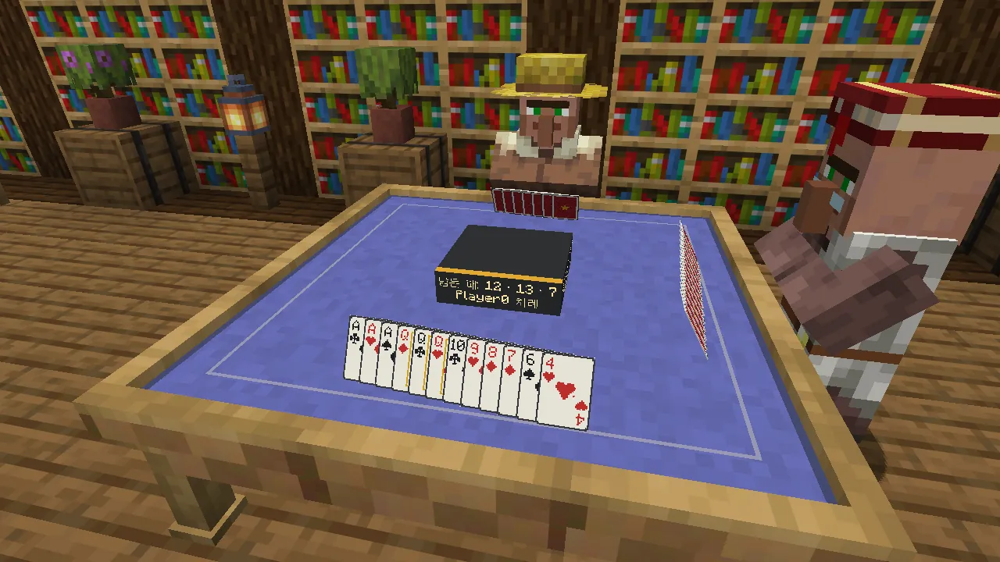</td>
    <td>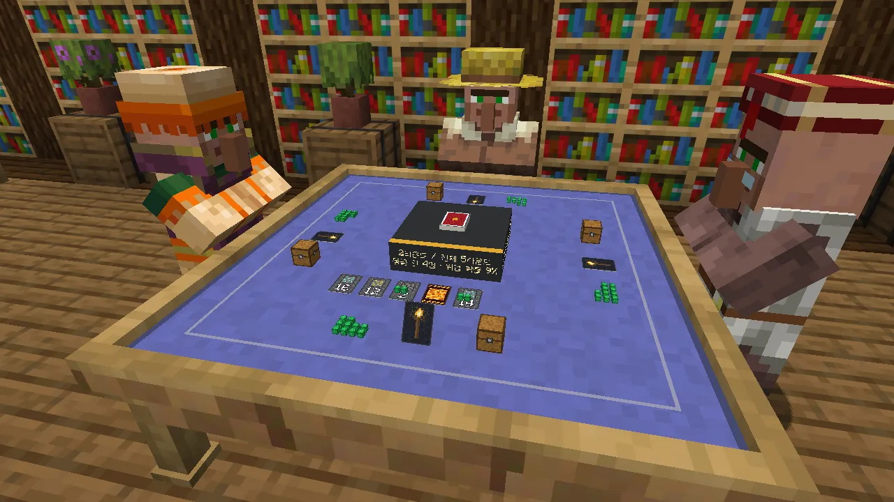</td>
  </tr>
  <tr>
    <td valign="top"><b>파오더콰이</b> · 3인<br>모두가 각자도생, 손패를 먼저 다 낸 사람이 이깁니다. 16장 또는 15장씩, 낼 수 있으면 꼭 내야 하는 규칙을 켜거나 끌 수 있습니다.</td>
    <td valign="top"><b>동굴 탐험</b> · 2~8인<br>모두 함께 동굴로 내려가고, 카드가 한 장 뒤집힐 때마다 안에 남은 사람끼리 광석의 에메랄드를 나눕니다. 한 장마다 모두가 서로 모르게 동시에, 더 깊이 들어갈지 캠프로 돌아가 에메랄드를 상자에 넣을지 고릅니다. 같은 위험이 두 번째로 나오면 동굴에 남은 사람은 가진 것을 모두 잃습니다.</td>
  </tr>
  <tr>
    <td>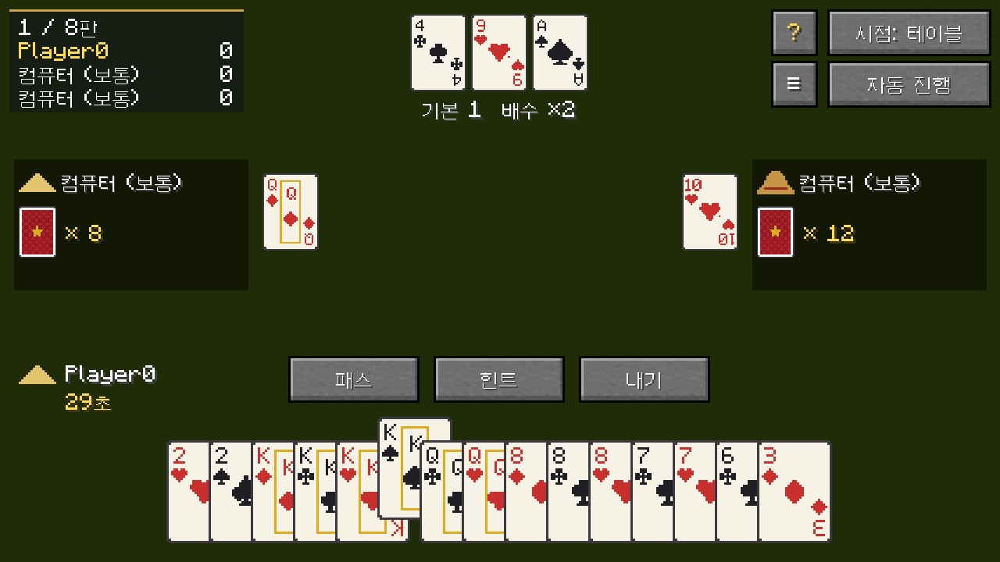</td>
    <td valign="middle"><b>바로 칠 수 있게</b><br>자리에 앉으면 손패, 점수, <b>힌트</b> 버튼이 보입니다. <b>?</b> 버튼의 규칙서는 모든 게임을 그림으로 설명합니다.</td>
  </tr>
</table>

## TuKuai에서 쳐야 하는 이유

- **카드가 정말 테이블 위에.** 손패는 주인을 향해 서 있고, 낸 카드는 가운데에 떨어지며, 지나가는 사람도 구경할 수 있습니다. 몰입 시점으로 바꾸면 테이블 위의 카드를 바로 골라 냅니다.
- **사람이 모자랄 일이 없습니다.** 빈자리에는 언제든 쉬움, 보통, 어려움 컴퓨터가 앉고, 자리를 비우거나 접속이 끊긴 사람 대신 칩니다. 모두 자리를 뜨면 돌아올 때까지 판이 기다립니다.
- **하룻밤 내내.** 한 경기는 여러 판의 점수를 합산하고, 모든 판은 어느 자리의 시점으로든 다시 볼 수 있으며, 테이블은 모두의 전적을 기록합니다.
- **방을 내 취향대로.** 테이블과 의자는 모든 종류의 나무로 만들 수 있고, 테이블보와 방석은 원하는 색으로 염색하며, 카드 뒷면과 앞면도 여러 가지입니다. 큰 테이블에는 8명까지 앉습니다.

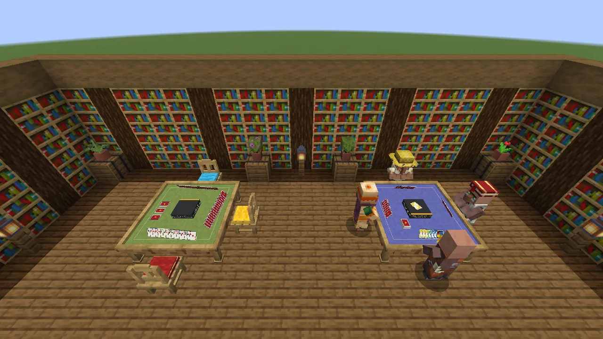

## 시작하기

### 다운로드

[Releases](https://github.com/Konyaco/TuKuai/releases/latest)에서 사용하는 Minecraft 버전과 로더에 맞는 jar(예: `tukuai-fabric-1.21.1-<버전>.jar`)를 받으세요. 서버와 모든 플레이어의 게임에 설치해야 합니다. Minecraft 26.3, 26.2, 26.1.2, 1.21.1을 지원하며, 다음 모드가 필요합니다.

| 로더 | 필수 모드 |
| --- | --- |
| NeoForge 26.1.2, 26.2, 26.3 | [Kotlin for Forge](https://modrinth.com/mod/kotlin-for-forge) 6.4.0 이상 |
| NeoForge 1.21.1 | [Kotlin for Forge](https://modrinth.com/mod/kotlin-for-forge) 5.12.0 이상 |
| Fabric | [Fabric API](https://modrinth.com/mod/fabric-api), [Fabric Language Kotlin](https://modrinth.com/mod/fabric-language-kotlin) 1.13.13 이상 |

1.21.1에는 창백한 참나무가 없어서, 창백한 참나무 카드 테이블과 의자는 26.1.2 이상에서만 쓸 수 있습니다.

### 조합법

<table>
  <tr>
    <td width="33%" align="center">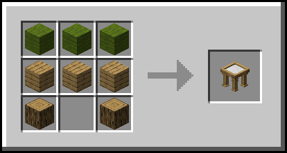<br><b>카드 테이블</b><br>양털 색은 자유입니다. 판자의 종류가 테이블의 나무를 정합니다.</td>
    <td width="33%" align="center">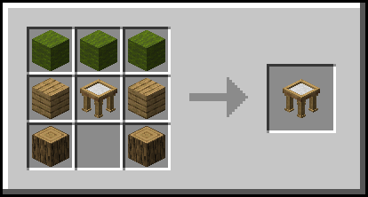<br><b>큰 카드 테이블</b><br>카드 테이블로 만듭니다. 최대 8명이 앉을 수 있습니다.</td>
    <td width="33%" align="center">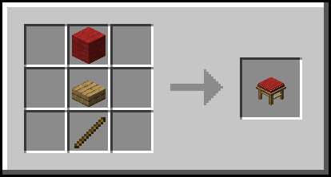<br><b>의자</b><br>양털이 방석 색을, 반 블록이 나무를 정합니다.</td>
  </tr>
</table>

크리에이티브 모드에서는 세 가지 모두 "기능 블록" 탭에 있습니다.

### 첫 게임

1. **카드 테이블 설치하기**. 3×3 블록 크기로, 클릭한 블록에서 앞쪽으로 펼쳐지므로 앞과 양옆에 공간을 비워 두세요.
2. **테이블을 우클릭**하고 "앉기"로 앉습니다. 빈자리는 "컴퓨터 추가"로 채울 수 있습니다.
3. **게임과 규칙을 고르고** "시작"을 누릅니다.

의자를 자리가 있는 변의 바깥쪽 가운데에 놓으면, 의자를 우클릭해 그 자리에 앉을 수 있습니다. 큰 카드 테이블은 5×5 블록이며, 한 변에 두 자리씩 최대 8명이 앉습니다.

영어, 중국어 간체, 중국어 번체, 일본어, 한국어를 지원하며 게임의 언어 설정을 따릅니다.

<details>
<summary><b>서버 설정</b></summary>

서버를 처음 켤 때(싱글플레이 월드를 열 때도) `config/tukuai-server.properties`가 만들어집니다. 수정한 뒤 `/reload`를 실행하거나 다시 시작하면 적용됩니다.

| 설정 | 기본값 | 동작 |
| --- | --- | --- |
| `allowBots` | `true` | 컴퓨터가 자리에 앉을 수 있는지 |
| `botDelaySeconds` | `1.1` | 컴퓨터가 카드를 내기 전 평균 대기 시간(초) |
| `saveReplays` | `true` | 다시 보기를 저장할지 |
| `maxReplays` | `500` | 보관할 다시 보기 수. 넘으면 오래된 것부터 삭제. `0`은 제한 없음 |
| `keepStats` | `true` | 전적을 기록할지 |

</details>

<details>
<summary><b>개발</b></summary>

JDK 25가 필요합니다. Minecraft 1.21.1에 쓰는 JDK 21은 Gradle이 알아서 받습니다.

```sh
./gradlew build                        # 컴파일, 테스트, 모든 로더와 Minecraft 버전의 jar 생성
./gradlew :mc26:fabric-26.3:runClient  # Fabric으로 Minecraft 26.3 실행
./gradlew :neoforge-1.21.1:runClient   # NeoForge로 Minecraft 1.21.1 실행
```

| 디렉터리 | 내용 |
| --- | --- |
| `engine` | 규칙, 컴퓨터, 다시 보기. Minecraft에 의존하지 않는 Kotlin 코드 |
| `common` | 모든 로더와 Minecraft 버전이 함께 쓰는 Minecraft 코드와 리소스. 최신 Minecraft에 맞춰 작성 |
| `mc26` | Minecraft 26.1.2, 26.2, 26.3을 묶은 하나의 [Stonecutter](https://stonecutter.kikugie.dev/) 프로젝트. `src`에 `compat` 패키지, 렌더러, 각 로더 진입점, 아이템 모델, 조합법이 있고 버전마다 다른 곳은 `//?` 주석으로 표시합니다. `versions/<로더>-<minecraft>/gradle.properties`에 각각의 버전 |
| `versions/1.21.1` | Minecraft 1.21.1: `gradle.properties`의 각 버전, 최신 Minecraft의 이름을 쓰게 해 주는 `compat` 패키지, 렌더러, 아이템 모델, 조합법 |
| `versions/1.21.1/fabric`, `versions/1.21.1/neoforge` | 1.21.1의 각 로더 진입점과 등록 |

새 게임 추가:

1. `engine`에서 `GameDefinition`을 구현하고 `TuKuai.init()`에서 `GameRegistry`에 등록합니다.
2. `common/.../client`에서 `GameUi`를 구현하고 `TuKuaiClient.init()`에서 `GameUis`에 등록합니다.
3. 모든 언어 파일에 `tukuai.game.<id>`와 각 규칙의 이름을 추가합니다.

테스트:

```sh
./gradlew :engine:test                           # 규칙과 컴퓨터의 단위 테스트
./gradlew :mc26:fabric-26.1.2:runClientGameTest  # 게임을 실행해 몇 판 진행하고 스크린샷을 찍음
./gradlew :mc26:fabric-26.1.2:runMultiplayerTest # 전용 서버와 클라이언트 두 개로 하는 멀티플레이 테스트
./gradlew :fabric-1.21.1:runSmokeTest            # Minecraft 1.21.1에서 게임마다 한 판씩 하고 스크린샷을 찍음
./gradlew :mc26:neoforge-26.3:runSmokeTest       # 같은 테스트를 26.x의 아무 버전과 로더에서 실행
TUKUAI_SHOWCASE=en_us,zh_cn ./gradlew :mc26:fabric-26.1.2:runClientGameTest   # 이 README의 스크린샷을 찍음
```

커밋 메시지는 `[type](scope) Title` 형식입니다. 의존성 버전은 `gradle.properties`와 `versions/<minecraft>/gradle.properties`에 있습니다.

</details>

## 라이선스

[MIT](LICENSE)
