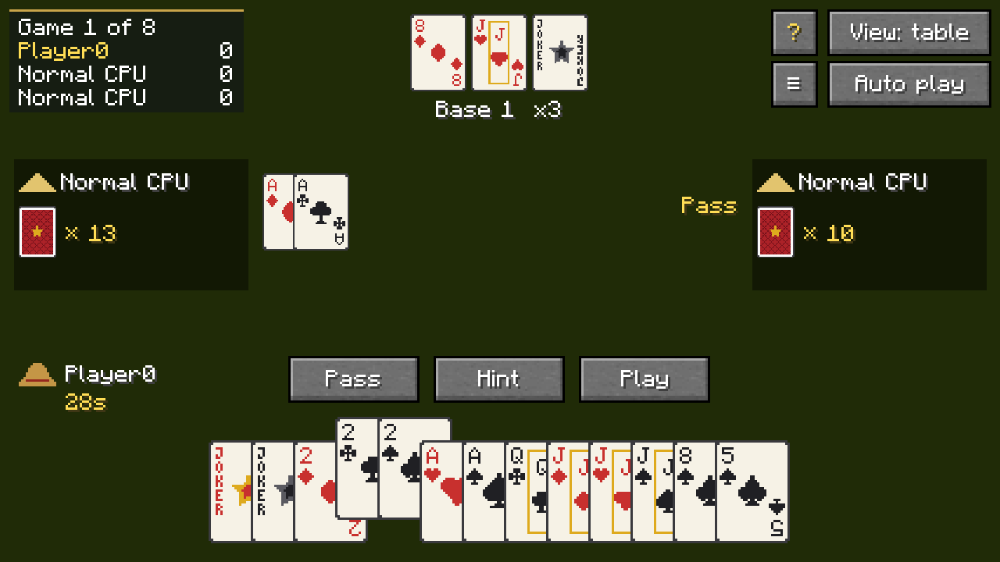
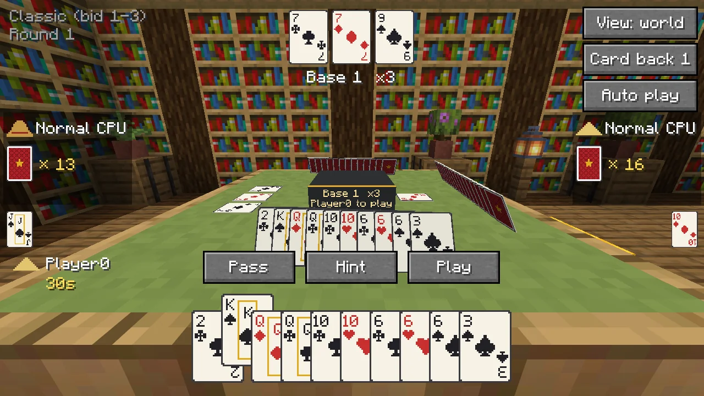
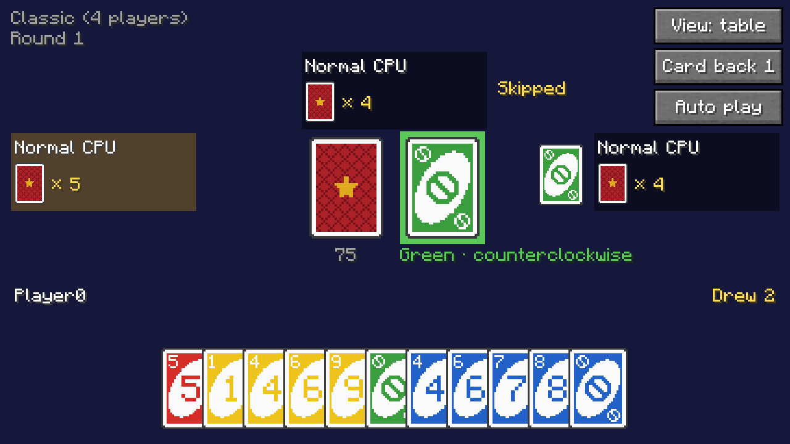
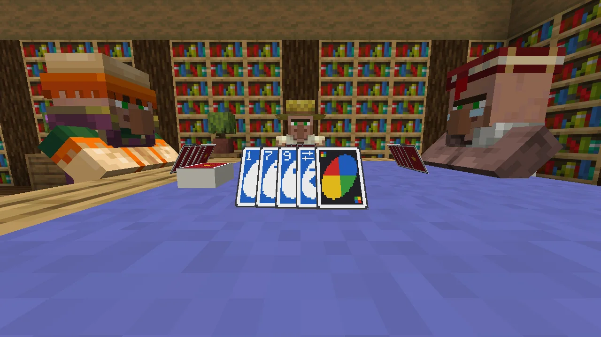
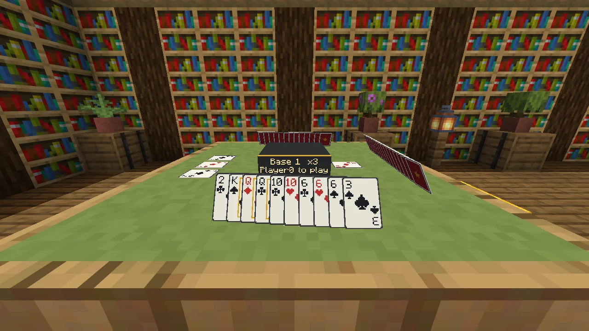
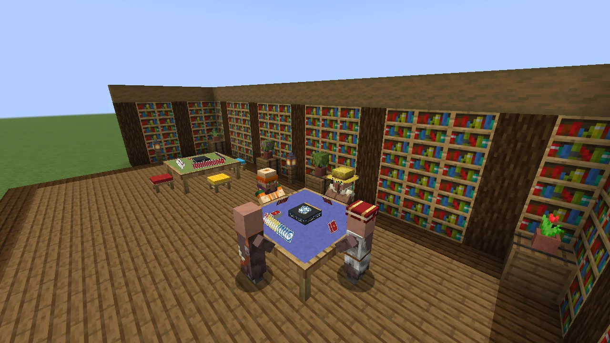
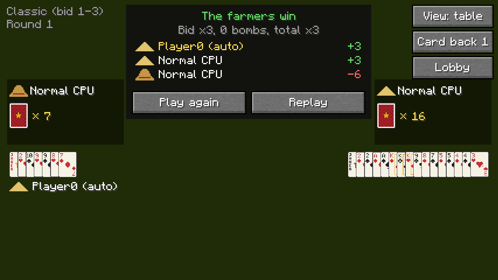
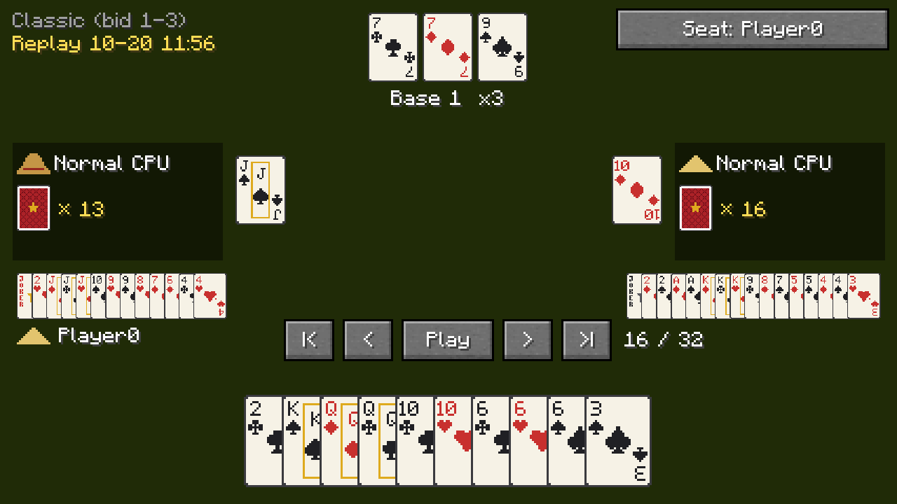
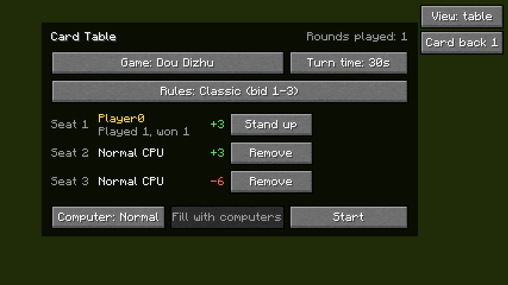

<p align="center"></p>

<p align="center">
  <b>English</b> · <a href="README.zh-CN.md">简体中文</a> · <a href="README.zh-TW.md">繁體中文</a> · <a href="README.ja.md">日本語</a> · <a href="README.ko.md">한국어</a>
</p>

<p align="center">
  A card table for Minecraft. Pull up a stool, deal in your friends or a few computer players, and play Dou Dizhu, UNO or Pao De Kuai without leaving your world.
</p>

<p align="center">
  <a href="https://github.com/Konyaco/TuKuai/actions/workflows/build.yml"></a>
  <a href="https://github.com/Konyaco/TuKuai/releases/latest"></a>
  
  
  <a href="LICENSE"></a>
</p>


TuKuai (土块棋牌室, "Dirt Block Parlor") adds a card table you can craft and place. Sit at it with other players, fill the empty seats with computers, and play. The cards are really on the table, so anyone walking past can watch. Dou Dizhu, UNO and Pao De Kuai for now, more games later.

It only uses in-game points. Nobody loses real money here, only their dignity.

## Download

Get the jar for your loader from [Releases](https://github.com/Konyaco/TuKuai/releases/latest). It needs Minecraft 26.1.2 and:

| Loader | Also install |
| --- | --- |
| NeoForge 26.1.2 | [Kotlin for Forge](https://modrinth.com/mod/kotlin-for-forge) 6.4.0 or newer |
| Fabric | [Fabric API](https://modrinth.com/mod/fabric-api) and [Fabric Language Kotlin](https://modrinth.com/mod/fabric-language-kotlin) 1.13.13 or newer |

## What's in it

### Dou Dizhu

The Chinese three-player game: one landlord against two farmers. Three rule sets: classic bidding (1 to 3 points), rob the landlord, and unshuffled, which deals noticeably more bombs.

<table>
  <tr>
    <td width="50%"></td>
    <td width="50%"></td>
  </tr>
  <tr>
    <td align="center">Table view: the whole screen is the table.</td>
    <td align="center">World view: the same game, with the room still around you. Tab switches.</td>
  </tr>
</table>

### UNO

Two to four players, with four rule sets: classic for 4, 3 or 2 players, and a 4-player version where draw cards stack (+2 on +2, +4 on either).

<table>
  <tr>
    <td width="50%"></td>
    <td width="50%"></td>
  </tr>
  <tr>
    <td align="center">Playable cards pop up; click one to play it.</td>
    <td align="center">Close the screen and you're still at the table.</td>
  </tr>
</table>

### Pao De Kuai

"Run fast": three players, each on their own, racing to empty their hand. Whoever holds the 3 of spades leads. Three rule sets: 16 cards each, 15 cards each, and 16 cards where you may always pass. In the other two, if you can beat the play, you have to.

When someone is down to one card, their box and the table show a red warning, and the player before them may only play a single if it's their highest card.

### Out in the world

The table takes up 3x3 blocks. Each hand stands on it facing its owner, so everyone else sees the backs, and the last cards played and the landlord's cards lie in the middle. The cards have a bit of thickness to them. Right-click the table with a dye to change the cloth, and pick a card back with the button in the top right of the screen. The small button beside it changes the card faces: classic, large corners that are easier to read in a squeezed hand, or four colors (diamonds blue, clubs green). Tables and stools come in every kind of wood, from oak to warped, and stool cushions in all 16 colors.

<table>
  <tr>
    <td width="50%"></td>
    <td width="50%"></td>
  </tr>
  <tr>
    <td align="center">Your own hand stands up facing you.</td>
    <td align="center">The villagers are only set dressing. The computer players are invisible, which is either polite or unsettling.</td>
  </tr>
</table>

### Computers, and people who wander off

Empty seats can take a computer: easy, normal or hard. Hard plays the hand out in its head many times before it commits to a card.

If someone walks away or drops out, a computer plays their turns so the game doesn't stall. Run out of time twice in a row and the computer takes over for you; click "Stop auto" to get your hand back.

### Replays and records

Every finished game is saved. Step through it, see everyone's cards, and watch it from any seat. The table also keeps a record for each player.

<table>
  <tr>
    <td width="33%"></td>
    <td width="33%"></td>
    <td width="33%"></td>
  </tr>
  <tr>
    <td align="center">End of the round</td>
    <td align="center">Replay, all cards showing</td>
    <td align="center">The lobby, with your record</td>
  </tr>
</table>

New to a game? The **?** button at the table opens a rule book, with pictures of every Dou Dizhu and Pao De Kuai pattern and every UNO action card, and a page on the rules of the table you're at.

It speaks English, Simplified Chinese, Traditional Chinese, Japanese and Korean, and follows your game language.

## How to play

1. **Craft a card table.** Top row: 3 wool of any color. Middle row: 3 planks of one kind of wood; the table's frame and legs come out in that wood. Bottom row: a log of any kind in each corner. In creative it's in the Functional Blocks tab.
2. **Place it and right-click it.** The table spreads out 3x3 from the block you clicked, so leave room in front and to both sides. Click "Sit here" to take a seat, "Add computer" on an empty seat, or "Fill with computers" for all of them.
3. **Pick a game.** "Game" switches between Dou Dizhu, UNO and Pao De Kuai. Choose the rules and the turn timer, then click "Start".

Tables placed by older versions (one block big) grow into 3x3 tables by themselves. If there isn't room, they drop as an item instead.

**Stools.** Craft one from a wool, a wooden slab and a stick, stacked top to bottom. The wool sets the cushion color, which you can re-dye later, and the slab sets the wood. Put a stool just outside the middle of a side that has a seat (three sides for Dou Dizhu and Pao De Kuai, all four for 4-player UNO), and right-clicking it sits you in that seat. A stool that isn't next to a table is still a perfectly good stool.

### Controls

Dou Dizhu:

| Input | Does |
| --- | --- |
| Left-click a card | Select or deselect it |
| Right-click | Clear the selection |
| Space / Enter | Play the selected cards; with nothing selected, pass |
| H | Hint. Press again for a different play |
| Tab | Switch between the table view and the world view |

UNO. Playable cards are raised; click one to play it. Wild cards ask for a color first.

| Input | Does |
| --- | --- |
| Left-click a card | Play it |
| Right-click | Back out of choosing a color |
| D | Draw (a penalty is drawn all at once) |
| Space / Enter | Keep the playable card you just drew |
| U | Call UNO with two cards left, then play. Forget and you draw 2 |
| Tab | Switch between the table view and the world view |

A few UNO simplifications: the first card turned up is always a number card. +4 can only be played when you have nothing of the current color, so there's no challenging it. UNO has to be called as you play your second-to-last card; miss it and the penalty is immediate. First to empty their hand wins, and everyone else pays what's left in theirs: face value for numbers, 20 for action cards, 50 for wilds.

Pao De Kuai:

| Input | Does |
| --- | --- |
| Left-click a card | Select or deselect it |
| Right-click | Clear the selection |
| Space / Enter | Play the selected cards; with nothing selected, pass, if you're allowed to |
| H | Hint. Press again for a different play |
| Tab | Switch between the table view and the world view |

When you can beat the play and have to, "Pass" is greyed out. The winner gets a point for every card left in the other hands, nothing for a hand down to one card, and double from someone who never played. A bomb that wins its round collects 10 from each other player.

### Replays

- When a round ends, click "Replay" in the result box.
- `/tukuai replays` lists recent games; click a name to watch it. `/tukuai replay <name>` opens one by name.
- In a replay: Space pauses and resumes, Left and Right step back and forward, Home and End jump to the start and the end, Tab changes whose seat you watch from.

Replays are saved in `tukuai/replays` inside the world folder.

### Records

- `/tukuai stats` shows how many games you've played and won, and your points. `/tukuai stats <player>` shows someone else's.
- `/tukuai top` shows the ten players with the most points.

Records are kept in `tukuai/stats.json` inside the world folder. Only people count; the computers don't get a record.

## Server settings

The first time a server starts (or a single-player world opens), the mod writes `config/tukuai-server.properties`. Change it, then `/reload` or restart:

| Setting | Default | What it does |
| --- | --- | --- |
| `allowBots` | `true` | Whether computers may take seats |
| `botDelaySeconds` | `1.1` | Roughly how many seconds a computer waits before it plays |
| `saveReplays` | `true` | Whether finished games are saved |
| `maxReplays` | `500` | How many replays to keep; the oldest go first. `0` keeps them all |
| `keepStats` | `true` | Whether to keep player records |

## For developers

<details>
<summary>Building, code layout, adding a game, tests</summary>

### Building

You need JDK 25. From the repository root:

```sh
./gradlew build                 # compile, test, and build the jars for both loaders
./gradlew :engine:test          # only the rules engine's unit tests
./gradlew :fabric:runClient     # start the game with Fabric
./gradlew :neoforge:runClient   # start the game with NeoForge
```

The jars end up in `fabric/build/libs` and `neoforge/build/libs`.

### Code layout

| Directory | What's in it |
| --- | --- |
| `engine` | Rules, computer players and replays. Plain Kotlin with no Minecraft in it, so it can be unit tested on its own |
| `common` | Minecraft code and resources shared by both loaders: blocks, networking, screens, rendering, textures, language files |
| `fabric`, `neoforge` | Each loader's entry point, registration and event glue. The thinner the better |

Each loader compiles `engine` and `common` into its own jar, so there is one jar per loader.
Nothing in `engine` may reference `net.minecraft`. Mixins, when there are any, go in `common/src/main/java` and are written in Java.

### Adding a game

1. In `engine`, implement `GameDefinition` (rules, dealing, moves, what each seat can see, the computer player) and register it with `GameRegistry` in `TuKuai.init()`.
2. In `common/.../client`, implement `GameUi` (how the screen is drawn and which cards go on the table) and register it with `GameUis` in `TuKuaiClient.init()`.
3. Add `tukuai.game.<id>` and the name of each rule set to every language file. CI checks that every language file has the same keys as `en_us.json`.

Tables, seats, computers filling in, turn timers, syncing, saving and replays are shared, so a new game gets them for free.

### Tests

- `./gradlew :engine:test` runs the rules and computer tests, including one that checks the hard computer really does win more than the normal one on the same deals.
- `./gradlew :fabric:runClientGameTest` opens the real game and plays a round: sits down, adds computers, lets them finish, watches the replay, and takes a screenshot at each step. CI runs it under xvfb and prints the screenshots into the log as base64.
- `TUKUAI_SHOWCASE=en_us,zh_cn ./gradlew :fabric:runClientGameTest` takes the screenshots in this README instead, once for each language listed. They land in `fabric/build/run/clientGameTest/screenshots`. The ones used here are converted to WebP and kept in `docs/images`.
- `./gradlew :fabric:runMultiplayerTest` starts a dedicated server and two game windows, each a separate player, and has them play two rounds of Dou Dizhu at one table with a computer, over the network. Partway through, each player in turn drops off and comes back to their seat.

Commit messages look like `[type](scope) Title`, for example `[feat](engine) Add Dou Dizhu hand types`.

Dependency versions are all in `gradle.properties`. `kotlin_version` must not be newer than the Kotlin bundled with Kotlin for Forge and Fabric Language Kotlin.

</details>

## License

[MIT](LICENSE)
