<p align="center">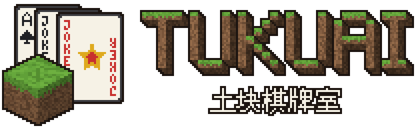</p>

<p align="center">
  <b>English</b> · <a href="README.zh-CN.md">简体中文</a> · <a href="README.zh-TW.md">繁體中文</a> · <a href="README.ja.md">日本語</a> · <a href="README.ko.md">한국어</a>
</p>

<p align="center">
  <a href="https://github.com/Konyaco/TuKuai/actions/workflows/build.yml"></a>
  <a href="https://github.com/Konyaco/TuKuai/releases/latest"></a>
  
  
  <a href="LICENSE"></a>
</p>
<h3 align="center">A card table for your Minecraft world.<br>Pull up a stool and play Dou Dizhu, mahjong, UNO and more with friends, or with computers when they are not around.</h3>

<p align="center">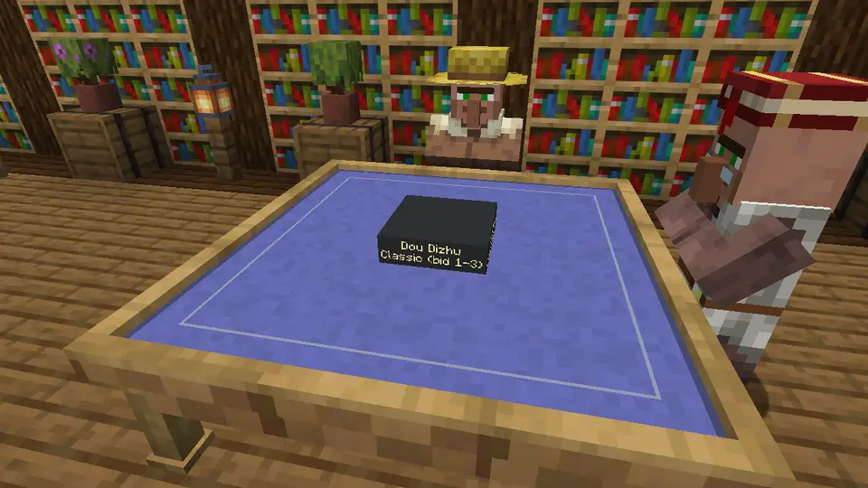</p>

<p align="center"><b>7 games</b> · <b>2 to 8 players</b> · <b>computers for any empty seat</b> · <b>replays of every game</b> · <b>Fabric and NeoForge</b></p>

## The games

<table>
  <tr>
    <td width="50%">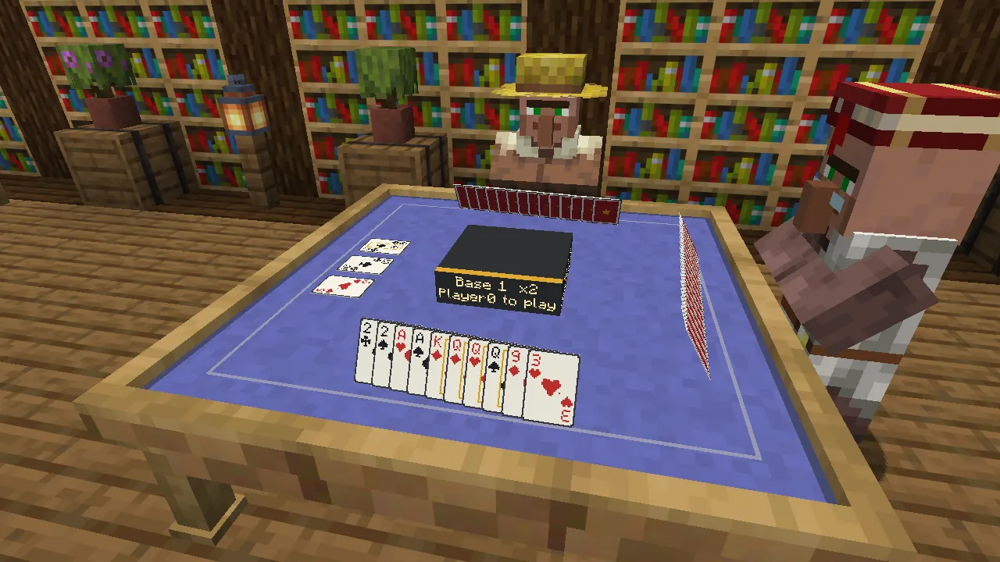</td>
    <td width="50%">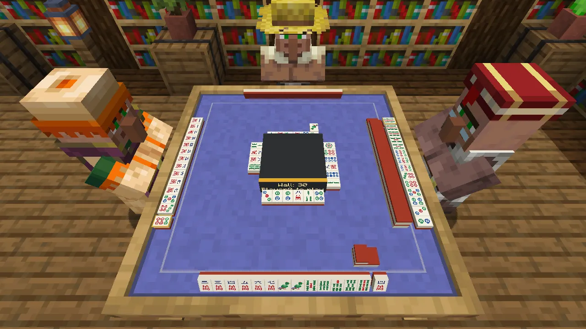</td>
  </tr>
  <tr>
    <td valign="top"><b>Dou Dizhu</b> · 3 or 4 players<br>One landlord against the farmers. Bid or rob for the landlord, play an unshuffled deck, or play four with two decks and bombs of up to eight cards.</td>
    <td valign="top"><b>Mahjong</b> · 4 players<br>Sichuan rules, played as a blood battle: pass three tiles on, drop a suit, and play on after a win until three players are out. The tiles stand on the table around the wall.</td>
  </tr>
  <tr>
    <td>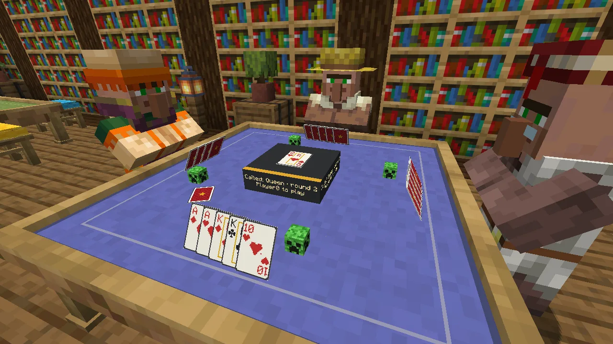</td>
    <td>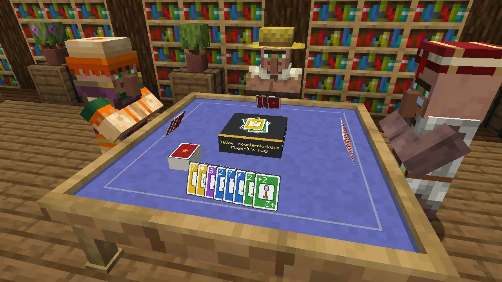</td>
  </tr>
  <tr>
    <td valign="top"><b>Creeper Bluff</b> · 2 to 8 players<br>Like Liar's Bar, with a creeper instead of a revolver. Lay your cards face down and lie if you must, or call out the last player; whoever is wrong lights their creeper's fuse, and one lighting in six blows. The host decides whether it hurts.</td>
    <td valign="top"><b>Tutu Cards</b> · 2 to 8 players<br>Our own game in the spirit of UNO, with cards from Minecraft. A lit TNT smokes on the table, and nobody knows on whose turn it goes off.</td>
  </tr>
  <tr>
    <td>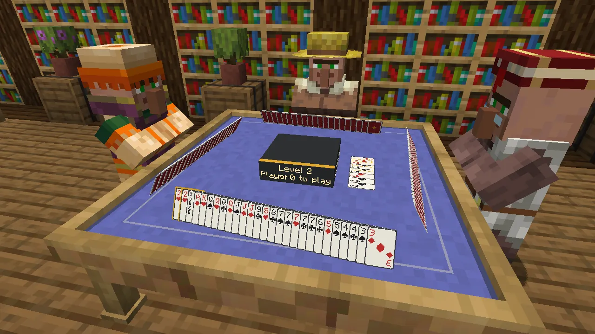</td>
    <td>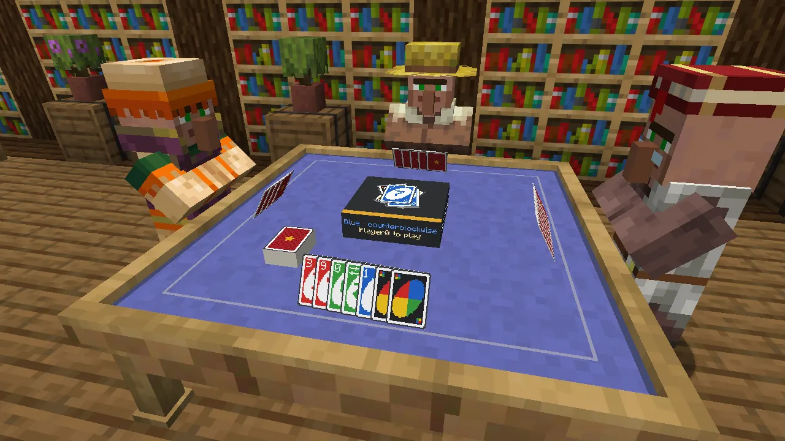</td>
  </tr>
  <tr>
    <td valign="top"><b>Guandan</b> · 4 players<br>Two teams, two decks, wild cards and tribute. Play one round, or climb all the way to Ace.</td>
    <td valign="top"><b>UNO</b> · 2 to 4 players<br>Classic rules, or let the penalty cards stack up on the next player.</td>
  </tr>
  <tr>
    <td>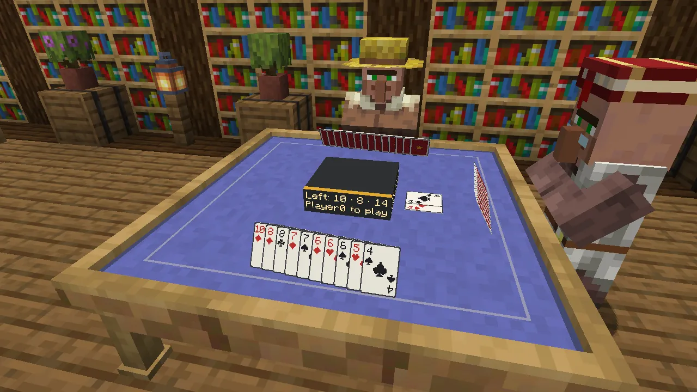</td>
    <td>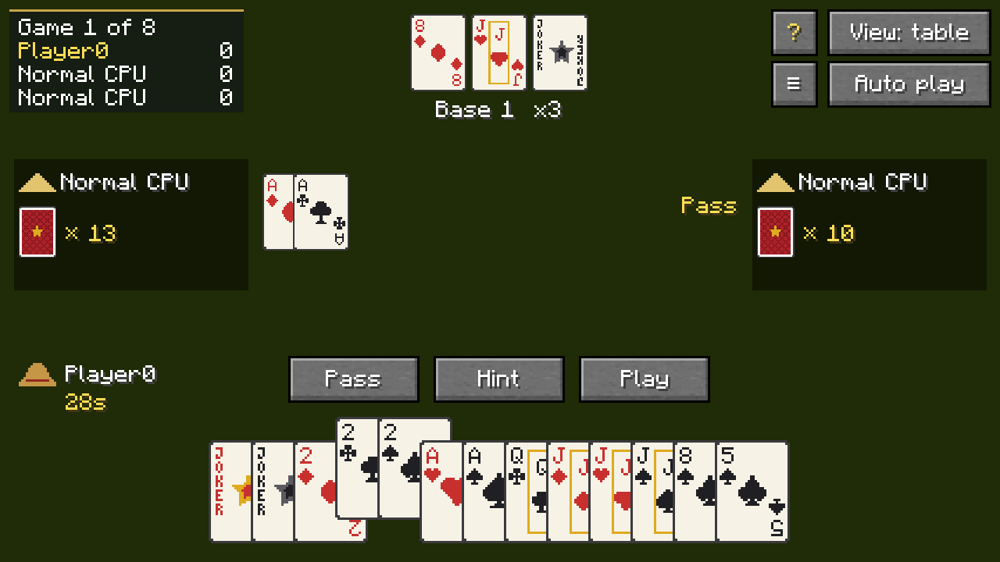</td>
  </tr>
  <tr>
    <td valign="top"><b>Pao De Kuai</b> · 3 players<br>Every player for themselves, and the first to empty their hand wins. 16 or 15 cards each, with or without having to beat.</td>
    <td valign="top"><b>Easy to pick up</b><br>Sit down and the table screen shows your hand, the scores and a <b>Hint</b> button. The rule book behind the <b>?</b> button explains every game with pictures.</td>
  </tr>
</table>

## Why play at TuKuai

- **The cards are really on the table.** Hands stand up facing their players, played cards land in the middle, and anyone walking by can watch. Switch to the immersive view to pick and play your cards straight off the table.
- **Never short of players.** Computers take any empty seat at easy, normal or hard, and play on for anyone who leaves or disconnects. If everyone walks away, the game waits for them.
- **Settle in for the evening.** A match keeps the scores over several games, every game is saved to replay from any seat, and each table keeps everyone's record.
- **Make the room your own.** Tables and stools come in every kind of wood, the cloth and cushions take any dye, and there are several card backs and faces. The big table seats eight.

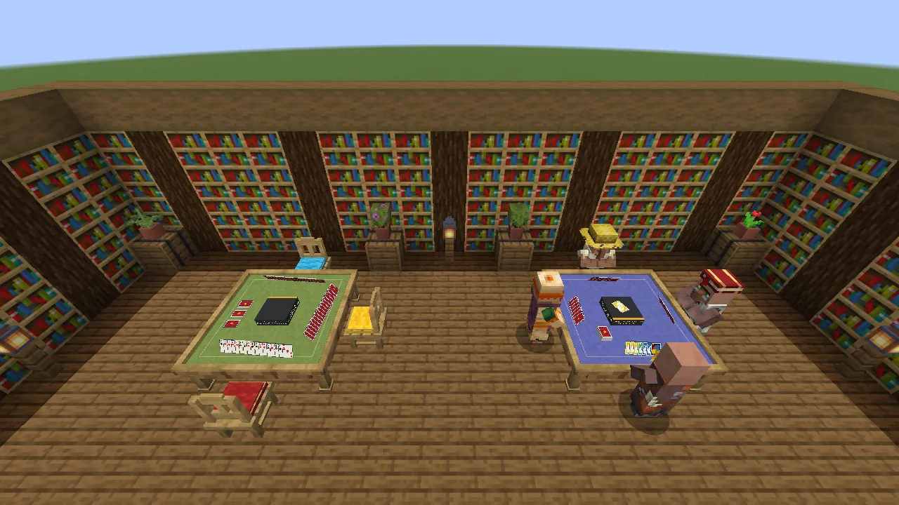

## Getting started

### Download

Get the jar for your Minecraft version and loader from [Releases](https://github.com/Konyaco/TuKuai/releases/latest), such as `tukuai-fabric-1.21.1-<version>.jar`. Install it on the server and on every player's game. It runs on Minecraft 26.3, 26.2, 26.1.2 and 1.21.1, and needs:

| Loader | Also install |
| --- | --- |
| NeoForge 26.1.2, 26.2, 26.3 | [Kotlin for Forge](https://modrinth.com/mod/kotlin-for-forge) 6.4.0 or newer |
| NeoForge 1.21.1 | [Kotlin for Forge](https://modrinth.com/mod/kotlin-for-forge) 5.12.0 or newer |
| Fabric | [Fabric API](https://modrinth.com/mod/fabric-api) and [Fabric Language Kotlin](https://modrinth.com/mod/fabric-language-kotlin) 1.13.13 or newer |

Pale oak tables and stools need 26.1.2 or newer, since 1.21.1 has no pale oak.

### Crafting

<table>
  <tr>
    <td width="33%" align="center">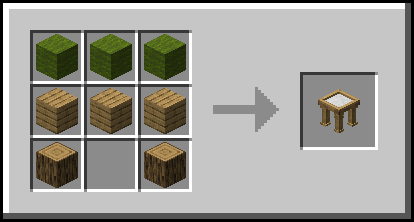<br><b>Card table</b><br>Wool of any color. The planks set the wood of the table.</td>
    <td width="33%" align="center">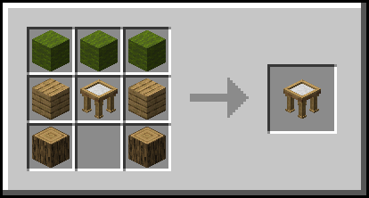<br><b>Big card table</b><br>Made from a card table. Seats up to eight.</td>
    <td width="33%" align="center">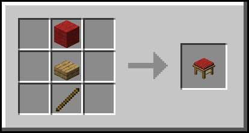<br><b>Stool</b><br>The wool sets the cushion color, the slab sets the wood.</td>
  </tr>
</table>

In creative mode, all three are in the Functional Blocks tab.

### First game

1. **Place a card table.** It takes 3×3 blocks and spreads out from the block you click, so leave room in front and to both sides.
2. **Right-click it**, click "Sit here", and click "Add computer" on any empty seat.
3. **Choose a game and its rules**, then click "Start".

Place a stool just outside the middle of a side with a seat, and right-click it to sit there. The big card table takes 5×5 blocks and seats two to a side, up to eight.

The mod is available in English, Simplified Chinese, Traditional Chinese, Japanese and Korean, and follows your game language.

<details>
<summary><b>Server settings</b></summary>

The first time a server starts (or a single-player world opens), the mod writes `config/tukuai-server.properties`. Change it, then run `/reload` or restart.

| Setting | Default | What it does |
| --- | --- | --- |
| `allowBots` | `true` | Whether computers may take seats |
| `botDelaySeconds` | `1.1` | Average seconds a computer waits before it plays |
| `saveReplays` | `true` | Whether games are saved for replay |
| `maxReplays` | `500` | How many replays to keep, oldest removed first; `0` for no limit |
| `keepStats` | `true` | Whether to keep player records |

</details>

<details>
<summary><b>Development</b></summary>

Requires JDK 25; Gradle fetches JDK 21 for Minecraft 1.21.1 itself.

```sh
./gradlew build                        # compile, test, and build the jars for every loader and Minecraft version
./gradlew :mc26:fabric-26.3:runClient  # start Minecraft 26.3 with Fabric
./gradlew :neoforge-1.21.1:runClient   # start Minecraft 1.21.1 with NeoForge
```

| Directory | Contents |
| --- | --- |
| `engine` | Rules, computer players and replays, in plain Kotlin without Minecraft |
| `common` | Minecraft code and resources shared by every loader and Minecraft version, written for the newest Minecraft |
| `mc26` | Minecraft 26.1.2, 26.2 and 26.3 as one [Stonecutter](https://stonecutter.kikugie.dev/) project: `src` has the `compat` package, renderers, each loader's entry point, item models and recipes, with `//?` comments where the versions differ; `versions/<loader>-<minecraft>/gradle.properties` has each one's versions |
| `versions/1.21.1` | Minecraft 1.21.1: its versions in `gradle.properties`, the `compat` package that gives it the newest Minecraft's names, renderers, item models and recipes |
| `versions/1.21.1/fabric`, `versions/1.21.1/neoforge` | Each loader's entry point and registration for 1.21.1 |

Adding a game:

1. In `engine`, implement `GameDefinition` and register it with `GameRegistry` in `TuKuai.init()`.
2. In `common/.../client`, implement `GameUi` and register it with `GameUis` in `TuKuaiClient.init()`.
3. Add `tukuai.game.<id>` and the name of each rule set to every language file.

Tests:

```sh
./gradlew :engine:test                           # unit tests for the rules and computer players
./gradlew :mc26:fabric-26.1.2:runClientGameTest  # starts the game, plays a few rounds and takes screenshots
./gradlew :mc26:fabric-26.1.2:runMultiplayerTest # a dedicated server with two clients
./gradlew :fabric-1.21.1:runSmokeTest            # plays each game once on Minecraft 1.21.1 and takes screenshots
./gradlew :mc26:neoforge-26.3:runSmokeTest       # the same on any 26.x version and loader
TUKUAI_SHOWCASE=en_us,zh_cn ./gradlew :mc26:fabric-26.1.2:runClientGameTest   # takes the screenshots in this README
```

Commit messages follow `[type](scope) Title`. Dependency versions are in `gradle.properties` and `versions/<minecraft>/gradle.properties`.

</details>

## License

[MIT](LICENSE)
