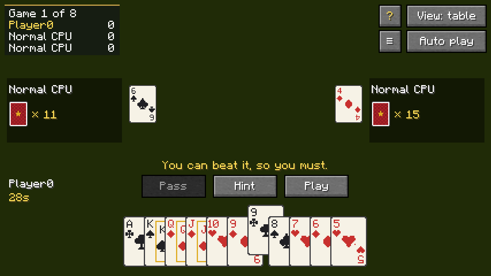
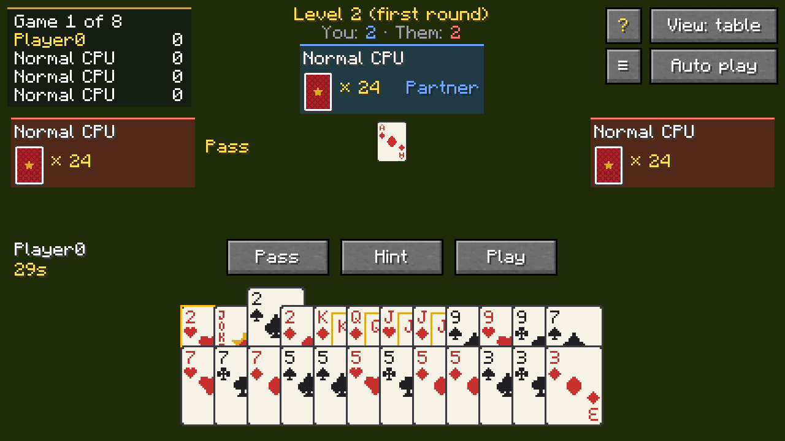
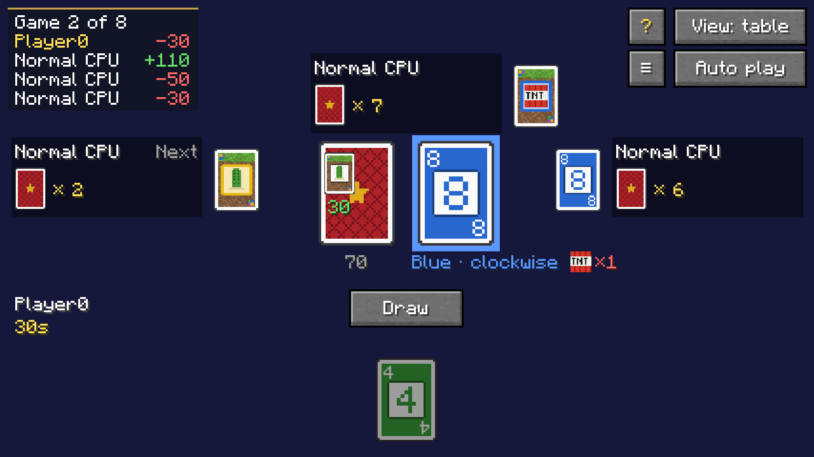

<p align="center"></p>

<p align="center">
  <b>English</b> · <a href="README.zh-CN.md">简体中文</a> · <a href="README.zh-TW.md">繁體中文</a> · <a href="README.ja.md">日本語</a> · <a href="README.ko.md">한국어</a>
</p>

<p align="center">
  <a href="https://github.com/Konyaco/TuKuai/actions/workflows/build.yml"></a>
  <a href="https://github.com/Konyaco/TuKuai/releases/latest"></a>
  
  
  <a href="LICENSE"></a>
</p>

TuKuai adds a card table to Minecraft that you can craft and place, and play cards at with friends or computer players.


## Features

- **A real table in the world**: the cards lie on the table itself. Each hand stands up facing its owner, played cards go to the middle, and anyone nearby can watch.
- **Multiplayer, with computers**: computers can fill empty seats at three levels, easy, normal and hard, and take over for players who leave or disconnect. If every player has left, the game pauses until someone sits down to play on or end the match.
- **Replays and records**: every game is saved and can be replayed from any seat. The table keeps a record for each player.
- **Custom looks**: tables and stools come in every kind of wood, the cloth and cushions can be dyed, and there are several card backs and card faces.
- **Immersive view**: the screen stays clear of the world, and you pick and play cards straight from the table.

## Games

<table>
  <tr>
    <td width="55%"></td>
    <td><b>Dou Dizhu</b><br>Three players: one landlord against two farmers. Rule sets: classic bidding, rob the landlord, and unshuffled; or four players with two decks, one landlord against three farmers, with bombs of up to eight cards.</td>
  </tr>
  <tr>
    <td></td>
    <td><b>UNO</b><br>Two to four players. Classic rules, or rules that let penalty cards stack.</td>
  </tr>
  <tr>
    <td></td>
    <td><b>Pao De Kuai</b><br>Three players, each for themselves; the first to play out their hand wins. 16 or 15 cards each, with or without a must-beat rule.</td>
  </tr>
  <tr>
    <td></td>
    <td><b>Guandan</b><br>Four players in two teams, with two decks. Play a single round, or a long game up to Ace.</td>
  </tr>
  <tr>
    <td></td>
    <td><b>Tutu Cards</b><br>An original game in the spirit of UNO, with special cards taken from Minecraft, such as TNT that smokes on the table. Two to eight players; six and eight need a big card table.</td>
  </tr>
</table>

The rules of each game are in the rule book in the game: click the **?** button at the table.

## Getting started

### Download

Get the jar for your Minecraft version and loader from [Releases](https://github.com/Konyaco/TuKuai/releases/latest), such as `tukuai-fabric-1.21.1-<version>.jar`. It runs on Minecraft 26.1.2 and 1.21.1, and needs:

| Loader | Also install |
| --- | --- |
| NeoForge 26.1.2 | [Kotlin for Forge](https://modrinth.com/mod/kotlin-for-forge) 6.4.0 or newer |
| NeoForge 1.21.1 | [Kotlin for Forge](https://modrinth.com/mod/kotlin-for-forge) 5.12.0 or newer |
| Fabric | [Fabric API](https://modrinth.com/mod/fabric-api) and [Fabric Language Kotlin](https://modrinth.com/mod/fabric-language-kotlin) 1.13.13 or newer |

Pale oak tables and stools need 26.1.2, since 1.21.1 has no pale oak.

### Crafting

<table>
  <tr>
    <td width="33%" align="center"><br><b>Card table</b><br>Wool of any color. The planks set the wood of the table.</td>
    <td width="33%" align="center"><br><b>Big card table</b><br>Made from a card table. Seats up to eight.</td>
    <td width="33%" align="center"><br><b>Stool</b><br>The wool sets the cushion color, the slab sets the wood.</td>
  </tr>
</table>

In creative mode, all three are in the Functional Blocks tab.

### First game

1. **Place a card table.** It takes 3×3 blocks and spreads out from the block you click, so leave room in front and to both sides.
2. **Right-click it**, click "Sit here", and click "Add computer" on any empty seat.
3. **Choose a game and its rules**, then click "Start".

Place a stool just outside the middle of a side with a seat, and right-click it to sit there. The big card table takes 5×5 blocks and seats two to a side, up to eight.

The mod is available in English, Simplified Chinese, Traditional Chinese, Japanese and Korean, and follows your game language.

<details>
<summary><b>Server settings</b></summary>

The first time a server starts (or a single-player world opens), the mod writes `config/tukuai-server.properties`. Change it, then run `/reload` or restart.

| Setting | Default | What it does |
| --- | --- | --- |
| `allowBots` | `true` | Whether computers may take seats |
| `botDelaySeconds` | `1.1` | Average seconds a computer waits before it plays |
| `saveReplays` | `true` | Whether games are saved for replay |
| `maxReplays` | `500` | How many replays to keep, oldest removed first; `0` for no limit |
| `keepStats` | `true` | Whether to keep player records |

</details>

<details>
<summary><b>Development</b></summary>

Requires JDK 25; Gradle fetches JDK 21 for Minecraft 1.21.1 itself.

```sh
./gradlew build                        # compile, test, and build the jars for every loader and Minecraft version
./gradlew :fabric-26.1.2:runClient     # start Minecraft 26.1.2 with Fabric
./gradlew :neoforge-1.21.1:runClient   # start Minecraft 1.21.1 with NeoForge
```

| Directory | Contents |
| --- | --- |
| `engine` | Rules, computer players and replays, in plain Kotlin without Minecraft |
| `common` | Minecraft code and resources shared by every loader and Minecraft version, written for the newest Minecraft |
| `versions/<minecraft>` | What differs for one Minecraft version: its versions in `gradle.properties`, the `compat` package that gives older versions the newest Minecraft's names, renderers, item models and recipes |
| `versions/<minecraft>/fabric`, `versions/<minecraft>/neoforge` | Each loader's entry point and registration for that version |

Adding a game:

1. In `engine`, implement `GameDefinition` and register it with `GameRegistry` in `TuKuai.init()`.
2. In `common/.../client`, implement `GameUi` and register it with `GameUis` in `TuKuaiClient.init()`.
3. Add `tukuai.game.<id>` and the name of each rule set to every language file.

Tests:

```sh
./gradlew :engine:test                         # unit tests for the rules and computer players
./gradlew :fabric-26.1.2:runClientGameTest     # starts the game, plays a few rounds and takes screenshots
./gradlew :fabric-26.1.2:runMultiplayerTest    # a dedicated server with two clients
./gradlew :fabric-1.21.1:runSmokeTest          # plays each game once on Minecraft 1.21.1 and takes screenshots
TUKUAI_SHOWCASE=en_us,zh_cn ./gradlew :fabric-26.1.2:runClientGameTest   # takes the screenshots in this README
```

Commit messages follow `[type](scope) Title`. Dependency versions are in `gradle.properties` and `versions/<minecraft>/gradle.properties`.

</details>

## License

[MIT](LICENSE)
