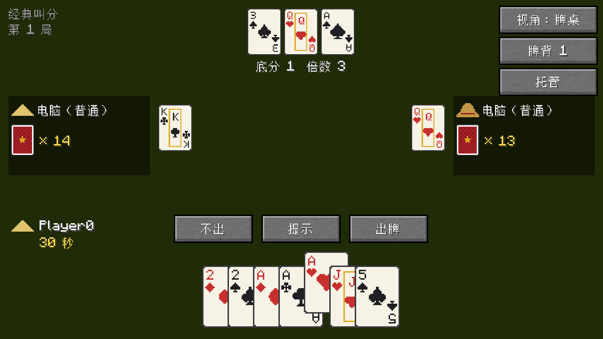
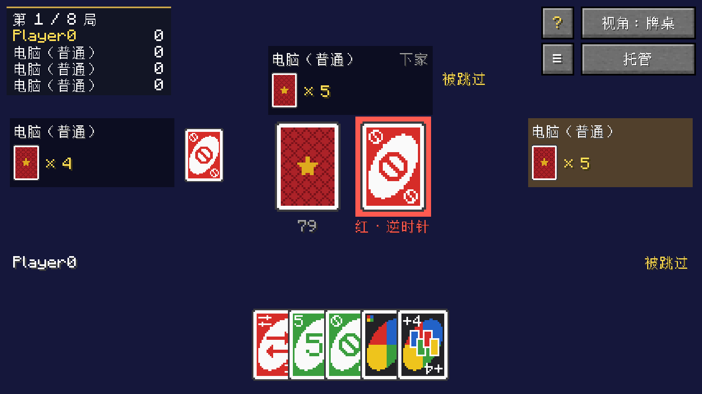
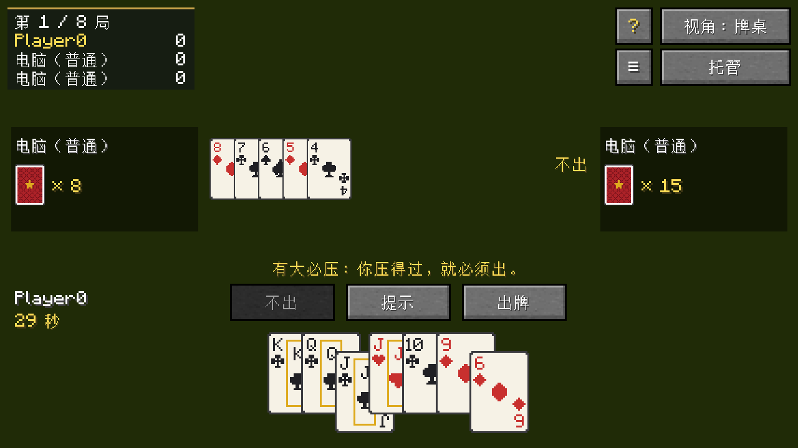
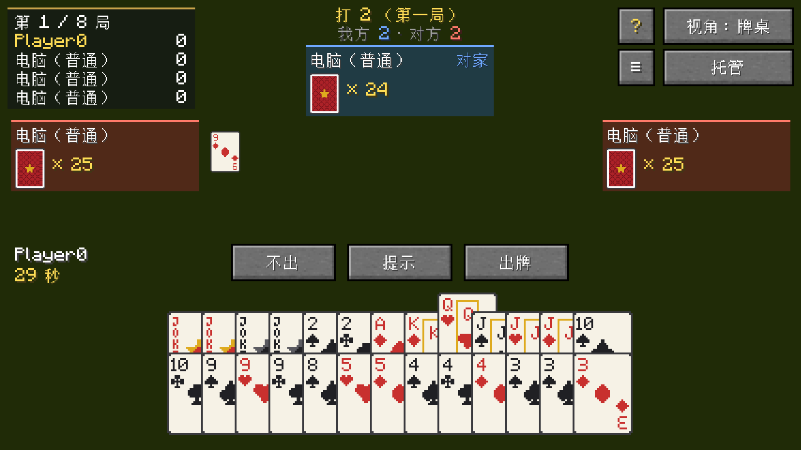
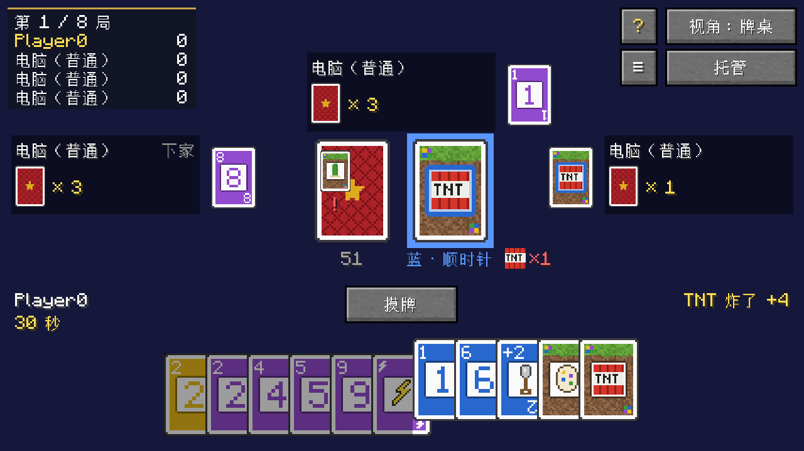
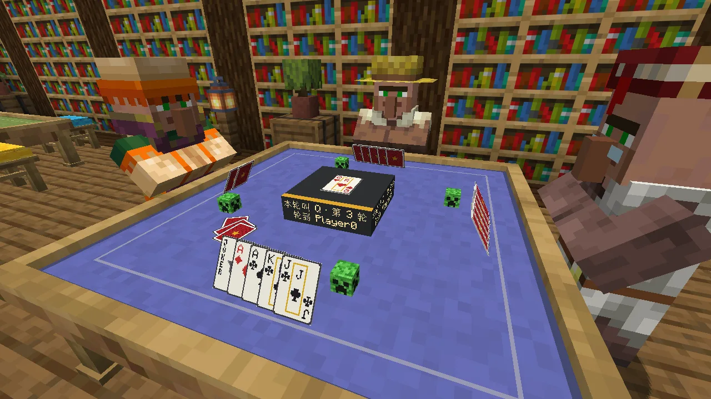
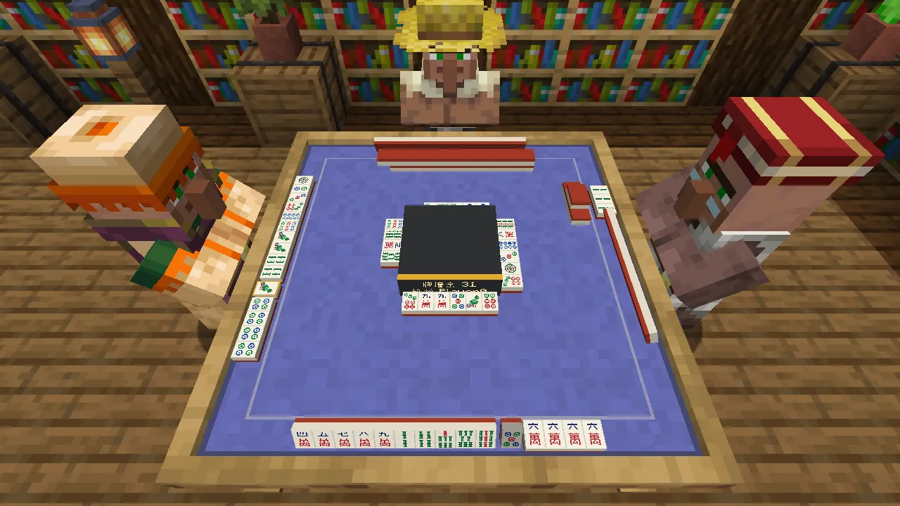

<p align="center"></p>

<p align="center">
  <a href="README.md">English</a> · <b>简体中文</b> · <a href="README.zh-TW.md">繁體中文</a> · <a href="README.ja.md">日本語</a> · <a href="README.ko.md">한국어</a>
</p>

<p align="center">
  <a href="https://github.com/Konyaco/TuKuai/actions/workflows/build.yml"></a>
  <a href="https://github.com/Konyaco/TuKuai/releases/latest"></a>
  
  
  <a href="LICENSE"></a>
</p>

土块棋牌室在 Minecraft 中加入可以合成和摆放的牌桌，供玩家与朋友或电脑一同打牌。


## 特色

- **立体牌桌**：牌摆在世界中的桌面上。手牌立起朝向自己，出过的牌放在桌子中央，旁人也能看到。
- **多人联机与电脑补位**：空位可由电脑补上，分简单、普通、困难三档；玩家离开或掉线时由电脑代打；在打的人全都离座时对局暂停，等有人坐上桌接着打或结束对局。
- **回放与战绩**：每局自动保存回放，可从任意座位的视角重看；牌桌记录每位玩家的战绩。
- **外观定制**：牌桌和凳子有多种木材可选，桌布和坐垫可以染色，牌背和牌面有多种样式。
- **沉浸视角**：界面不遮挡世界，直接点选桌上的牌出牌。

## 游戏

<table>
  <tr>
    <td width="55%"></td>
    <td><b>斗地主</b><br>三人游戏，一名地主对两名农民。规则可选经典叫分、抢地主和不洗牌；也能玩四人斗地主：两副牌，一名地主对三名农民，炸弹最多八张。</td>
  </tr>
  <tr>
    <td></td>
    <td><b>UNO</b><br>2 至 4 人。可选经典规则或罚牌可叠加的规则。</td>
  </tr>
  <tr>
    <td></td>
    <td><b>跑得快</b><br>三人各自为战，先出完手牌者获胜。可选每人 16 张或 15 张，以及是否有大必压。</td>
  </tr>
  <tr>
    <td></td>
    <td><b>掼蛋</b><br>四人分两队，使用两副牌。可选只打一局，或连续打到 A。</td>
  </tr>
  <tr>
    <td></td>
    <td><b>土土牌</b><br>本模组原创的出牌游戏，玩法与 UNO 相近，功能牌取材自 Minecraft，例如会在桌上冒烟的 TNT。2 至 8 人，6 人和 8 人需使用大方桌。</td>
  </tr>
  <tr>
    <td></td>
    <td><b>吹牛苦力怕</b><br>类似骗子酒馆的吹牛游戏，用苦力怕代替左轮枪。扣下牌说都是叫到的点数，或者揭穿上家撒谎；猜错的一方点燃自己苦力怕的引线，六次里有一次会炸。2 至 8 人。房主可以选苦力怕炸了会不会在世界里伤到它的主人。</td>
  </tr>
  <tr>
    <td></td>
    <td><b>麻将</b><br>四人，四川麻将血战到底：换三张、定缺，有人胡了其他人接着打，直到三家胡牌。麻将牌立在桌上，牌墙码在中间。</td>
  </tr>
</table>

规则说明见游戏内的规则书：点击牌桌界面上的 **?** 按钮即可打开。

## 开始游玩

### 下载

从 [Releases](https://github.com/Konyaco/TuKuai/releases/latest) 下载对应 Minecraft 版本和加载器的 jar，例如 `tukuai-fabric-1.21.1-<版本>.jar`。支持 Minecraft 26.1.2 和 1.21.1，还需要：

| 加载器 | 前置模组 |
| --- | --- |
| NeoForge 26.1.2 | [Kotlin for Forge](https://modrinth.com/mod/kotlin-for-forge) 6.4.0 或更新 |
| NeoForge 1.21.1 | [Kotlin for Forge](https://modrinth.com/mod/kotlin-for-forge) 5.12.0 或更新 |
| Fabric | [Fabric API](https://modrinth.com/mod/fabric-api)、[Fabric Language Kotlin](https://modrinth.com/mod/fabric-language-kotlin) 1.13.13 或更新 |

苍白橡木的牌桌和凳子只有 26.1.2 有，1.21.1 还没有苍白橡木。

### 合成

<table>
  <tr>
    <td width="33%" align="center"><br><b>牌桌</b><br>羊毛颜色不限，木板决定桌子的木材。</td>
    <td width="33%" align="center"><br><b>大方桌</b><br>由一张牌桌扩展而成，最多坐 8 人。</td>
    <td width="33%" align="center"><br><b>凳子</b><br>羊毛决定坐垫颜色，台阶决定木材。</td>
  </tr>
</table>

创造模式下，三者都在「功能方块」物品栏中。

### 上手

1. **放下牌桌**。牌桌占 3×3 格，会从点击的方块向前展开，前方和左右需留出空地。
2. **右键打开牌桌**，点「坐这里」入座，空位可点「加电脑」补上。
3. **选择游戏和规则**，点「开始」。

凳子放在牌桌有座位一侧的外边正中，右键凳子即可坐到对应座位。大方桌占 5×5 格，每边两个座位，最多坐 8 人。

界面支持简体中文、繁体中文、英文、日文和韩文，随游戏语言切换。

<details>
<summary><b>服务器设置</b></summary>

首次开服（或进入单人存档）后会生成 `config/tukuai-server.properties`，修改后执行 `/reload` 或重启生效。

| 设置 | 默认 | 作用 |
| --- | --- | --- |
| `allowBots` | `true` | 是否允许电脑入座 |
| `botDelaySeconds` | `1.1` | 电脑出牌前的平均等待秒数 |
| `saveReplays` | `true` | 是否保存回放 |
| `maxReplays` | `500` | 回放保留上限，超出时删除最旧的；`0` 表示不限 |
| `keepStats` | `true` | 是否记录战绩 |

</details>

<details>
<summary><b>开发</b></summary>

需要 JDK 25；Minecraft 1.21.1 要用的 JDK 21 由 Gradle 自动下载。

```sh
./gradlew build                        # 编译、测试，并打出每个加载器、每个 Minecraft 版本的 jar
./gradlew :fabric-26.1.2:runClient     # 用 Fabric 启动 Minecraft 26.1.2
./gradlew :neoforge-1.21.1:runClient   # 用 NeoForge 启动 Minecraft 1.21.1
```

| 目录 | 内容 |
| --- | --- |
| `engine` | 规则、电脑和回放，纯 Kotlin，不依赖 Minecraft |
| `common` | 所有加载器和 Minecraft 版本共用的 Minecraft 代码和资源，按最新版 Minecraft 写 |
| `versions/<minecraft>` | 某个 Minecraft 版本独有的部分：`gradle.properties` 里的各项版本，让旧版本用上最新版 Minecraft 名字的 `compat` 包，渲染器、物品模型和配方 |
| `versions/<minecraft>/fabric`、`versions/<minecraft>/neoforge` | 该版本下各加载器的入口和注册 |

加入新游戏：

1. 在 `engine` 中实现 `GameDefinition`，并在 `TuKuai.init()` 中注册到 `GameRegistry`。
2. 在 `common/.../client` 中实现 `GameUi`，并在 `TuKuaiClient.init()` 中注册到 `GameUis`。
3. 在每个语言文件中加入 `tukuai.game.<id>` 和各规则的名称。

测试：

```sh
./gradlew :engine:test                         # 规则与电脑的单元测试
./gradlew :fabric-26.1.2:runClientGameTest     # 启动游戏实际打几局并截图
./gradlew :fabric-26.1.2:runMultiplayerTest    # 专用服务器加两个客户端的联机测试
./gradlew :fabric-1.21.1:runSmokeTest          # 在 Minecraft 1.21.1 上每种玩法各打一局并截图
TUKUAI_SHOWCASE=en_us,zh_cn ./gradlew :fabric-26.1.2:runClientGameTest   # 拍摄本文的截图
```

提交信息格式为 `[type](scope) Title`。依赖版本见 `gradle.properties` 和 `versions/<minecraft>/gradle.properties`。

</details>

## 许可证

[MIT](LICENSE)
