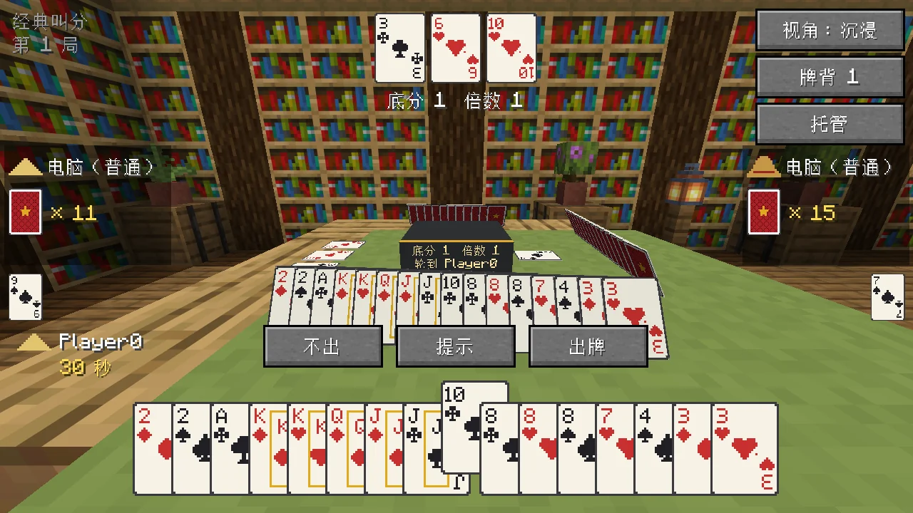
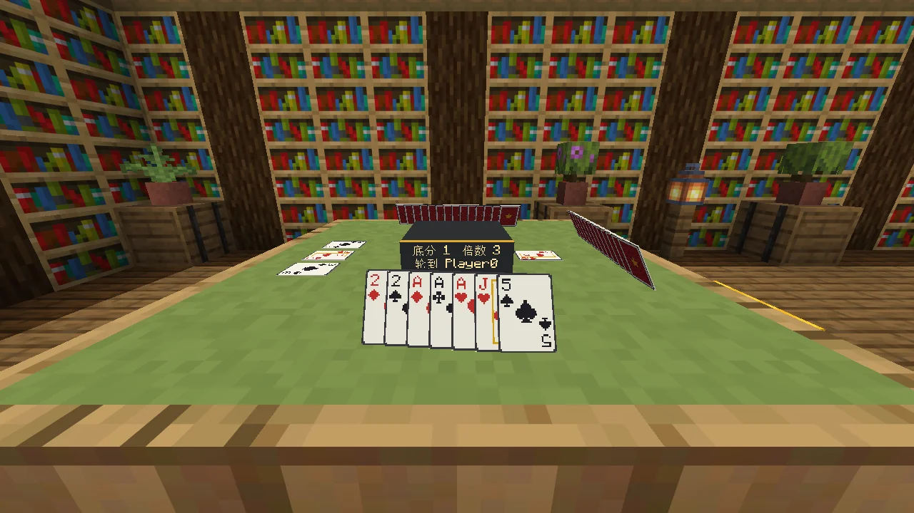
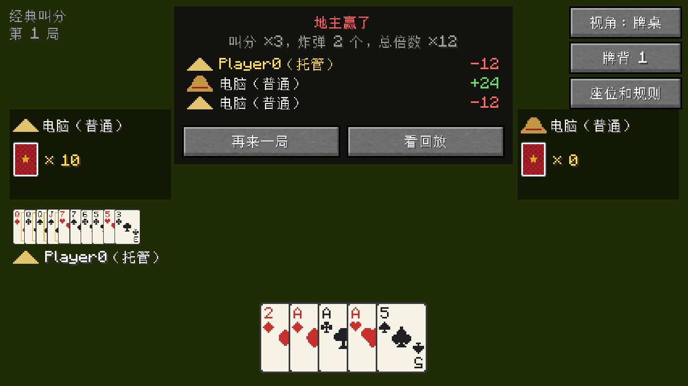
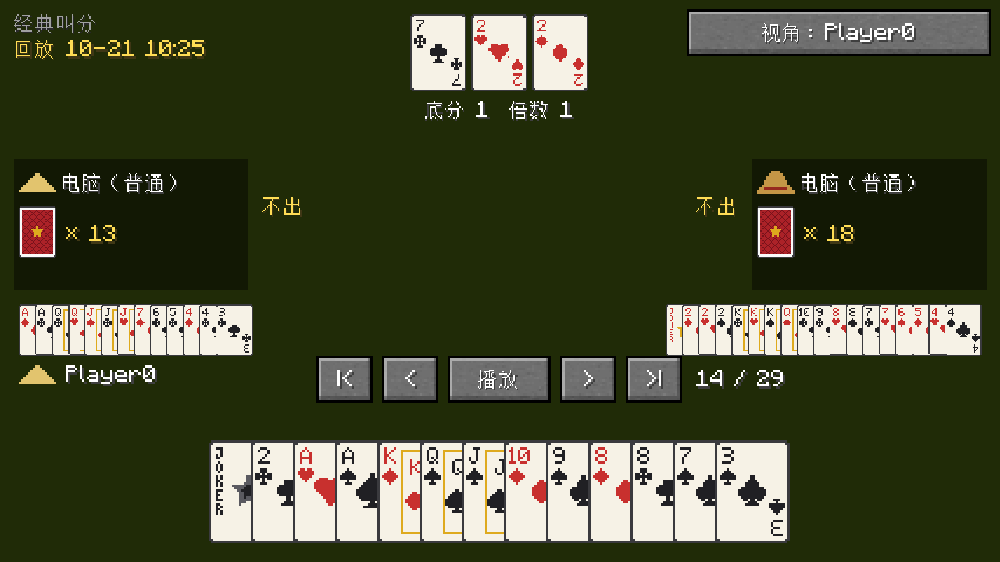
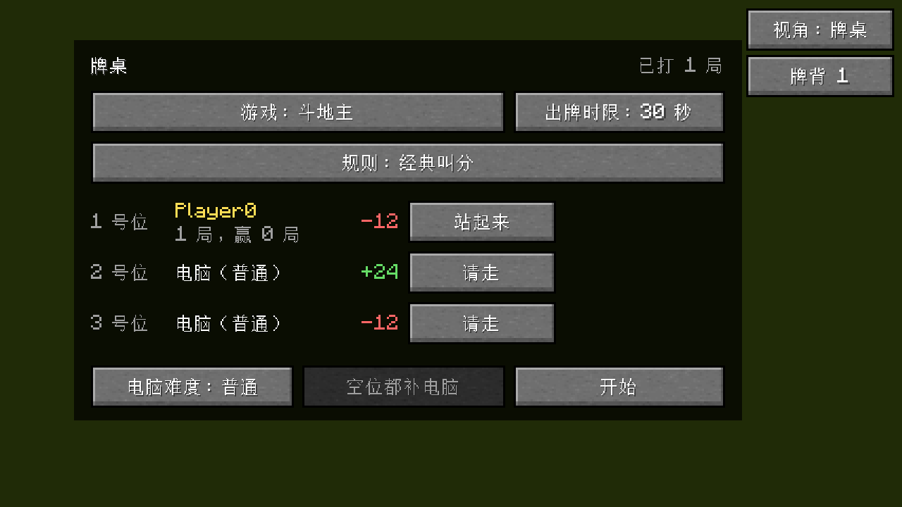

<p align="center"></p>

<p align="center">
  <a href="README.md">English</a> · <b>简体中文</b> · <a href="README.zh-TW.md">繁體中文</a> · <a href="README.ja.md">日本語</a> · <a href="README.ko.md">한국어</a>
</p>

<p align="center">
  在 Minecraft 里摆一张牌桌，叫上朋友或者几个电脑，坐下来打斗地主、玩 UNO。
</p>

<p align="center">
  <a href="https://github.com/Konyaco/TuKuai/actions/workflows/build.yml"></a>
  <a href="https://github.com/Konyaco/TuKuai/releases/latest"></a>
  
  
  <a href="LICENSE"></a>
</p>


土块棋牌室加了一张能合成、能摆放的牌桌。几个人坐一桌，空位让电脑补上，就能开打。牌是真的摆在桌上的，路过的人都看得见。目前有斗地主和 UNO，以后还会加别的棋牌游戏。

只用游戏内积分，不涉及真实金钱。输了顶多输点面子。

## 下载

到 [Releases](https://github.com/Konyaco/TuKuai/releases/latest) 下载对应加载器的 jar。需要 Minecraft 26.1.2，另外还要装：

| 加载器 | 还需要 |
| --- | --- |
| NeoForge 26.1.2 | [Kotlin for Forge](https://modrinth.com/mod/kotlin-for-forge) 6.4.0 或更新 |
| Fabric | [Fabric API](https://modrinth.com/mod/fabric-api)、[Fabric Language Kotlin](https://modrinth.com/mod/fabric-language-kotlin) 1.13.13 或更新 |

## 能做什么

### 斗地主

三种规则可选：「经典叫分」「抢地主」和「不洗牌」（炸弹更多）。

<table>
  <tr>
    <td width="50%"></td>
    <td width="50%"></td>
  </tr>
  <tr>
    <td align="center">牌桌视角：整个屏幕就是牌桌。</td>
    <td align="center">沉浸视角：不挡住世界，抬头就是真实的牌桌。按 Tab 切换。</td>
  </tr>
</table>

### UNO

2 到 4 人，四种规则：4 人经典、4 人罚牌可叠加（+2 能接 +2，+4 能接 +2 或 +4），以及 3 人、2 人经典。

<table>
  <tr>
    <td width="50%"></td>
    <td width="50%"></td>
  </tr>
  <tr>
    <td align="center">能出的牌会抬起来，点一下就出。</td>
    <td align="center">关掉界面，人还坐在桌边。</td>
  </tr>
</table>

### 在世界里看得见

牌桌占 3x3 格。每个人的手牌立在桌上朝向自己，别人只能看到牌背；刚出的牌和底牌摆在中间。桌上的牌有厚度。用染料右键牌桌换桌布颜色，界面右上角换牌背。凳子有 16 种坐垫颜色。

<table>
  <tr>
    <td width="50%"></td>
    <td width="50%"></td>
  </tr>
  <tr>
    <td align="center">自己的手牌立着朝向自己。</td>
    <td align="center">村民只是摆着好看的。真正在打牌的电脑是隐形的，说不上是礼貌还是吓人。</td>
  </tr>
</table>

### 电脑补位，掉线不卡局

空位可以让电脑补上。电脑有简单、普通、困难三档，困难会先在心里把牌局推演很多遍再出牌。

有人走开或掉线，电脑先替他打；连续超时两次会自动托管，回来点「取消托管」就能接着打。

### 回放和战绩

每局打完自动存档。可以一步步重看，能看到所有人的牌，也能换成任何一家的视角。牌桌还会记下每个人的战绩。

<table>
  <tr>
    <td width="33%"></td>
    <td width="33%"></td>
    <td width="33%"></td>
  </tr>
  <tr>
    <td align="center">结算</td>
    <td align="center">回放，所有人的牌都看得见</td>
    <td align="center">大厅里显示战绩</td>
  </tr>
</table>

不会玩？牌桌上的 **?** 按钮打开规则书：斗地主的每种牌型、UNO 的每张功能牌都配了图，还有一页专讲这张桌子当前的规则。

界面支持简体中文、繁体中文、英文、日文、韩文，跟着游戏的语言设置走。

## 怎么玩

1. **合成牌桌**：第一排放 3 块任意颜色的羊毛，第二排放 3 块任意木板，第三排左右两格各放 1 块任意原木。创造模式在「功能方块」栏里。
2. **放下，右键打开**。牌桌占 3x3 格，从你点的那一格往前铺开，所以前方和左右要留出空地。点「坐这里」入座，空位点「加电脑」，或者直接点「空位都补电脑」。
3. **选游戏**：点「游戏」切换斗地主或 UNO，选好规则和出牌时限，点「开始」。

旧版本放的一格牌桌会自动长成 3x3，周围没空地的话会变回物品掉在地上。

**凳子**：用一块羊毛、一个木台阶和一根木棍从上到下竖着合成，羊毛的颜色就是坐垫的颜色，之后也能用染料右键换色。在牌桌有座位的边外面（斗地主三条边，4 人 UNO 四条边）、正对中间的位置放上凳子，右键凳子就是坐到那一边的座位上。不挨着牌桌的凳子也能直接坐，凳子本来就是用来坐的。

### 操作

斗地主：

| 操作 | 作用 |
| --- | --- |
| 左键点牌 | 选中或取消这张牌 |
| 右键 | 清空选择 |
| 空格 / 回车 | 出选中的牌；没选牌时就是「不出」 |
| H | 提示，多按几次换一种出法 |
| Tab | 切换牌桌 / 沉浸视角 |

UNO：能出的牌会抬起来，点一下就出；万能牌出之前要选颜色。

| 操作 | 作用 |
| --- | --- |
| 左键点牌 | 出这张牌 |
| 右键 | 取消选颜色 |
| D | 摸牌（被罚时一次摸完） |
| 空格 / 回车 | 摸到能出的牌但想留着 |
| U | 剩两张时喊 UNO，再出牌；忘了喊会罚摸 2 张 |
| Tab | 切换牌桌 / 沉浸视角 |

UNO 的几处简化：翻开的第一张一定是数字牌；+4 只能在手里没有当前颜色时出（不用质疑）；喊 UNO 要在出倒数第二张牌时一起喊，没喊就直接罚。谁先出完谁赢，其他人按手里剩下的牌给分：数字牌按点数，功能牌 20 分，万能牌 50 分。

### 回放

- 一局结束后，结算框里点「看回放」。
- `/tukuai replays` 列出最近的对局，点名字就能打开；`/tukuai replay <名字>` 按名字打开。
- 回放里空格暂停或继续，左右方向键前后一步，Home / End 跳到开头或结尾，Tab 换视角。

回放文件存在存档目录的 `tukuai/replays` 里。

### 战绩

- `/tukuai stats` 看自己打了多少局、赢了多少、积分多少；`/tukuai stats <玩家名>` 看别人的。
- `/tukuai top` 看积分排行前十。

战绩存在存档目录的 `tukuai/stats.json` 里，只算真人，电脑不记。

## 服务器设置

第一次开服（或进单人存档）后会生成 `config/tukuai-server.properties`，改完后 `/reload` 或重启生效：

| 设置 | 默认 | 作用 |
| --- | --- | --- |
| `allowBots` | `true` | 是否允许电脑玩家入座 |
| `botDelaySeconds` | `1.1` | 电脑出牌前平均等几秒 |
| `saveReplays` | `true` | 是否保存回放 |
| `maxReplays` | `500` | 最多留多少局回放，多了先删最旧的；`0` 表示不限 |
| `keepStats` | `true` | 是否记录战绩 |

## 开发

<details>
<summary>编译、代码结构、加新游戏、测试</summary>

### 编译

需要 JDK 25。在仓库根目录运行：

```sh
./gradlew build                 # 编译、测试，并打出两个加载器的 jar
./gradlew :engine:test          # 只跑规则引擎的单元测试
./gradlew :fabric:runClient     # 用 Fabric 启动游戏
./gradlew :neoforge:runClient   # 用 NeoForge 启动游戏
```

打好的 jar 在 `fabric/build/libs` 和 `neoforge/build/libs`。

### 代码结构

| 目录 | 放什么 |
| --- | --- |
| `engine` | 规则、电脑、回放等纯 Kotlin 代码，不依赖 Minecraft，可以单独跑单元测试 |
| `common` | 两个加载器共用的 Minecraft 代码和资源（方块、网络、界面、渲染、贴图、语言文件） |
| `fabric`、`neoforge` | 各加载器的入口、注册和事件转接，越薄越好 |

`engine` 和 `common` 的源码由两个加载器各自编译进自己的 jar，所以每个加载器只发布一个 jar。
`engine` 里不能引用任何 `net.minecraft` 的类；Mixin 以后放在 `common/src/main/java`，用 Java 写。

### 加一个新游戏

1. 在 `engine` 里实现 `GameDefinition`（规则、发牌、出招、每个座位能看到什么、电脑），在 `TuKuai.init()` 里注册到 `GameRegistry`。
2. 在 `common/.../client` 里实现 `GameUi`（界面怎么画、桌面上摆什么牌），在 `TuKuaiClient.init()` 里注册到 `GameUis`。
3. 在每个语言文件里加上 `tukuai.game.<id>` 和各个规则的名字。CI 会检查所有语言文件的键是否和 `en_us.json` 一致。

牌桌、座位、电脑代打、计时、同步、存档和回放都是通用的，不用再写一遍。

### 测试

- `./gradlew :engine:test` 跑规则和电脑的测试，包括「困难电脑在同样的牌局里比普通电脑赢得多」。
- `./gradlew :fabric:runClientGameTest` 会真的打开游戏打一局：坐下、加电脑、托管打完、看回放，每一步截图。CI 上用 xvfb 跑，截图以 base64 打在日志里。
- `TUKUAI_SHOWCASE=en_us,zh_cn ./gradlew :fabric:runClientGameTest` 改为拍这份 README 里的截图，列出的每种语言各拍一套，存在 `fabric/build/run/clientGameTest/screenshots`。用到的几张转成 WebP 放在 `docs/images`。

提交信息统一写成 `[type](scope) Title`，例如 `[feat](engine) Add Dou Dizhu hand types`。

依赖版本都在 `gradle.properties`。`kotlin_version` 不能高于 Kotlin for Forge 和 Fabric Language Kotlin 自带的 Kotlin 版本。

</details>

## 许可证

[MIT](LICENSE)
