<p align="center">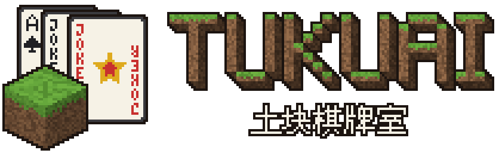</p>

<p align="center">
  <a href="README.md">English</a> · <b>简体中文</b> · <a href="README.zh-TW.md">繁體中文</a> · <a href="README.ja.md">日本語</a> · <a href="README.ko.md">한국어</a>
</p>

<p align="center">
  <a href="https://github.com/Konyaco/TuKuai/actions/workflows/build.yml"></a>
  <a href="https://github.com/Konyaco/TuKuai/releases/latest"></a>
  
  
  <a href="LICENSE"></a>
</p>
<h3 align="center">在你的 Minecraft 世界里摆一张牌桌。<br>搬个凳子坐下，和朋友打斗地主、麻将、UNO……朋友不在，就叫电脑来凑一桌。</h3>

<p align="center">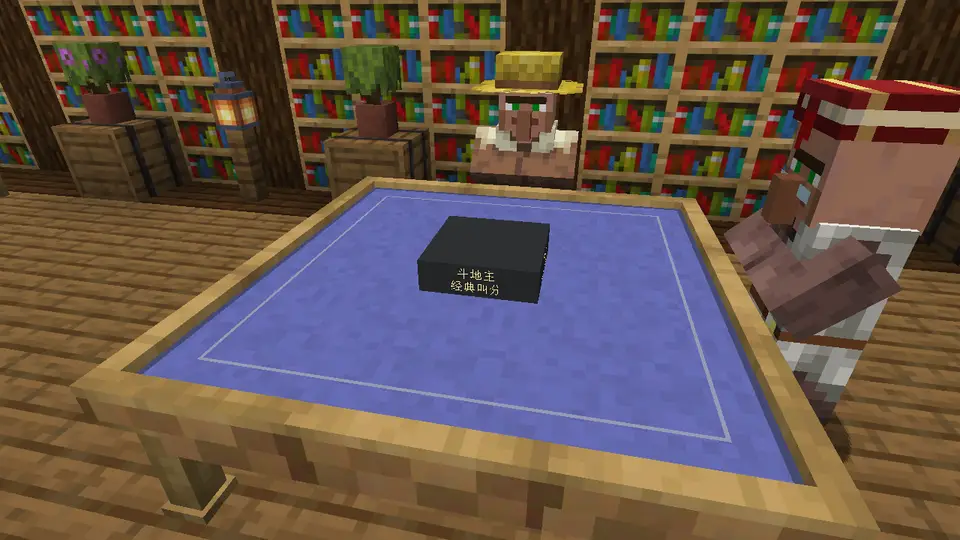</p>

<p align="center"><b>7 种玩法</b> · <b>2 到 8 人</b> · <b>空位电脑补</b> · <b>每局都能回放</b> · <b>Fabric 和 NeoForge</b></p>

## 玩法

<table>
  <tr>
    <td width="50%">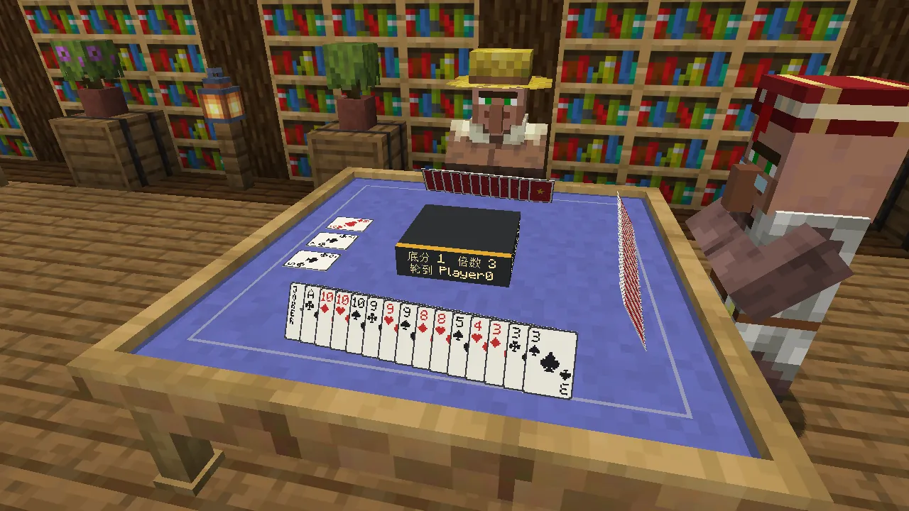</td>
    <td width="50%">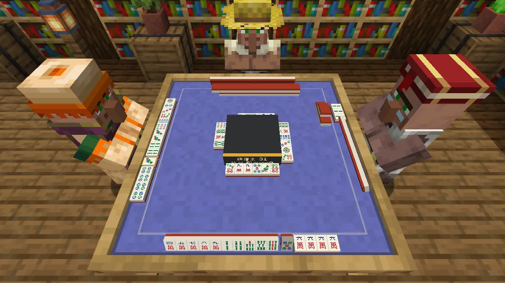</td>
  </tr>
  <tr>
    <td valign="top"><b>斗地主</b> · 3 或 4 人<br>一个地主对几个农民。可以叫分、抢地主、打不洗牌，也能四个人用两副牌打，炸弹最多八张。</td>
    <td valign="top"><b>麻将</b> · 4 人<br>四川麻将血战到底：换三张、定缺，有人胡了其他人接着打，直到三家胡牌。麻将牌立在桌上，牌墙码在中间。</td>
  </tr>
  <tr>
    <td>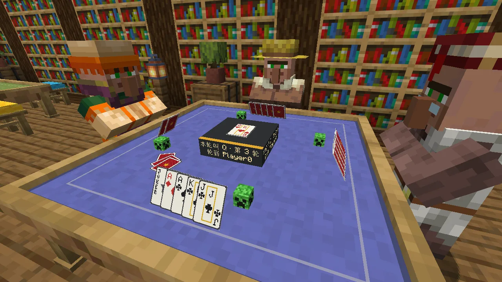</td>
    <td>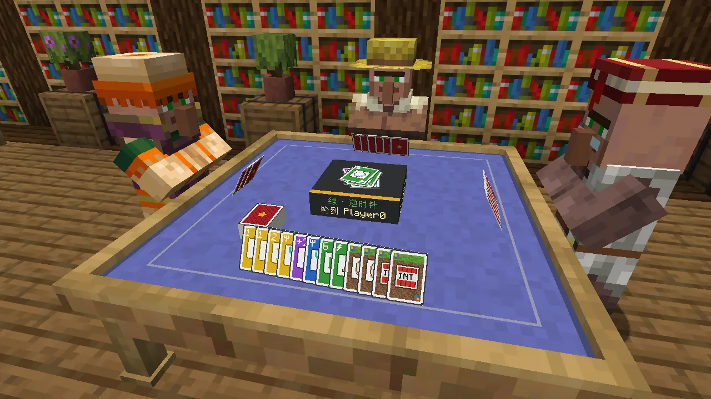</td>
  </tr>
  <tr>
    <td valign="top"><b>吹牛苦力怕</b> · 2 到 8 人<br>像骗子酒馆，只是把左轮枪换成了苦力怕。扣下牌，该吹就吹，或者揭穿上家；猜错的人点燃自己苦力怕的引线，六次里有一次会炸。炸了疼不疼，房主说了算。</td>
    <td valign="top"><b>土土牌</b> · 2 到 8 人<br>本模组原创，玩法和 UNO 差不多，功能牌取材自 Minecraft。点着的 TNT 在桌上冒烟，谁也不知道会在谁的回合炸。</td>
  </tr>
  <tr>
    <td>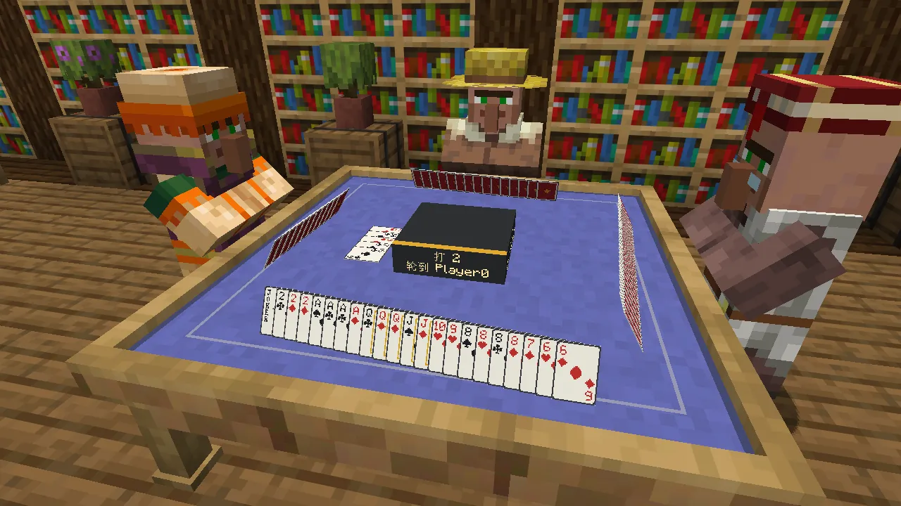</td>
    <td>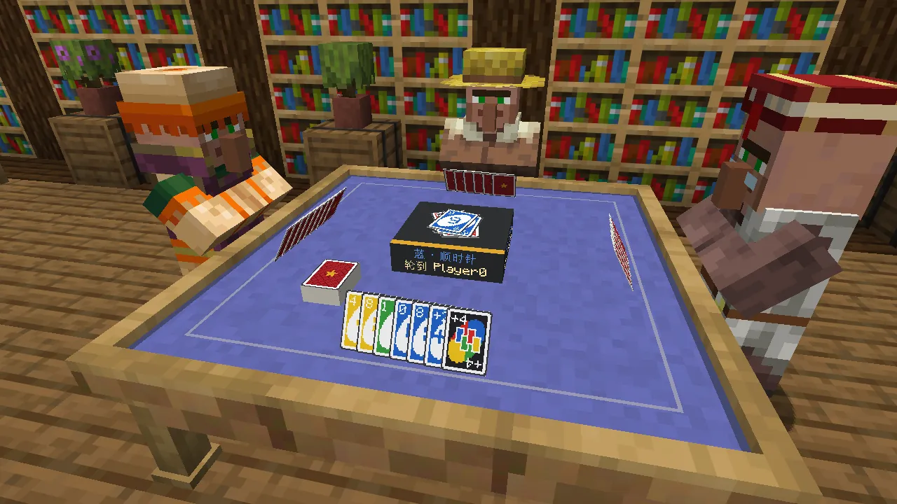</td>
  </tr>
  <tr>
    <td valign="top"><b>掼蛋</b> · 4 人<br>两队对打，两副牌，有逢人配，有进贡还贡。可以只打一局，也可以一路打到 A。</td>
    <td valign="top"><b>UNO</b> · 2 到 4 人<br>经典规则，或者让罚牌一张张叠给下家。</td>
  </tr>
  <tr>
    <td>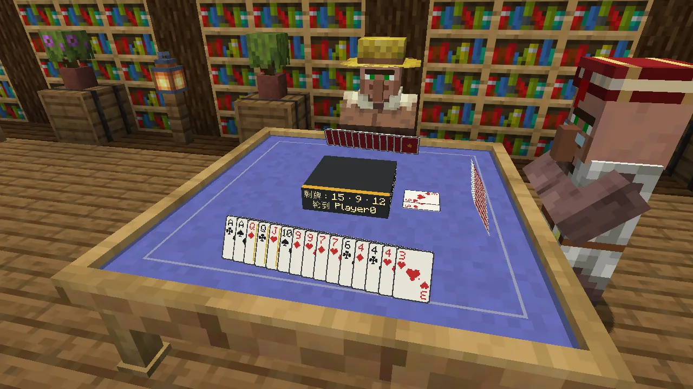</td>
    <td>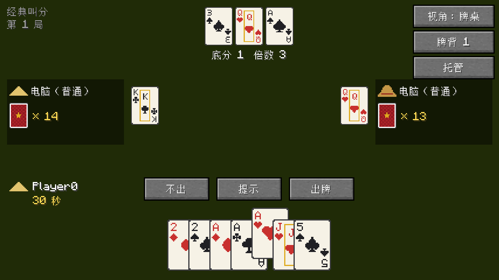</td>
  </tr>
  <tr>
    <td valign="top"><b>跑得快</b> · 3 人<br>各自为战，谁先出完谁赢。每人 16 张或 15 张，可选有没有大必压。</td>
    <td valign="top"><b>上手容易</b><br>坐下就能看到手牌、比分和<b>提示</b>按钮。点 <b>?</b> 打开规则书，每种玩法都有图解。</td>
  </tr>
</table>

## 为什么来土块棋牌室

- **牌真的摆在桌上。** 手牌立起来朝着自己，出过的牌落在桌子中间，路过的人都能围观。打开沉浸视角，直接点桌上的牌出牌。
- **永远不缺人。** 空位随时加电脑，分简单、普通、困难三档；有人离开或掉线，电脑接着替他打。大家都走开了，牌局就停下来等人回来。
- **一坐一晚上。** 一场比赛连打好几局、累计比分，每局都存了回放，能换任意座位的视角重看，牌桌还记着每个人的战绩。
- **把屋子布置成你的样子。** 牌桌和凳子有各种木头，桌布和坐垫随便染色，牌背、牌面有好几套。大方桌能坐 8 个人。

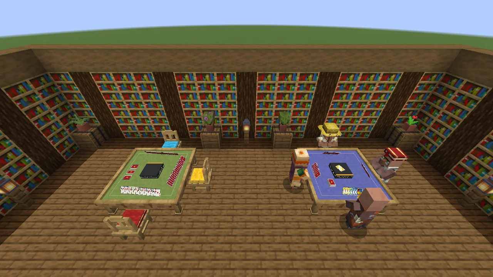

## 开始游玩

### 下载

从 [Releases](https://github.com/Konyaco/TuKuai/releases/latest) 下载对应 Minecraft 版本和加载器的 jar，例如 `tukuai-fabric-1.21.1-<版本>.jar`。服务器和每位玩家都要安装。支持 Minecraft 26.3、26.2、26.1.2 和 1.21.1，还需要：

| 加载器 | 前置模组 |
| --- | --- |
| NeoForge 26.1.2, 26.2, 26.3 | [Kotlin for Forge](https://modrinth.com/mod/kotlin-for-forge) 6.4.0 或更新 |
| NeoForge 1.21.1 | [Kotlin for Forge](https://modrinth.com/mod/kotlin-for-forge) 5.12.0 或更新 |
| Fabric | [Fabric API](https://modrinth.com/mod/fabric-api)、[Fabric Language Kotlin](https://modrinth.com/mod/fabric-language-kotlin) 1.13.13 或更新 |

苍白橡木的牌桌和凳子需要 26.1.2 或更新版本，1.21.1 还没有苍白橡木。

### 合成

<table>
  <tr>
    <td width="33%" align="center">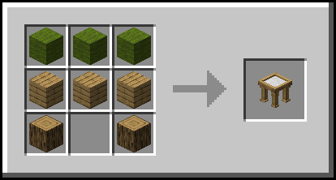<br><b>牌桌</b><br>羊毛颜色不限，木板决定桌子的木材。</td>
    <td width="33%" align="center">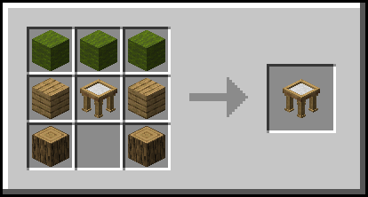<br><b>大方桌</b><br>由一张牌桌扩展而成，最多坐 8 人。</td>
    <td width="33%" align="center">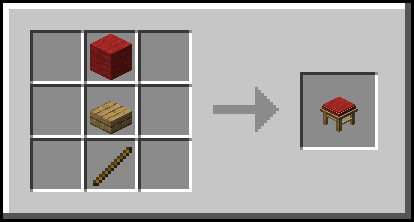<br><b>凳子</b><br>羊毛决定坐垫颜色，台阶决定木材。</td>
  </tr>
</table>

创造模式下，三者都在「功能方块」物品栏中。

### 上手

1. **放下牌桌**。牌桌占 3×3 格，会从点击的方块向前展开，前方和左右需留出空地。
2. **右键打开牌桌**，点「坐这里」入座，空位可点「加电脑」补上。
3. **选择游戏和规则**，点「开始」。

凳子放在牌桌有座位一侧的外边正中，右键凳子即可坐到对应座位。大方桌占 5×5 格，每边两个座位，最多坐 8 人。

界面支持简体中文、繁体中文、英文、日文和韩文，随游戏语言切换。

<details>
<summary><b>服务器设置</b></summary>

首次开服（或进入单人存档）后会生成 `config/tukuai-server.properties`，修改后执行 `/reload` 或重启生效。

| 设置 | 默认 | 作用 |
| --- | --- | --- |
| `allowBots` | `true` | 是否允许电脑入座 |
| `botDelaySeconds` | `1.1` | 电脑出牌前的平均等待秒数 |
| `saveReplays` | `true` | 是否保存回放 |
| `maxReplays` | `500` | 回放保留上限，超出时删除最旧的；`0` 表示不限 |
| `keepStats` | `true` | 是否记录战绩 |

</details>

<details>
<summary><b>开发</b></summary>

需要 JDK 25；Minecraft 1.21.1 要用的 JDK 21 由 Gradle 自动下载。

```sh
./gradlew build                        # 编译、测试，并打出每个加载器、每个 Minecraft 版本的 jar
./gradlew :mc26:fabric-26.3:runClient  # 用 Fabric 启动 Minecraft 26.3
./gradlew :neoforge-1.21.1:runClient   # 用 NeoForge 启动 Minecraft 1.21.1
```

| 目录 | 内容 |
| --- | --- |
| `engine` | 规则、电脑和回放，纯 Kotlin，不依赖 Minecraft |
| `common` | 所有加载器和 Minecraft 版本共用的 Minecraft 代码和资源，按最新版 Minecraft 写 |
| `mc26` | Minecraft 26.1.2、26.2、26.3 合成的一个 [Stonecutter](https://stonecutter.kikugie.dev/) 项目：`src` 里是 `compat` 包、渲染器、各加载器的入口、物品模型和配方，版本之间不同的地方用 `//?` 注释标出；`versions/<加载器>-<minecraft>/gradle.properties` 是各自的版本号 |
| `versions/1.21.1` | Minecraft 1.21.1：`gradle.properties` 里的各项版本，让它用上最新版 Minecraft 名字的 `compat` 包，渲染器、物品模型和配方 |
| `versions/1.21.1/fabric`、`versions/1.21.1/neoforge` | 1.21.1 下各加载器的入口和注册 |

加入新游戏：

1. 在 `engine` 中实现 `GameDefinition`，并在 `TuKuai.init()` 中注册到 `GameRegistry`。
2. 在 `common/.../client` 中实现 `GameUi`，并在 `TuKuaiClient.init()` 中注册到 `GameUis`。
3. 在每个语言文件中加入 `tukuai.game.<id>` 和各规则的名称。

测试：

```sh
./gradlew :engine:test                           # 规则与电脑的单元测试
./gradlew :mc26:fabric-26.1.2:runClientGameTest  # 启动游戏实际打几局并截图
./gradlew :mc26:fabric-26.1.2:runMultiplayerTest # 专用服务器加两个客户端的联机测试
./gradlew :fabric-1.21.1:runSmokeTest            # 在 Minecraft 1.21.1 上每种玩法各打一局并截图
./gradlew :mc26:neoforge-26.3:runSmokeTest       # 在任一 26.x 版本和加载器上做同样的测试
TUKUAI_SHOWCASE=en_us,zh_cn ./gradlew :mc26:fabric-26.1.2:runClientGameTest   # 拍摄本文的截图
```

提交信息格式为 `[type](scope) Title`。依赖版本见 `gradle.properties` 和 `versions/<minecraft>/gradle.properties`。

</details>

## 许可证

[MIT](LICENSE)
