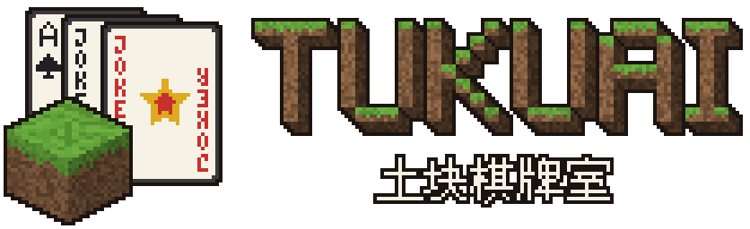
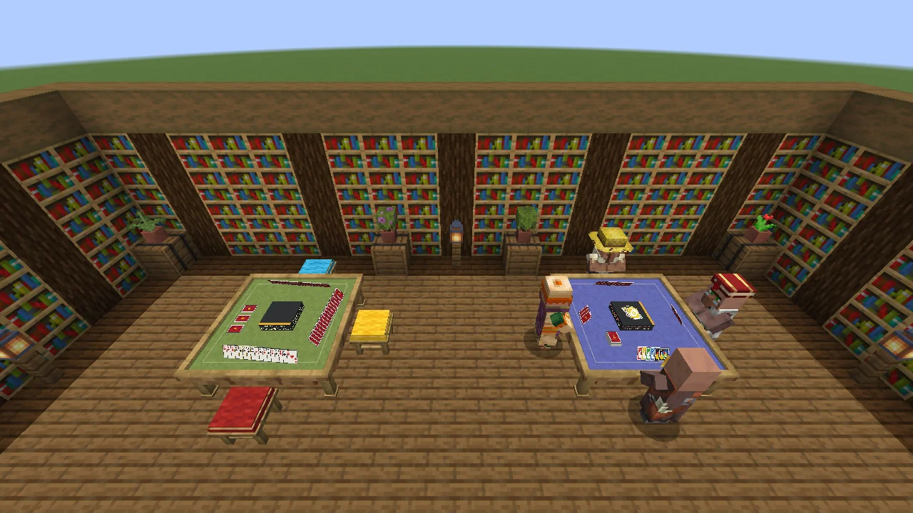
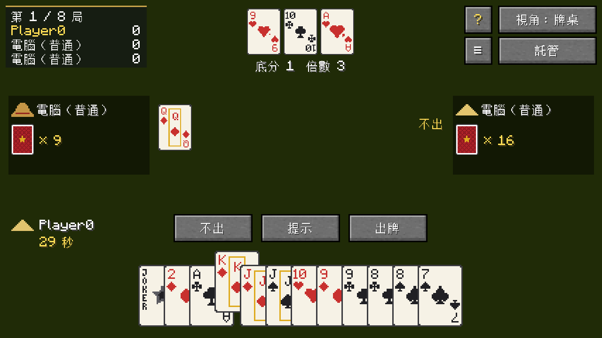
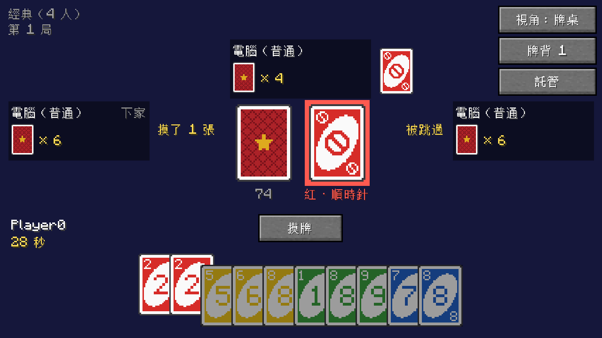
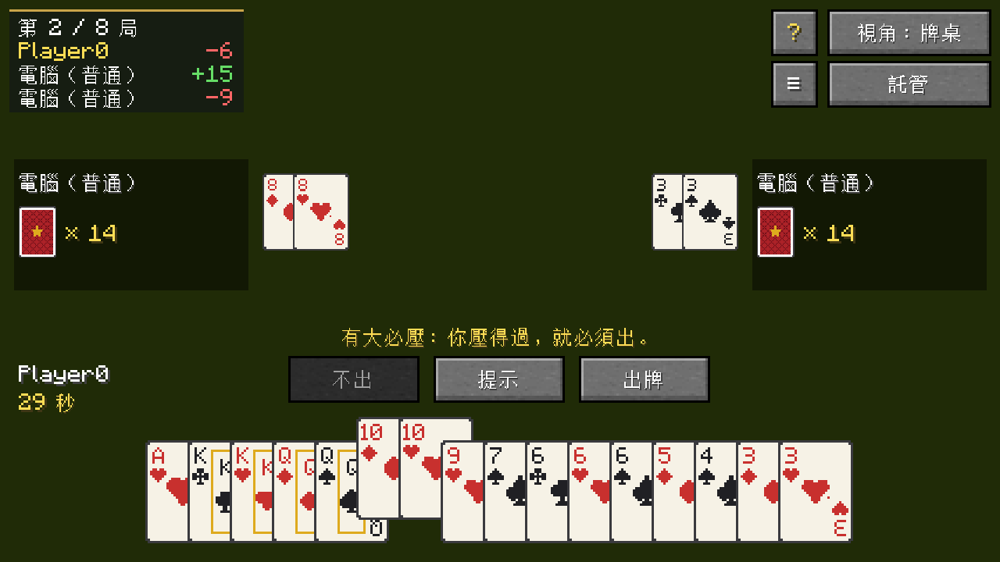
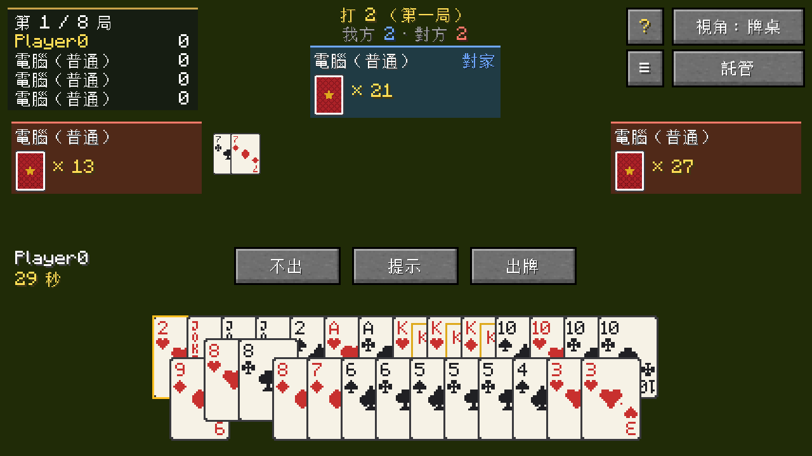
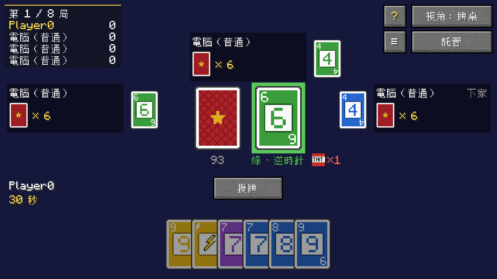
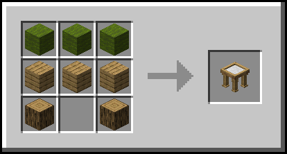
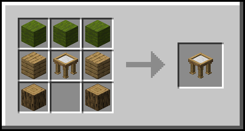
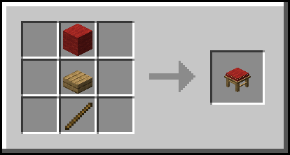

<p align="center"></p>

<p align="center">
  <a href="README.md">English</a> · <a href="README.zh-CN.md">简体中文</a> · <b>繁體中文</b> · <a href="README.ja.md">日本語</a> · <a href="README.ko.md">한국어</a>
</p>

<p align="center">
  <a href="https://github.com/Konyaco/TuKuai/actions/workflows/build.yml"></a>
  <a href="https://github.com/Konyaco/TuKuai/releases/latest"></a>
  
  
  <a href="LICENSE"></a>
</p>

土塊棋牌室在 Minecraft 中加入可以合成和擺放的牌桌，供玩家與朋友或電腦一同打牌。



## 特色

- **立體牌桌**：牌擺在世界中的桌面上。手牌立起朝向自己，出過的牌放在桌子中央，旁人也看得到。
- **多人連線與電腦補位**：空位可由電腦補上，分簡單、普通、困難三檔；玩家離開或斷線時由電腦代打；在打的人全都離座時對局暫停，等有人坐上桌接著打或結束對局。
- **回放與戰績**：每局自動保存回放，可從任意座位的視角重看；牌桌記錄每位玩家的戰績。
- **外觀自訂**：牌桌和凳子有多種木材可選，桌布和坐墊可以染色，牌背和牌面有多種樣式。
- **沉浸視角**：介面不遮擋世界，直接點選桌上的牌出牌。

## 遊戲

<table>
  <tr>
    <td width="55%"></td>
    <td><b>鬥地主</b><br>三人遊戲，一名地主對兩名農民。規則可選經典叫分、搶地主和不洗牌；也能玩四人鬥地主：兩副牌，一名地主對三名農民，炸彈最多八張。</td>
  </tr>
  <tr>
    <td></td>
    <td><b>UNO</b><br>2 至 4 人。可選經典規則或罰牌可疊加的規則。</td>
  </tr>
  <tr>
    <td></td>
    <td><b>跑得快</b><br>三人各自為戰，先出完手牌者獲勝。可選每人 16 張或 15 張，以及是否有大必壓。</td>
  </tr>
  <tr>
    <td></td>
    <td><b>摜蛋</b><br>四人分兩隊，使用兩副牌。可選只打一局，或連續打到 A。</td>
  </tr>
  <tr>
    <td></td>
    <td><b>土土牌</b><br>本模組原創的出牌遊戲，玩法與 UNO 相近，功能牌取材自 Minecraft，例如會在桌上冒煙的 TNT。2 至 8 人，6 人和 8 人需使用大方桌。</td>
  </tr>
</table>

規則說明見遊戲內的規則書：點擊牌桌介面上的 **?** 按鈕即可開啟。

## 開始遊玩

### 下載

從 [Releases](https://github.com/Konyaco/TuKuai/releases/latest) 下載對應 Minecraft 版本和載入器的 jar，例如 `tukuai-fabric-1.21.1-<版本>.jar`。支援 Minecraft 26.1.2 和 1.21.1，還需要：

| 載入器 | 前置模組 |
| --- | --- |
| NeoForge 26.1.2 | [Kotlin for Forge](https://modrinth.com/mod/kotlin-for-forge) 6.4.0 或更新 |
| NeoForge 1.21.1 | [Kotlin for Forge](https://modrinth.com/mod/kotlin-for-forge) 5.12.0 或更新 |
| Fabric | [Fabric API](https://modrinth.com/mod/fabric-api)、[Fabric Language Kotlin](https://modrinth.com/mod/fabric-language-kotlin) 1.13.13 或更新 |

蒼白橡木的牌桌和凳子只有 26.1.2 有，1.21.1 還沒有蒼白橡木。

### 合成

<table>
  <tr>
    <td width="33%" align="center"><br><b>牌桌</b><br>羊毛顏色不限，木材決定桌子的木頭種類。</td>
    <td width="33%" align="center"><br><b>大方桌</b><br>由一張牌桌擴展而成，最多坐 8 人。</td>
    <td width="33%" align="center"><br><b>凳子</b><br>羊毛決定坐墊顏色，半磚決定木頭種類。</td>
  </tr>
</table>

創造模式下，三者都在「功能方塊」物品欄中。

### 上手

1. **放下牌桌**。牌桌佔 3×3 格，會從點擊的方塊向前展開，前方和左右需留出空地。
2. **右鍵開啟牌桌**，點「坐這裡」入座，空位可點「加電腦」補上。
3. **選擇遊戲和規則**，點「開始」。

凳子放在牌桌有座位一側的外邊正中，右鍵凳子即可坐到對應座位。大方桌佔 5×5 格，每邊兩個座位，最多坐 8 人。

介面支援簡體中文、繁體中文、英文、日文和韓文，隨遊戲語言切換。

<details>
<summary><b>伺服器設定</b></summary>

首次開服（或進入單人存檔）後會產生 `config/tukuai-server.properties`，修改後執行 `/reload` 或重新啟動生效。

| 設定 | 預設 | 作用 |
| --- | --- | --- |
| `allowBots` | `true` | 是否允許電腦入座 |
| `botDelaySeconds` | `1.1` | 電腦出牌前的平均等待秒數 |
| `saveReplays` | `true` | 是否保存回放 |
| `maxReplays` | `500` | 回放保留上限，超出時刪除最舊的；`0` 表示不限 |
| `keepStats` | `true` | 是否記錄戰績 |

</details>

<details>
<summary><b>開發</b></summary>

需要 JDK 25；Minecraft 1.21.1 要用的 JDK 21 由 Gradle 自動下載。

```sh
./gradlew build                        # 編譯、測試，並打包每個載入器、每個 Minecraft 版本的 jar
./gradlew :fabric-26.1.2:runClient     # 用 Fabric 啟動 Minecraft 26.1.2
./gradlew :neoforge-1.21.1:runClient   # 用 NeoForge 啟動 Minecraft 1.21.1
```

| 目錄 | 內容 |
| --- | --- |
| `engine` | 規則、電腦和回放，純 Kotlin，不依賴 Minecraft |
| `common` | 所有載入器和 Minecraft 版本共用的 Minecraft 程式碼和資源，按最新版 Minecraft 撰寫 |
| `versions/<minecraft>` | 某個 Minecraft 版本獨有的部分：`gradle.properties` 裡的各項版本，讓舊版本用上最新版 Minecraft 名稱的 `compat` 套件，渲染器、物品模型和配方 |
| `versions/<minecraft>/fabric`、`versions/<minecraft>/neoforge` | 該版本下各載入器的進入點和註冊 |

加入新遊戲：

1. 在 `engine` 中實作 `GameDefinition`，並在 `TuKuai.init()` 中註冊到 `GameRegistry`。
2. 在 `common/.../client` 中實作 `GameUi`，並在 `TuKuaiClient.init()` 中註冊到 `GameUis`。
3. 在每個語言檔中加入 `tukuai.game.<id>` 和各規則的名稱。

測試：

```sh
./gradlew :engine:test                         # 規則與電腦的單元測試
./gradlew :fabric-26.1.2:runClientGameTest     # 啟動遊戲實際打幾局並截圖
./gradlew :fabric-26.1.2:runMultiplayerTest    # 專用伺服器加兩個用戶端的連線測試
./gradlew :fabric-1.21.1:runSmokeTest          # 在 Minecraft 1.21.1 上每種玩法各打一局並截圖
TUKUAI_SHOWCASE=en_us,zh_cn ./gradlew :fabric-26.1.2:runClientGameTest   # 拍攝本文的截圖
```

提交訊息格式為 `[type](scope) Title`。依賴版本見 `gradle.properties` 和 `versions/<minecraft>/gradle.properties`。

</details>

## 授權

[MIT](LICENSE)
