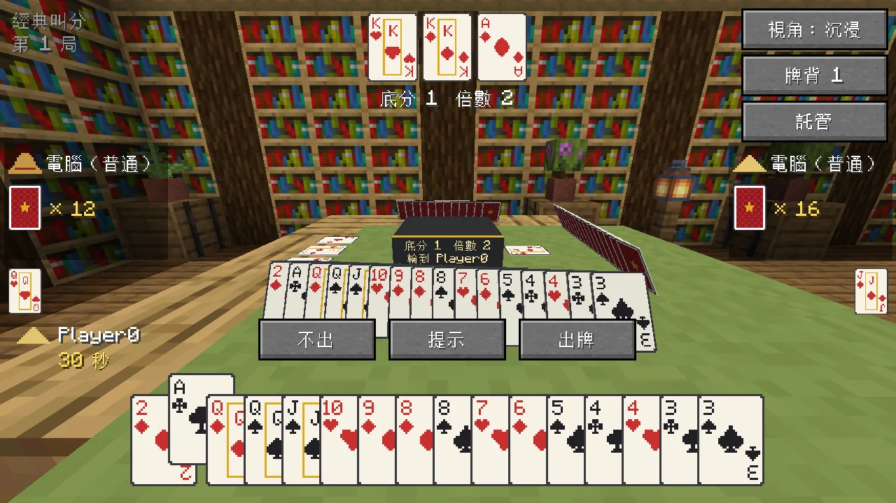
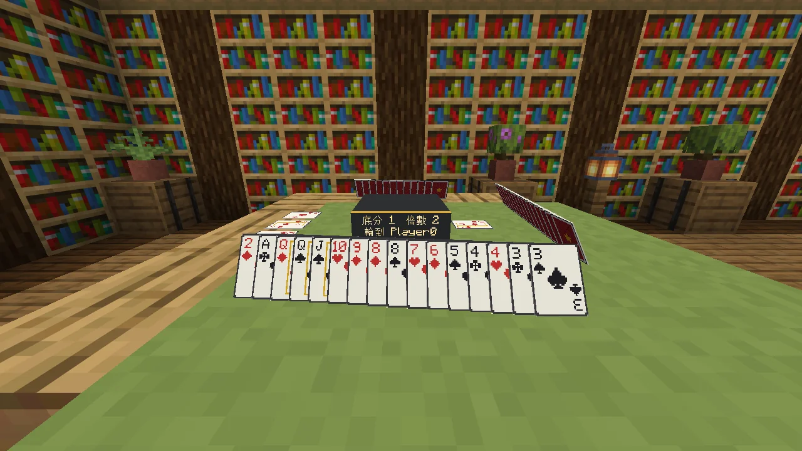
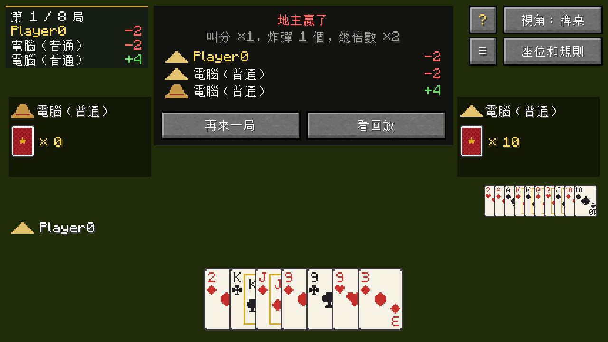
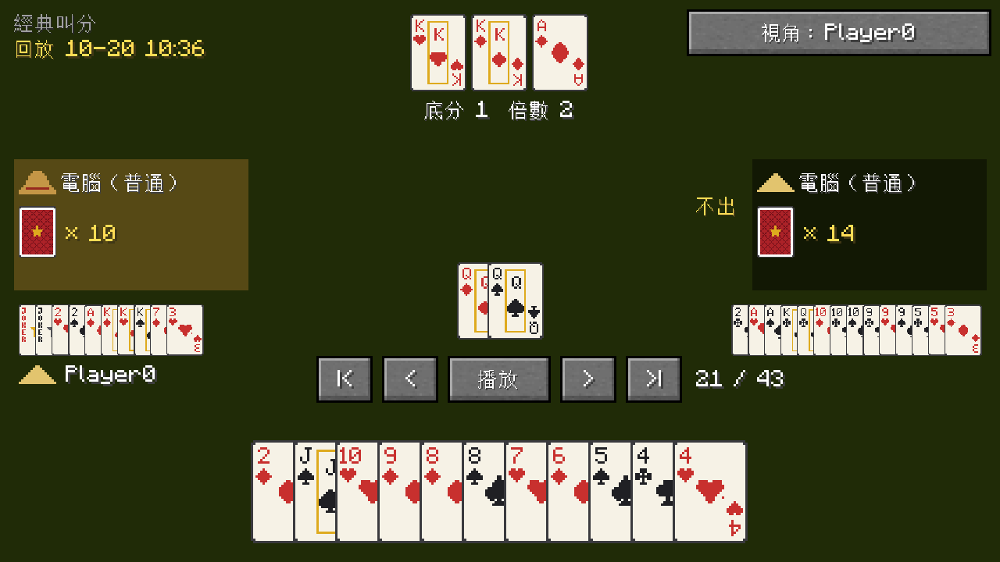
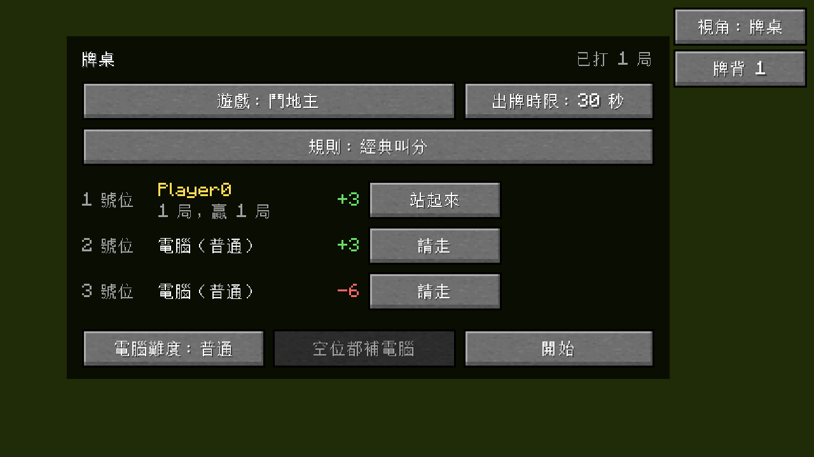

  <a href="README.md">English</a> · <a href="README.zh-CN.md">简体中文</a> · <b>繁體中文</b> · <a href="README.ja.md">日本語</a> · <a href="README.ko.md">한국어</a>

  在 Minecraft 裡擺一張牌桌，找朋友或幾個電腦，坐下來打鬥地主、跑得快，或是玩 UNO。

  
  
  
  
  

土塊棋牌室加了一張能合成、能擺放的牌桌。幾個人坐一桌，空位讓電腦補上，就能開打。牌是真的擺在桌上的，路過的人都看得到。目前有鬥地主、UNO 和跑得快，之後還會加入其他棋牌遊戲。

只用遊戲內積分，不涉及真實金錢。輸了頂多輸點面子。

## 下載

到 [Releases](https://github.com/Konyaco/TuKuai/releases/latest) 下載對應載入器的 jar。需要 Minecraft 26.1.2，另外還要裝：

| 載入器 | 還需要 |
| --- | --- |
| NeoForge 26.1.2 | [Kotlin for Forge](https://modrinth.com/mod/kotlin-for-forge) 6.4.0 或更新 |
| Fabric | [Fabric API](https://modrinth.com/mod/fabric-api)、[Fabric Language Kotlin](https://modrinth.com/mod/fabric-language-kotlin) 1.13.13 或更新 |

## 能做什麼

### 鬥地主

三種規則可選：「經典叫分」「搶地主」和「不洗牌」（炸彈更多）。

<table>
  <tr>
    <td width="50%"></td>
    <td width="50%"></td>
  </tr>
  <tr>
    <td align="center">牌桌視角：整個畫面就是牌桌。</td>
    <td align="center">沉浸視角：不擋住世界，抬頭就是真實的牌桌。按 Tab 切換。</td>
  </tr>
</table>

### UNO

2 到 4 人，四種規則：4 人經典、4 人罰牌可疊加（+2 能接 +2，+4 能接 +2 或 +4），以及 3 人、2 人經典。

<table>
  <tr>
    <td width="50%"></td>
    <td width="50%"></td>
  </tr>
  <tr>
    <td align="center">能出的牌會抬起來，點一下就出。</td>
    <td align="center">關掉介面，人還坐在桌邊。</td>
  </tr>
</table>

### 跑得快

三個人各打各的，看誰先把手上的牌出完。拿到黑桃 3 的人先出。三種規則：每人 16 張、每人 15 張，以及 16 張但隨時可以不出。另外兩種規則有大必壓：壓得過就必須出。

有人只剩一張牌時，他的資訊框和桌上都會亮出紅色的報單提示；他的上家出單張，只能出自己最大的那張。

### 在世界裡看得到

牌桌佔 3x3 格。每個人的手牌立在桌上朝向自己，別人只看得到牌背；剛出的牌和底牌擺在中間。桌上的牌有厚度。用染料右鍵牌桌換桌布顏色，介面右上角換牌背。牌桌和凳子有各種木頭可選，從橡木到扭曲木都有；凳子還有 16 種坐墊顏色。

<table>
  <tr>
    <td width="50%"></td>
    <td width="50%"></td>
  </tr>
  <tr>
    <td align="center">自己的手牌立著朝向自己。</td>
    <td align="center">村民只是擺著好看的。真正在打牌的電腦是隱形的，說不上是禮貌還是嚇人。</td>
  </tr>
</table>

### 電腦補位，斷線不卡局

空位可以讓電腦補上。電腦有簡單、普通、困難三檔，困難會先在心裡把牌局推演很多遍再出牌。

有人走開或斷線，電腦先替他打；連續逾時兩次會自動託管，回來點「取消託管」就能接著打。

### 回放和戰績

每局打完自動存檔。可以一步步重看，能看到所有人的牌，也能換成任何一家的視角。牌桌還會記下每個人的戰績。

<table>
  <tr>
    <td width="33%"></td>
    <td width="33%"></td>
    <td width="33%"></td>
  </tr>
  <tr>
    <td align="center">結算</td>
    <td align="center">回放，所有人的牌都看得到</td>
    <td align="center">座位和規則畫面顯示戰績</td>
  </tr>
</table>

不會玩？牌桌上的 **?** 按鈕打開規則書：鬥地主和跑得快的每種牌型、UNO 的每張功能牌都配了圖，還有一頁專講這張桌子目前的規則。

介面支援簡體中文、繁體中文、英文、日文、韓文，跟著遊戲的語言設定走。

## 怎麼玩

1. **合成牌桌**：第一排放 3 塊任意顏色的羊毛，第二排放 3 塊同一種木材，木材是什麼木頭，桌子的邊框和桌腳就是什麼木頭，第三排左右兩格各放 1 塊任意原木。創造模式在「功能方塊」欄裡。
2. **放下，右鍵打開**。牌桌佔 3x3 格，從你點的那一格往前鋪開，所以前方和左右要留出空地。點「坐這裡」入座，空位點「加電腦」，或者直接點「空位都補電腦」。
3. **選遊戲**：點「遊戲」在鬥地主、UNO 和跑得快之間切換，選好規則和出牌時限，點「開始」。

舊版本放的一格牌桌會自動長成 3x3，周圍沒空地的話會變回物品掉在地上。

**凳子**：用一塊羊毛、一個木半磚和一根木棒從上到下直著合成，羊毛的顏色就是坐墊的顏色，之後也能用染料右鍵換色；半磚是什麼木頭，凳子就是什麼木頭。在牌桌有座位的邊外面（鬥地主和跑得快三條邊，4 人 UNO 四條邊）、正對中間的位置放上凳子，右鍵凳子就是坐到那一邊的座位上。不靠著牌桌的凳子也能直接坐，凳子本來就是拿來坐的。

### 操作

鬥地主：

| 操作 | 作用 |
| --- | --- |
| 左鍵點牌 | 選取或取消這張牌 |
| 右鍵 | 清空選取 |
| 空白鍵 / Enter | 出選取的牌；沒選牌時就是「不出」 |
| H | 提示，多按幾次換一種出法 |
| Tab | 切換牌桌 / 沉浸視角 |

UNO：能出的牌會抬起來，點一下就出；萬用牌出之前要選顏色。

| 操作 | 作用 |
| --- | --- |
| 左鍵點牌 | 出這張牌 |
| 右鍵 | 取消選顏色 |
| D | 摸牌（被罰時一次摸完） |
| 空白鍵 / Enter | 摸到能出的牌但想留著 |
| U | 剩兩張時喊 UNO，再出牌；忘了喊會罰摸 2 張 |
| Tab | 切換牌桌 / 沉浸視角 |

UNO 的幾處簡化：翻開的第一張一定是數字牌；+4 只能在手裡沒有目前顏色時出（不用質疑）；喊 UNO 要在出倒數第二張牌時一起喊，沒喊就直接罰。誰先出完誰贏，其他人按手裡剩下的牌給分：數字牌按點數，功能牌 20 分，萬用牌 50 分。

跑得快：

| 操作 | 作用 |
| --- | --- |
| 左鍵點牌 | 選取或取消這張牌 |
| 右鍵 | 清空選取 |
| 空白鍵 / Enter | 出選取的牌；沒選牌時就是「不出」（規則允許時） |
| H | 提示，多按幾次換一種出法 |
| Tab | 切換牌桌 / 沉浸視角 |

壓得過又必須壓時，「不出」按鈕是灰的。先出完的人贏，另外兩人手上每剩一張賠 1 分，只剩一張的不賠，一張都沒出過的加倍。贏下一輪的炸彈向其他每人各收 10 分。

### 回放

- 一局結束後，結算框裡點「看回放」。
- `/tukuai replays` 列出最近的對局，點名字就能打開；`/tukuai replay <名字>` 按名字打開。
- 回放裡空白鍵暫停或繼續，左右方向鍵前後一步，Home / End 跳到開頭或結尾，Tab 換視角。

回放檔案存在存檔目錄的 `tukuai/replays` 裡。

### 戰績

- `/tukuai stats` 看自己打了多少局、贏了多少、積分多少；`/tukuai stats <玩家名稱>` 看別人的。
- `/tukuai top` 看積分排行前十。

戰績存在存檔目錄的 `tukuai/stats.json` 裡，只算真人，電腦不記。

## 伺服器設定

第一次開服（或進單人存檔）後會產生 `config/tukuai-server.properties`，改完後 `/reload` 或重新啟動生效：

| 設定 | 預設 | 作用 |
| --- | --- | --- |
| `allowBots` | `true` | 是否允許電腦玩家入座 |
| `botDelaySeconds` | `1.1` | 電腦出牌前平均等幾秒 |
| `saveReplays` | `true` | 是否保存回放 |
| `maxReplays` | `500` | 最多留多少局回放，多了先刪最舊的；`0` 表示不限 |
| `keepStats` | `true` | 是否記錄戰績 |

## 開發

編譯、程式結構、加新遊戲和測試的說明，請看 [English README 的 For developers](README.md#for-developers) 或 [简体中文 README 的「开发」](README.zh-CN.md#开发)。

## 授權

[MIT](LICENSE)
