<p align="center">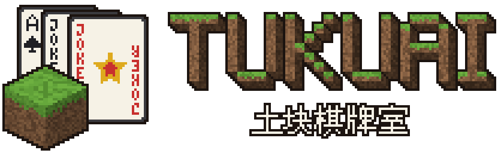</p>

<p align="center">
  <a href="README.md">English</a> · <a href="README.zh-CN.md">简体中文</a> · <b>繁體中文</b> · <a href="README.ja.md">日本語</a> · <a href="README.ko.md">한국어</a>
</p>

<p align="center">
  <a href="https://github.com/Konyaco/TuKuai/actions/workflows/build.yml"></a>
  <a href="https://github.com/Konyaco/TuKuai/releases/latest"></a>
  
  
  <a href="LICENSE"></a>
</p>
<h3 align="center">在你的 Minecraft 世界裡擺一張牌桌。<br>搬張凳子坐下，和朋友打鬥地主、麻將、UNO……朋友不在，就叫電腦來湊一桌。</h3>

<p align="center">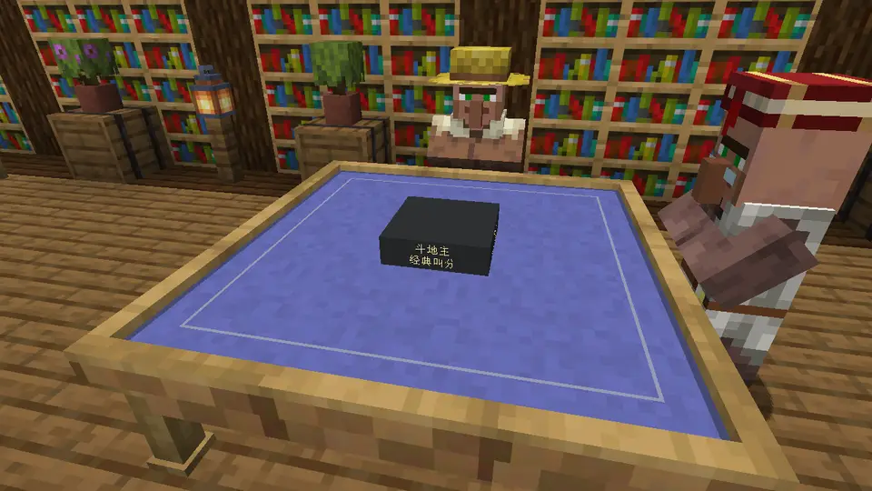</p>

<p align="center"><b>7 種玩法</b> · <b>2 到 8 人</b> · <b>空位電腦補</b> · <b>每局都能回放</b> · <b>Fabric 和 NeoForge</b></p>

## 玩法

<table>
  <tr>
    <td width="50%">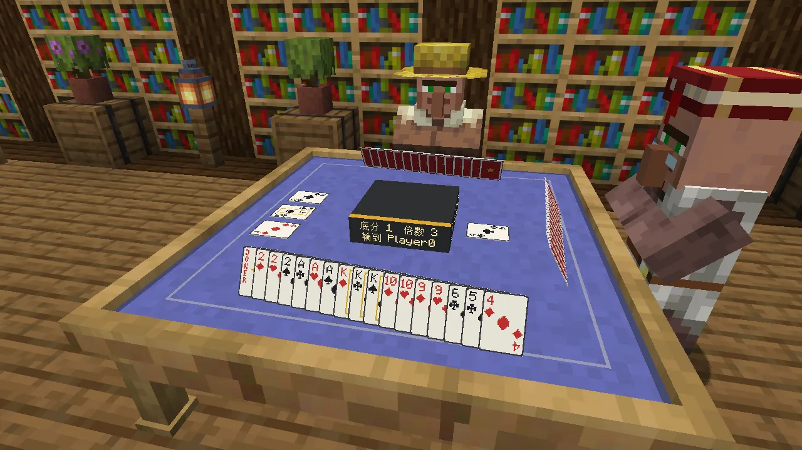</td>
    <td width="50%">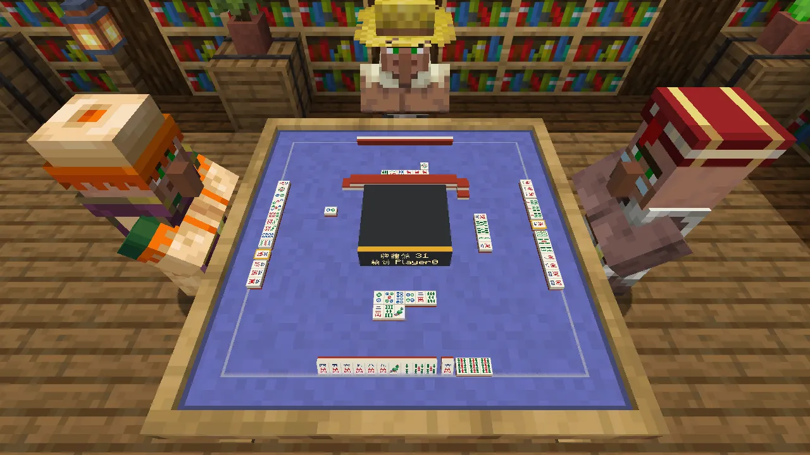</td>
  </tr>
  <tr>
    <td valign="top"><b>鬥地主</b> · 3 或 4 人<br>一個地主對幾個農民。可以叫分、搶地主、打不洗牌，也能四個人用兩副牌打，炸彈最多八張。</td>
    <td valign="top"><b>麻將</b> · 4 人<br>四川麻將血戰到底：換三張、定缺，有人胡了其他人接著打，直到三家胡牌。麻將牌立在桌上，牌牆碼在中間。</td>
  </tr>
  <tr>
    <td>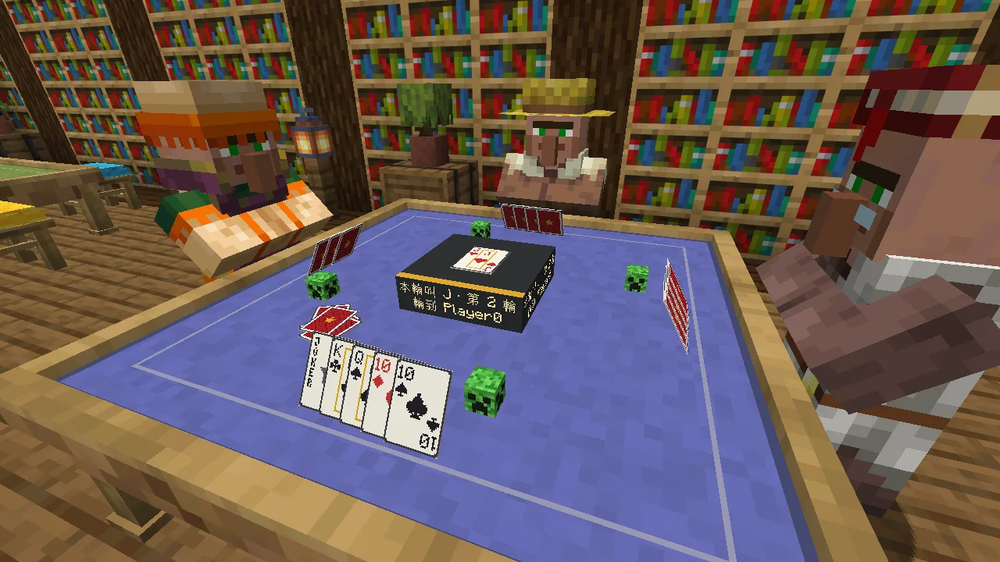</td>
    <td>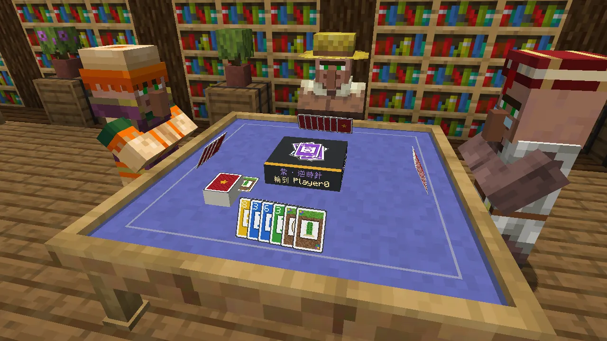</td>
  </tr>
  <tr>
    <td valign="top"><b>吹牛苦力怕</b> · 2 到 8 人<br>像騙子酒館，只是把左輪槍換成了苦力怕。蓋下牌，該吹就吹，或者揭穿上家；猜錯的人點燃自己苦力怕的引線，六次裡有一次會炸。炸了痛不痛，房主說了算。</td>
    <td valign="top"><b>土土牌</b> · 2 到 8 人<br>本模組原創，玩法和 UNO 差不多，功能牌取材自 Minecraft。點著的 TNT 在桌上冒煙，誰也不知道會在誰的回合炸。</td>
  </tr>
  <tr>
    <td>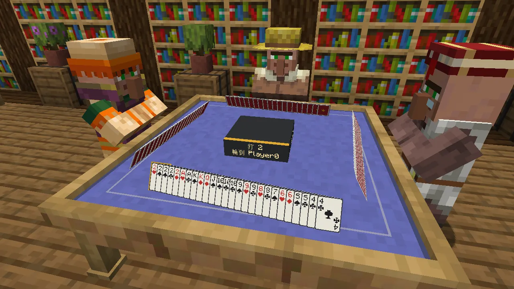</td>
    <td>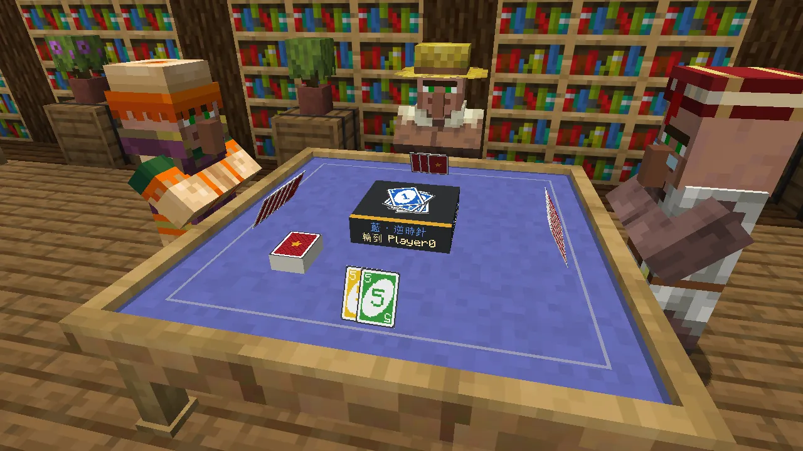</td>
  </tr>
  <tr>
    <td valign="top"><b>摜蛋</b> · 4 人<br>兩隊對打，兩副牌，有逢人配，有進貢還貢。可以只打一局，也可以一路打到 A。</td>
    <td valign="top"><b>UNO</b> · 2 到 4 人<br>經典規則，或者讓罰牌一張張疊給下家。</td>
  </tr>
  <tr>
    <td>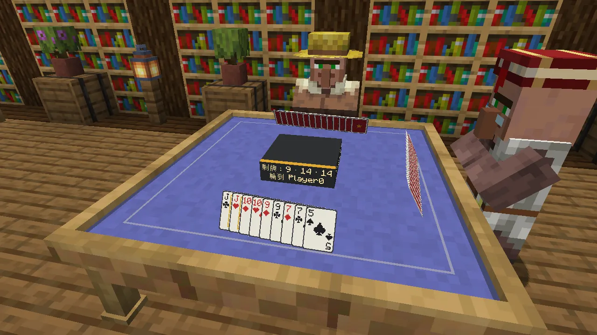</td>
    <td>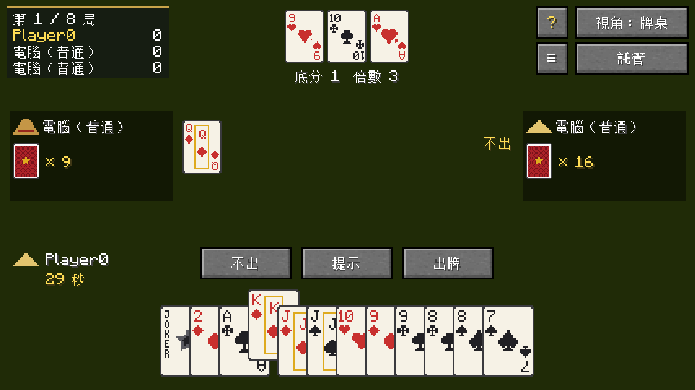</td>
  </tr>
  <tr>
    <td valign="top"><b>跑得快</b> · 3 人<br>各自為戰，誰先出完誰贏。每人 16 張或 15 張，可選有沒有大必壓。</td>
    <td valign="top"><b>上手容易</b><br>坐下就能看到手牌、比分和<b>提示</b>按鈕。點 <b>?</b> 打開規則書，每種玩法都有圖解。</td>
  </tr>
</table>

## 為什麼來土塊棋牌室

- **牌真的擺在桌上。** 手牌立起來朝著自己，出過的牌落在桌子中間，路過的人都能圍觀。打開沉浸視角，直接點桌上的牌出牌。
- **永遠不缺人。** 空位隨時加電腦，分簡單、普通、困難三檔；有人離開或斷線，電腦接著替他打。大家都走開了，牌局就停下來等人回來。
- **一坐一整晚。** 一場比賽連打好幾局、累計比分，每局都存了回放，能換任意座位的視角重看，牌桌還記著每個人的戰績。
- **把屋子布置成你的樣子。** 牌桌和凳子有各種木頭，桌布和坐墊隨意染色，牌背、牌面有好幾套。大方桌能坐 8 個人。

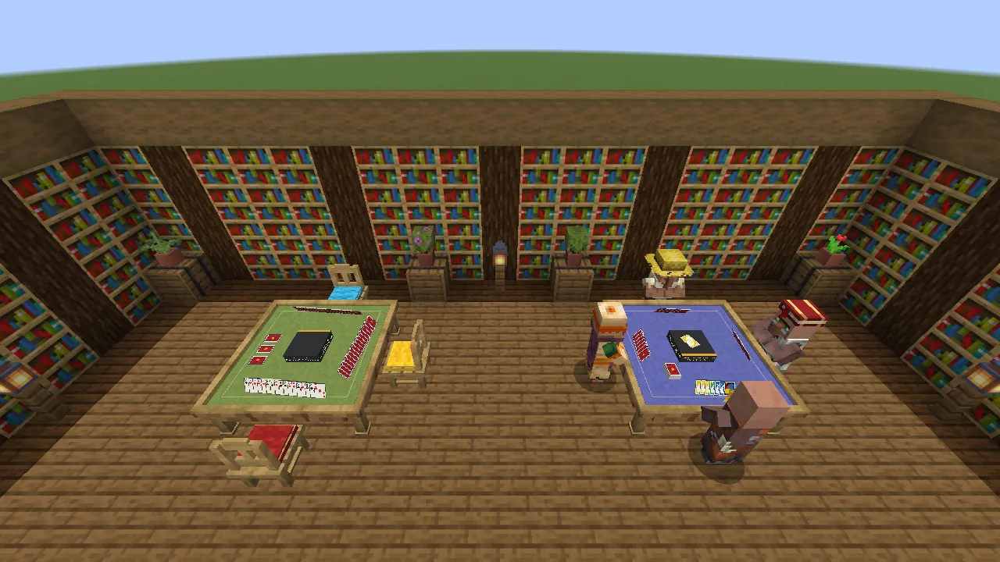

## 開始遊玩

### 下載

從 [Releases](https://github.com/Konyaco/TuKuai/releases/latest) 下載對應 Minecraft 版本和載入器的 jar，例如 `tukuai-fabric-1.21.1-<版本>.jar`。伺服器和每位玩家都要安裝。支援 Minecraft 26.1.2 和 1.21.1，還需要：

| 載入器 | 前置模組 |
| --- | --- |
| NeoForge 26.1.2 | [Kotlin for Forge](https://modrinth.com/mod/kotlin-for-forge) 6.4.0 或更新 |
| NeoForge 1.21.1 | [Kotlin for Forge](https://modrinth.com/mod/kotlin-for-forge) 5.12.0 或更新 |
| Fabric | [Fabric API](https://modrinth.com/mod/fabric-api)、[Fabric Language Kotlin](https://modrinth.com/mod/fabric-language-kotlin) 1.13.13 或更新 |

蒼白橡木的牌桌和凳子只有 26.1.2 有，1.21.1 還沒有蒼白橡木。

### 合成

<table>
  <tr>
    <td width="33%" align="center">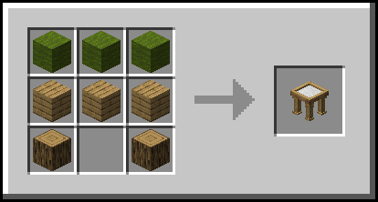<br><b>牌桌</b><br>羊毛顏色不限，木材決定桌子的木頭種類。</td>
    <td width="33%" align="center">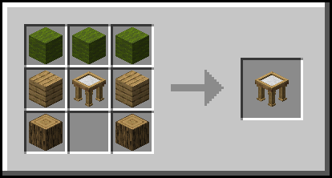<br><b>大方桌</b><br>由一張牌桌擴展而成，最多坐 8 人。</td>
    <td width="33%" align="center">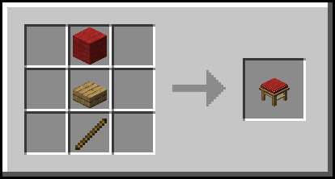<br><b>凳子</b><br>羊毛決定坐墊顏色，半磚決定木頭種類。</td>
  </tr>
</table>

創造模式下，三者都在「功能方塊」物品欄中。

### 上手

1. **放下牌桌**。牌桌佔 3×3 格，會從點擊的方塊向前展開，前方和左右需留出空地。
2. **右鍵開啟牌桌**，點「坐這裡」入座，空位可點「加電腦」補上。
3. **選擇遊戲和規則**，點「開始」。

凳子放在牌桌有座位一側的外邊正中，右鍵凳子即可坐到對應座位。大方桌佔 5×5 格，每邊兩個座位，最多坐 8 人。

介面支援簡體中文、繁體中文、英文、日文和韓文，隨遊戲語言切換。

<details>
<summary><b>伺服器設定</b></summary>

首次開服（或進入單人存檔）後會產生 `config/tukuai-server.properties`，修改後執行 `/reload` 或重新啟動生效。

| 設定 | 預設 | 作用 |
| --- | --- | --- |
| `allowBots` | `true` | 是否允許電腦入座 |
| `botDelaySeconds` | `1.1` | 電腦出牌前的平均等待秒數 |
| `saveReplays` | `true` | 是否保存回放 |
| `maxReplays` | `500` | 回放保留上限，超出時刪除最舊的；`0` 表示不限 |
| `keepStats` | `true` | 是否記錄戰績 |

</details>

<details>
<summary><b>開發</b></summary>

需要 JDK 25；Minecraft 1.21.1 要用的 JDK 21 由 Gradle 自動下載。

```sh
./gradlew build                        # 編譯、測試，並打包每個載入器、每個 Minecraft 版本的 jar
./gradlew :fabric-26.1.2:runClient     # 用 Fabric 啟動 Minecraft 26.1.2
./gradlew :neoforge-1.21.1:runClient   # 用 NeoForge 啟動 Minecraft 1.21.1
```

| 目錄 | 內容 |
| --- | --- |
| `engine` | 規則、電腦和回放，純 Kotlin，不依賴 Minecraft |
| `common` | 所有載入器和 Minecraft 版本共用的 Minecraft 程式碼和資源，按最新版 Minecraft 撰寫 |
| `versions/<minecraft>` | 某個 Minecraft 版本獨有的部分：`gradle.properties` 裡的各項版本，讓舊版本用上最新版 Minecraft 名稱的 `compat` 套件，渲染器、物品模型和配方 |
| `versions/<minecraft>/fabric`、`versions/<minecraft>/neoforge` | 該版本下各載入器的進入點和註冊 |

加入新遊戲：

1. 在 `engine` 中實作 `GameDefinition`，並在 `TuKuai.init()` 中註冊到 `GameRegistry`。
2. 在 `common/.../client` 中實作 `GameUi`，並在 `TuKuaiClient.init()` 中註冊到 `GameUis`。
3. 在每個語言檔中加入 `tukuai.game.<id>` 和各規則的名稱。

測試：

```sh
./gradlew :engine:test                         # 規則與電腦的單元測試
./gradlew :fabric-26.1.2:runClientGameTest     # 啟動遊戲實際打幾局並截圖
./gradlew :fabric-26.1.2:runMultiplayerTest    # 專用伺服器加兩個用戶端的連線測試
./gradlew :fabric-1.21.1:runSmokeTest          # 在 Minecraft 1.21.1 上每種玩法各打一局並截圖
TUKUAI_SHOWCASE=en_us,zh_cn ./gradlew :fabric-26.1.2:runClientGameTest   # 拍攝本文的截圖
```

提交訊息格式為 `[type](scope) Title`。依賴版本見 `gradle.properties` 和 `versions/<minecraft>/gradle.properties`。

</details>

## 授權

[MIT](LICENSE)
